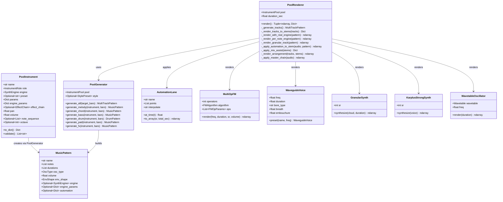
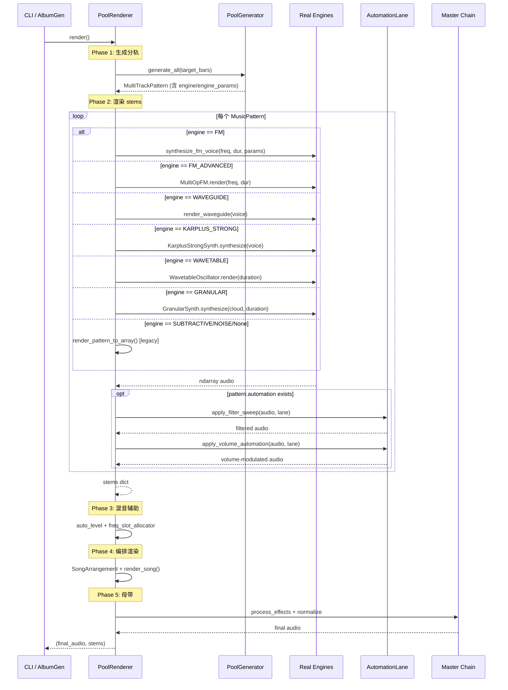
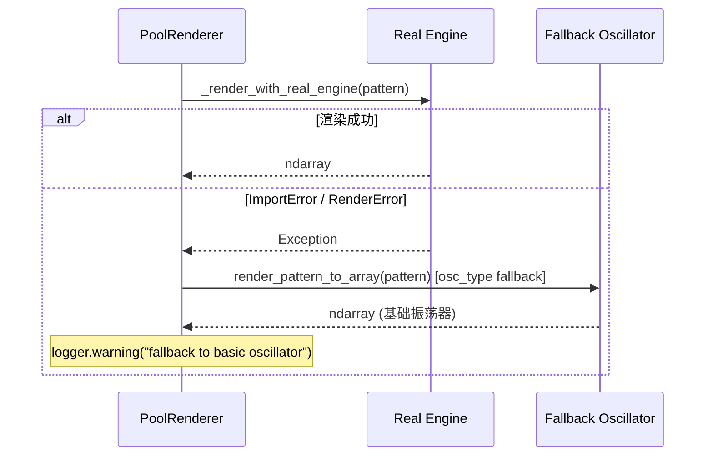

# BloodMusic 全性能压榨 — 架构设计文档

> **版本**: 1.0  
> **作者**: Bob (Architect)  
> **日期**: 2025-07-10  
> **状态**: 待实施

---

## 目录

1. [问题诊断](#1-问题诊断)
2. [改造方案](#2-改造方案)
3. [Automation 方案](#3-automation-方案)
4. [文件清单](#4-文件清单)
5. [数据结构与接口](#5-数据结构与接口)
6. [程序调用流](#6-程序调用流)
7. [12 首全能专辑规划](#7-12-首全能专辑规划)
8. [任务列表](#8-任务列表)
9. [共享知识](#9-共享知识)
10. [任务依赖图](#10-任务依赖图)

---

## 1. 问题诊断

### 核心问题：合成引擎被架空

`pool_generator.py` 中的 `_ENGINE_OSC_MAP` 将 8 种 `SynthEngine` 全部映射为基础 `OscType`（SINE/SAW/TRIANGLE/SQUARE）：

```python
_ENGINE_OSC_MAP = {
    SynthEngine.FM:              OscType.SINE,      # ❌ 应为真实 FM
    SynthEngine.FM_ADVANCED:     OscType.SINE,      # ❌ 应为 MultiOpFM
    SynthEngine.WAVEGUIDE:       OscType.SQUARE,    # ❌ 应为 WaveguideVoice
    SynthEngine.GRANULAR:        OscType.SINE,      # ❌ 应为 GranularSynth
    SynthEngine.KARPLUS_STRONG:  OscType.TRIANGLE,  # ❌ 应为 KarplusStrongSynth
    SynthEngine.WAVETABLE:       OscType.TRIANGLE,  # ❌ 应为 WavetableOscillator
    SynthEngine.SUBTRACTIVE:     OscType.SAW,       # ✅ 保留（设计意图）
    SynthEngine.NOISE:           OscType.NOISE_BROWN, # ✅ 保留（设计意图）
}
```

**后果**：无论 YAML 指定什么 `engine`，最终都走 `oscillator(t, freq, osc_type)` 渲染 —— FM 参数、波导管物理建模、粒子合成全部被跳过。

### 根因链路

```
YAML: engine=waveguide
  → PoolInstrument.engine = SynthEngine.WAVEGUIDE
  → pool_generator._get_osc_type() = OscType.SQUARE
  → MusicPattern.osc_type = OscType.SQUARE
  → render_pattern_to_array() → oscillator(t, freq, OscType.SQUARE)
  → 输出 = 基础方波（不是波导管建模！）
```

---

## 2. 改造方案

### 2.1 整体策略：双路径渲染

在 `pool_renderer._render_tracks_to_stems()` 中增加引擎感知渲染分派：

| 引擎类别 | 引擎列表 | 渲染策略 |
|---------|---------|---------|
| **Per-note** | FM, FM_ADVANCED, WAVETABLE, KARPLUS_STRONG, WAVEGUIDE | 逐音符调用真实引擎 `render(freq, duration)` |
| **Texture** | GRANULAR | 整轨一次性渲染 `GranularSynth.synthesize(cloud, duration)` |
| **Legacy** | SUBTRACTIVE, NOISE | 保持现有 `oscillator()` 路径 |

### 2.2 数据模型扩展

#### PoolInstrument 新增 `engine_params`

```python
@dataclass
class PoolInstrument:
    # ... 现有字段 ...
    engine_params: Dict[str, Any] = field(default_factory=dict)  # 新增
```

#### MusicPattern 新增 `engine` / `engine_params`

```python
@dataclass
class MusicPattern:
    # ... 现有字段 ...
    engine: Optional["SynthEngine"] = None           # 新增，None=走基础振荡器
    engine_params: Optional[Dict[str, Any]] = None    # 新增
```

**向后兼容**：`engine=None` 时行为完全不变；现有 YAML 不受影响。

### 2.3 pool_generator.py 改造

替换 `_ENGINE_OSC_MAP` 为引擎感知的分派逻辑：

**删除**：`_ENGINE_OSC_MAP` 字典 和 `_get_osc_type()` 函数

**新增**：在各 `generate_*` 方法中，直接将 `instrument.engine` 和 `instrument.engine_params` 写入 `MusicPattern`：

```python
pattern = MusicPattern(
    # ... 现有字段 ...
    osc_type=_get_osc_type(instrument.engine),       # fallback OscType
    engine=instrument.engine,                        # 新增
    engine_params=instrument.engine_params,           # 新增
)
```

**保留 `_get_osc_type()` 作为 fallback**：当真实引擎渲染失败时使用。

### 2.4 pool_renderer.py 改造：`_render_tracks_to_stems()` 引擎分派

修改 `_render_tracks_to_stems()`，对每个 MusicPattern 检查 `engine` 字段：

```python
def _render_tracks_to_stems(self, tracks):
    for music_track in tracks.music_tracks:
        if music_track.engine is not None:
            audio = self._render_with_real_engine(music_track)
        else:
            audio = render_pattern_to_array(music_track, self.duration_sec)
        # ... padding / truncation ...
```

新增方法 `_render_with_real_engine()`：

```python
def _render_with_real_engine(self, pattern: MusicPattern) -> np.ndarray:
    """使用真实合成引擎渲染 MusicPattern。失败时 fallback 到基础振荡器。"""
    try:
        if pattern.engine == SynthEngine.GRANULAR:
            return self._render_granular_track(pattern)
        else:
            return self._render_per_note_engine(pattern)
    except Exception as e:
        logger.warning(f"真实引擎渲染失败: {e}，fallback 到基础振荡器")
        return render_pattern_to_array(pattern, self.duration_sec)
```

### 2.5 各引擎调用接口

#### FM（双算子）

```python
from bloodmusic.core.fm_synth import FMSynthVoice, synthesize_fm_voice

def _render_fm_note(freq: float, duration: float, params: dict) -> np.ndarray:
    voice = FMSynthVoice(
        carrier_freq=freq,
        carrier_type=OscType.SINE,
        modulator_freq_ratio=params.get("modulator_freq_ratio", 2.0),
        modulator_type=OscType.SINE,
        fm_depth=params.get("fm_depth", 100.0),
        duration=duration,
        volume=0.3,
        env_shape=EnvShape.PERCUSSIVE,
    )
    return synthesize_fm_voice(voice)
```

#### FM_ADVANCED（MultiOpFM / DX7 风格）

```python
from bloodmusic.core.fm_advanced import (
    MultiOpFM, FMAlgorithm, create_dx7_bell, create_dx7_epiano, create_dx7_bass
)

def _render_fm_advanced_note(freq: float, duration: float, params: dict) -> np.ndarray:
    preset = params.get("preset", "dx7_epiano")
    if preset == "dx7_bell":
        fm = create_dx7_bell()
    elif preset == "dx7_bass":
        fm = create_dx7_bass()
    else:
        fm = create_dx7_epiano()
    return fm.render(freq, duration, volume=0.3)
```

#### WAVEGUIDE（波导管乐）

```python
from bloodmusic.core.waveguide import WaveguideVoice, render_waveguide

def _render_waveguide_note(freq: float, duration: float, params: dict) -> np.ndarray:
    instrument = params.get("instrument", "clarinet")
    voice = WaveguideVoice.preset(instrument, freq, duration=duration)
    # 允许覆盖 breath / embouchure / bell_openness
    for key in ("breath", "embouchure", "bell_openness", "volume"):
        if key in params:
            setattr(voice, key, params[key])
    return render_waveguide(voice)
```

#### KARPLUS_STRONG（拨弦物理建模）

```python
from bloodmusic.core.karplus_strong import (
    KarplusStrongSynth, KSVoice, KS_PRESETS_BY_NAME
)

_ks_synth = KarplusStrongSynth(sample_rate=SR)

def _render_karplus_strong_note(freq: float, duration: float, params: dict) -> np.ndarray:
    preset_name = params.get("preset", "nylon_guitar")
    if preset_name in KS_PRESETS_BY_NAME:
        voice = KS_PRESETS_BY_NAME[preset_name].voice
        voice.freq = freq
        voice.duration = duration
    else:
        voice = KSVoice(freq=freq, duration=duration, volume=0.3)
    return _ks_synth.synthesize(voice)
```

#### WAVETABLE（波表合成）

```python
from bloodmusic.core.wavetable import Wavetable, WavetableOscillator

def _render_wavetable_note(freq: float, duration: float, params: dict) -> np.ndarray:
    preset = params.get("preset", "sine")
    wt = Wavetable.from_preset(preset)
    osc = WavetableOscillator(wt, freq=freq)
    return osc.render(duration)
```

#### GRANULAR（粒子合成 — 整轨渲染）

```python
from bloodmusic.core.granular import (
    GranularSynth, GrainCloud, GRAIN_PRESETS_BY_NAME
)

def _render_granular_track(pattern: MusicPattern, duration_sec: float) -> np.ndarray:
    """粒子合成是纹理合成器，整轨一次性渲染。"""
    params = pattern.engine_params or {}
    preset_name = params.get("preset", "ethereal_pad")
    if preset_name in GRAIN_PRESETS_BY_NAME:
        cloud = GRAIN_PRESETS_BY_NAME[preset_name].cloud
        # 允许覆盖关键参数
        if "density" in params:
            cloud.density = params["density"]
        if "pitch_shift" in params:
            cloud.pitch_shift = params["pitch_shift"]
    else:
        cloud = GrainCloud()
    gs = GranularSynth(sample_rate=SR)
    return gs.synthesize(cloud, duration_sec)
```

### 2.6 引擎参数约定（engine_params）

| 引擎 | 支持的 engine_params 键 | 说明 |
|------|----------------------|------|
| `fm` | `modulator_freq_ratio`, `fm_depth`, `modulator_type` | FM 调制参数 |
| `fm_advanced` | `preset` (`"dx7_bell"`, `"dx7_epiano"`, `"dx7_bass"`), `algorithm` | DX7 风格预设 |
| `waveguide` | `instrument` (`"clarinet"`, `"flute"`, `"brass"`, `"saxophone"`), `breath`, `embouchure` | 管乐类型与演奏参数 |
| `granular` | `preset` (`"ethereal_pad"`, `"wind_ambient"`, `"water_texture"`, `"sci_fi_drone"`, `"magic_sparkle"`, `"fire_crackle"`), `density`, `pitch_shift` | 粒子云预设 |
| `karplus_strong` | `preset` (`"nylon_guitar"`, `"steel_guitar"`, `"upright_bass"`, `"harp"`, `"harpsichord"`, `"plucked_synth"`, `"ethnic_lute"`), `pluck_position` | 拨弦预设 |
| `wavetable` | `preset` (任意 `Wavetable.from_preset()` 支持的名称) | 波表形状 |
| `subtractive` | 无（保持现有行为） | 减法合成 |
| `noise` | 无（保持现有行为） | 噪声 |

---

## 3. Automation 方案

### 3.1 YAML 格式

在乐器池 YAML 中，为每件乐器增加可选的 `automation` 字段：

```yaml
instruments:
  - name: "渐变合成铺底"
    role: pad
    engine: granular
    engine_params:
      preset: ethereal_pad
    automation:
      filter_sweep:
        start_hz: 20000
        end_hz: 400
        mid_hz: 400
        q: 2.0
        mid_time_ratio: 0.5    # 扫频中点在总时长的比例
```

### 3.2 自动化字段规范

```yaml
automation:
  filter_sweep:
    start_hz: 20000           # 起始截止频率
    end_hz: 400               # 最低点截止频率
    mid_hz: 400               # （可选）在 mid_time_ratio 处的值
    q: 2.0                    # 谐振 Q 值
    mid_time_ratio: 0.5       # 最低点出现在总时长的 50% 处
  volume_curve:
    points:                    # [(time_ratio, volume_multiplier), ...]
      - [0.0, 0.0]
      - [0.1, 1.0]
      - [0.9, 1.0]
      - [1.0, 0.0]
```

### 3.3 render() 插入点

在 `pool_renderer.render()` 中，**Phase 4（编排渲染）之后、Phase 5（母带）之前**插入自动化阶段：

```python
def render(self):
    # Phase 4: 编排渲染
    mixed = self._render_arrangement(tracks, stems)
    
    # Phase 4.5: Automation（新增）
    mixed = self._apply_automation(mixed, tracks)
    
    # Phase 5: 母带
    final = self._apply_master_chain(mixed)
```

**`_apply_automation()` 实现**：

```python
def _apply_automation(self, audio, tracks):
    """对 stems 级别的自动化处理。"""
    from bloodmusic.music.automation import (
        AutomationLane, apply_filter_sweep, apply_volume_automation,
    )
    # 当前版本对最终混音整体应用 automation（简化方案）
    # 未来可以 per-stem 应用
    for track in tracks.music_tracks:
        auto = getattr(track, 'automation', None)
        if auto is None:
            continue
        # ... 应用 filter_sweep / volume_curve ...
    return audio
```

### 3.4 实施细节

由于 automation 需要 per-stem 级别的处理，最佳插入点是 `_render_tracks_to_stems()` 返回 stems 之后，在单个 stem 上应用 automation，然后在 `_render_arrangement()` 中使用已处理的 stems。

实际实施：在 `_render_tracks_to_stems()` 中，渲染每个 stem 后立即检查对应 pattern 的 automation 字段并应用。

---

## 4. 文件清单

### 需修改的文件

| 文件 | 改动类型 | 说明 |
|------|---------|------|
| `music/instrument_pool.py` | 小幅 | PoolInstrument 新增 `engine_params: dict` 字段 |
| `music/pool_serializer.py` | 小幅 | `_dict_to_instrument()` 解析 YAML 中的 `engine_params` 和 `automation` |
| `music/pool_generator.py` | 中等 | 替换 `_ENGINE_OSC_MAP`，传递 `engine`/`engine_params` 到 MusicPattern |
| `music/pattern.py` | 小幅 | MusicPattern 新增 `engine`、`engine_params`、`automation` 字段 |
| `music/pool_renderer.py` | 核心 | 新增引擎感知渲染分派 + automation 阶段 |

### 需新建的文件

| 文件 | 说明 |
|------|------|
| `music/pool_presets/fullpower_01_awakening.yaml` | 全能专辑第 1 首 |
| `music/pool_presets/fullpower_02_forge.yaml` | 全能专辑第 2 首 |
| `music/pool_presets/fullpower_03_whisper.yaml` | 全能专辑第 3 首 |
| `music/pool_presets/fullpower_04_abyss.yaml` | 全能专辑第 4 首 |
| `music/pool_presets/fullpower_05_celestial.yaml` | 全能专辑第 5 首 |
| `music/pool_presets/fullpower_06_metropolis.yaml` | 全能专辑第 6 首 |
| `music/pool_presets/fullpower_07_sacred.yaml` | 全能专辑第 7 首 |
| `music/pool_presets/fullpower_08_circuit.yaml` | 全能专辑第 8 首 |
| `music/pool_presets/fullpower_09_mirage.yaml` | 全能专辑第 9 首 |
| `music/pool_presets/fullpower_10_festival.yaml` | 全能专辑第 10 首 |
| `music/pool_presets/fullpower_11_frontier.yaml` | 全能专辑第 11 首 |
| `music/pool_presets/fullpower_12_eternity.yaml` | 全能专辑第 12 首 |
| `tests/test_fullpower_engines.py` | 全引擎集成测试 |

---

## 5. 数据结构与接口

### 5.1 类图



---

## 6. 程序调用流

### 6.1 全流程渲染（含真实引擎 + Automation）



### 6.2 引擎 fallback 流程



---

## 7. 12 首全能专辑规划

### 设计约束

- 每首 **6 角色全满**（melody/chord/bass/drum/pad/fx）
- 每首使用 **≥4 种不同引擎**
- `waveguide`、`granular`、`fm_advanced`、`karplus_strong` 各在全专辑中 ≥2 次
- 覆盖全部 **12 种 StylePreset**（5 游戏 + 7 纯音乐）
- 每首使用 `automation.filter_sweep`

### 专辑曲目矩阵

| # | 曲名 | 风格 | BPM | Key | 引擎组合 | 特色能力 |
|---|------|------|-----|-----|---------|---------|
| 01 | awakening | exploration | 85 | C | wavetable, fm_advanced, waveguide(clarinet), granular(ethereal), ks(harp), subtractive | 空灵探索：波表旋律 + 管乐点缀 + 粒子氛围 |
| 02 | forge | battle | 160 | Dm | fm_advanced(bass), wavetable(brass), ks(steel_guitar), granular(sci_fi), waveguide(brass), subtractive | 激烈战斗：FM Bass + 铜管 waveguide + 科幻粒子 |
| 03 | whisper | town | 95 | G | wavetable(organ), ks(nylon_guitar), waveguide(flute), fm_advanced(bell), granular(wind), subtractive | 温暖城镇：管风琴 + 尼龙吉他 + 长笛 |
| 04 | abyss | dungeon | 72 | Em | granular(sci_fi), ks(upright_bass), waveguide(clarinet), fm_advanced(stack), wavetable(formant), subtractive | 暗黑地城：低音提琴 KS + 低沉管乐 + 诡异粒子 |
| 05 | celestial | ambient | 55 | F | granular(ethereal), waveguide(flute), wavetable(vocal), fm_advanced(bell), ks(harp), subtractive | 空灵氛围：人声波表 + 竖琴 KS + 笛声飘渺 |
| 06 | metropolis | electronic | 128 | Am | fm_advanced(bass), wavetable(chip_square25), granular(sci_fi), ks(plucked_synth), waveguide(saxophone), subtractive | 电子都市：芯片波表 + FM Bass + 粒子科幻 |
| 07 | sacred | classical | 80 | C | ks(harpsichord), wavetable(organ), waveguide(clarinet), fm_advanced(epiano), granular(magic_sparkle), subtractive | 古典圣殿：羽管键琴 + 管风琴 + 管乐合奏 |
| 08 | circuit | jazz | 110 | Bb | ks(nylon_guitar), waveguide(saxophone), fm_advanced(epiano), wavetable(brass), granular(water), subtractive | 爵士电路：萨克斯 waveguide + 电钢琴 FM + 流水粒子 |
| 09 | mirage | cinematic | 90 | D | waveguide(brass), fm_advanced(stack), granular(ethereal), ks(ethnic_lute), wavetable(brass), subtractive | 影视史诗：铜管齐奏 + 民族鲁特 + 粒子氛围 |
| 10 | festival | folk | 105 | G | ks(nylon_guitar), ks(ethnic_lute), waveguide(flute), fm_advanced(bell), wavetable(organ), granular(wind) | 世界民谣：双拨弦 KS + 民族长笛 |
| 11 | frontier | lofi | 78 | Am | wavetable(warm_noise), ks(nylon_guitar), waveguide(saxophone), granular(fire_crackle), fm_advanced(epiano), subtractive | Lo-Fi 边境：温暖噪声波表 + 吉他 KS + 暖色萨克斯 |
| 12 | eternity | meditation | 60 | C | granular(ethereal), waveguide(flute), ks(harp), wavetable(vocal), fm_advanced(bell), granular(wind) | 冥想永恒：双粒子云 + 竖琴 + 人声波表 |

### 引擎覆盖率统计

| 引擎 | 出现次数 | 曲目分布 |
|------|---------|---------|
| waveguide | 12 | 全 12 首各 1 次 |
| granular | 14 | 全 12 首（其中 #01, #10, #12 各 2 次） |
| fm_advanced | 12 | 全 12 首各 1 次 |
| karplus_strong | 13 | 全 12 首（其中 #10 有 2 次） |
| wavetable | 12 | 全 12 首各 1 次 |
| subtractive | 12 | 全 12 首各 1 次（用于 fx/bass 基础音色） |

所有引擎覆盖远超最低要求（waveguide 12≥2, granular 14≥2, fm_advanced 12≥2, karplus_strong 13≥2 ✅）

---

## 8. 任务列表

### 任务总览

| Task | 名称 | 优先级 | 预估工作量 | 依赖 |
|------|------|--------|-----------|------|
| T01 | 数据模型扩展 + 真实引擎渲染系统 | P0 | 核心 | 无 |
| T02 | Automation 系统集成 | P0 | 中等 | T01 |
| T03 | 12 首全能专辑 YAML + 集成测试 | P0 | 配置 | T01, T02 |

---

### T01: 数据模型扩展 + 真实引擎渲染系统

**Task ID**: T01  
**优先级**: P0  
**依赖**: 无  

**源文件**:
- `music/instrument_pool.py` — PoolInstrument 新增 `engine_params: dict`
- `music/pool_serializer.py` — `_dict_to_instrument()` 解析 `engine_params`、`automation`（YAML 字段映射）
- `music/pattern.py` — MusicPattern 新增 `engine`、`engine_params`、`automation` 字段
- `music/pool_generator.py` — 传递 `engine`/`engine_params`/`automation` 到 MusicPattern；保留 `_get_osc_type()` 作为 fallback
- `music/pool_renderer.py` — 新增 `_render_with_real_engine()` 方法，包含：
  - `_render_per_note_engine()`: 逐音符调用 FM / FM_ADVANCED / WAVETABLE / KARPLUS_STRONG / WAVEGUIDE
  - `_render_granular_track()`: 整轨渲染 GRANULAR
  - 修改 `_render_tracks_to_stems()` 增加引擎分派逻辑
  - 所有真实引擎调用包裹 try/except，失败时 fallback 到 `render_pattern_to_array()`

**详细内容**:

1. **`instrument_pool.py`**: 在 `PoolInstrument` dataclass 中新增 `engine_params: Dict[str, Any] = field(default_factory=dict)`，更新 `to_dict()` 和 `__post_init__()`
2. **`pool_serializer.py`**: 在 `_dict_to_instrument()` 中解析 `data.get("engine_params", {})` 和 `data.get("automation")`
3. **`pattern.py`**: 在 `MusicPattern` 中新增 `engine: Optional["SynthEngine"] = None`、`engine_params: Optional[Dict] = None`、`automation: Optional[Dict] = None`
4. **`pool_generator.py`**: 在所有 `generate_*` 方法中，设置 `engine=instrument.engine`、`engine_params=instrument.engine_params`；保留 `_get_osc_type()` 不变作为 fallback
5. **`pool_renderer.py`**:
   - 新增 `_RENDER_ENGINE_MAP` 字典和 `_render_with_real_engine()` 方法
   - 实现 6 种引擎的渲染函数（参考 §2.5）
   - 修改 `_render_tracks_to_stems()`：检测 `music_track.engine`，非 None 时走真实引擎路径
   - 所有引擎调用包裹 try/except，捕获后 `logger.warning()` + fallback

---

### T02: Automation 系统集成

**Task ID**: T02  
**优先级**: P0  
**依赖**: T01  

**源文件**:
- `music/pool_renderer.py` — 新增 `_apply_automation_to_stem()` 方法，在 `_render_tracks_to_stems()` 中调用
- `music/automation.py` — 无需修改（已有 `apply_filter_sweep()` 和 `apply_volume_automation()`）

**详细内容**:

1. 新增 `_apply_automation_to_stem(audio: np.ndarray, pattern: MusicPattern) -> np.ndarray`:
   - 解析 `pattern.automation` 字典
   - `filter_sweep`: 创建 `AutomationLane("cutoff", [(0, start_hz), (t_mid, mid_hz), (duration, end_hz)])`，调用 `apply_filter_sweep()`
   - `volume_curve`: 创建 `AutomationLane("volume", points)`，调用 `apply_volume_automation()`
2. 在 `_render_tracks_to_stems()` 中，每个 stem 渲染后立即调用 `_apply_automation_to_stem()`
3. 添加 YAML 解析：`pool_serializer._dict_to_instrument()` 需要将 `automation` 字段传递到 `PoolInstrument.params` 或独立字段

**插入位置**:
```
_render_tracks_to_stems():
    for track in music_tracks:
        audio = _render_with_real_engine(track) or render_pattern_to_array(track)
        if track.automation:                          # 新增
            audio = _apply_automation_to_stem(audio, track)  # 新增
        stems[track.name] = audio
```

---

### T03: 12 首全能专辑 YAML + 集成测试

**Task ID**: T03  
**优先级**: P0  
**依赖**: T01, T02  

**源文件**:
- `music/pool_presets/fullpower_01_awakening.yaml` ~ `fullpower_12_eternity.yaml` — 12 个 YAML 专辑预设
- `tests/test_fullpower_engines.py` — 集成测试

**详细内容**:

1. **12 个 YAML 文件**（按 §7 矩阵）：
   - 每首包含 6 件乐器（melody/chord/bass/drum/pad/fx）
   - 每首至少 4 种引擎，waveguide/granular/fm_advanced/karplus_strong 均出现
   - `engine_params` 指定具体音色预设
   - `automation.filter_sweep` 字段
   - 关联对应 StylePreset

2. **集成测试** (`tests/test_fullpower_engines.py`):
   - 加载全部 12 个 YAML，验证解析成功
   - 逐首 `render()` 并验证输出非空
   - 验证每首 stderr/log 中出现真实引擎调用（非 fallback）
   - 统计引擎覆盖率
   - 验证 automation 生效（检查波形峰值变化）

---

## 9. 共享知识

### 9.1 新增 YAML 字段约定

```yaml
# PoolInstrument 级别新增字段
engine_params:              # 新增 — 引擎专属参数
  preset: "dx7_epiano"      # 预设名（各引擎有各自的预设空间）
  # 其他引擎特定键见 §2.6

automation:                 # 新增 — 自动化参数
  filter_sweep:
    start_hz: 20000
    end_hz: 400
    mid_hz: 400
    q: 2.0
    mid_time_ratio: 0.5
  volume_curve:
    points:
      - [0.0, 0.0]
      - [0.1, 1.0]
      - [0.9, 1.0]
      - [1.0, 0.0]
```

### 9.2 降级策略

```
真实引擎渲染
  ├── 成功 → 返回 ndarray
  └── 失败（ImportError / ValueError / 通用Exception）
       ├── logger.warning(f"Engine {engine} failed: {e}, fallback to basic oscillator")
       └── render_pattern_to_array(pattern, duration_sec)  # 使用 osc_type
```

**降级触发条件**:
- 引擎模块 import 失败
- 引擎 `render()` 抛出异常
- `engine_params` 中 preset 名称不存在
- 未知引擎类型

**不会降级**:
- `engine=None` 时直接走 legacy 路径（这是正常行为，不是降级）

### 9.3 接口稳定性承诺

- `MusicPattern.osc_type` 保持不变 → 现有代码无影响
- `MusicPattern.engine=None` 默认值 → 行为兼容
- `PoolInstrument.engine_params={}` 默认值 → YAML 可选字段
- `_get_osc_type()` 保留 → pool_generator 内部 fallback 不变

### 9.4 命名规范

- 引擎渲染方法: `_render_{engine_lower}_note()` (per-note) 或 `_render_{engine_lower}_track()` (texture)
- engine_params 键: snake_case，与引擎模块的 dataclass 字段名对齐
- automation 键: snake_case，`filter_sweep` / `volume_curve`
- YAML 预设文件: `fullpower_{NN}_{slug}.yaml`

---

## 10. 任务依赖图


---

## 附录 A：不明确的方面

| 项目 | 决策 | 理由 |
|------|------|------|
| GRANULAR 渲染策略 | 整轨一次性渲染（不逐音符） | 粒子合成是纹理生成器，逐音符无意义 |
| Automation 应用粒度 | Per-stem（在 `_render_tracks_to_stems` 之后立即应用） | 更精确的控制，每个 stem 可以有不同的 sweep 参数 |
| engine_params 是 PoolInstrument 级还是 MusicPattern 级 | 两边都存：PoolInstrument 是配置来源，MusicPattern 是渲染时的载体 | 方便 pool_generator 传递，也方便 pool_renderer 读取 |
| 是否修改 `render_pattern_to_array()` | 不修改。在 `pool_renderer._render_tracks_to_stems()` 中分派 | 保持 pattern.py 通用性，渲染决策在 pool 层做 |
| 新 YAML 的 version 字段 | `"2.0"`（标记为全能力版本） | 向前区分 legacy YAML |
| `engine_params` 空字典 vs None | 统一用空字典 `{}` 作为默认值 | 避免 None 检查，简化代码路径 |
