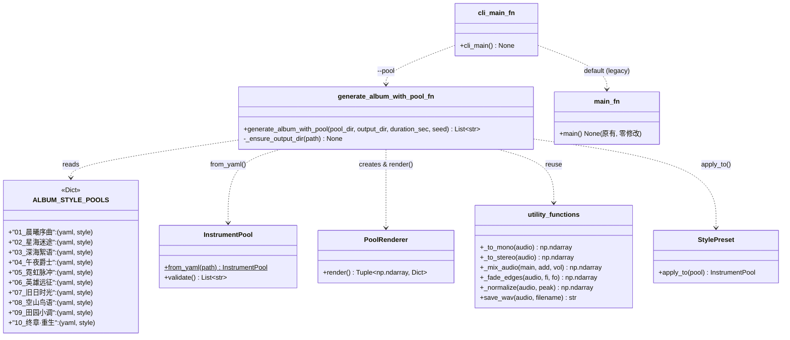
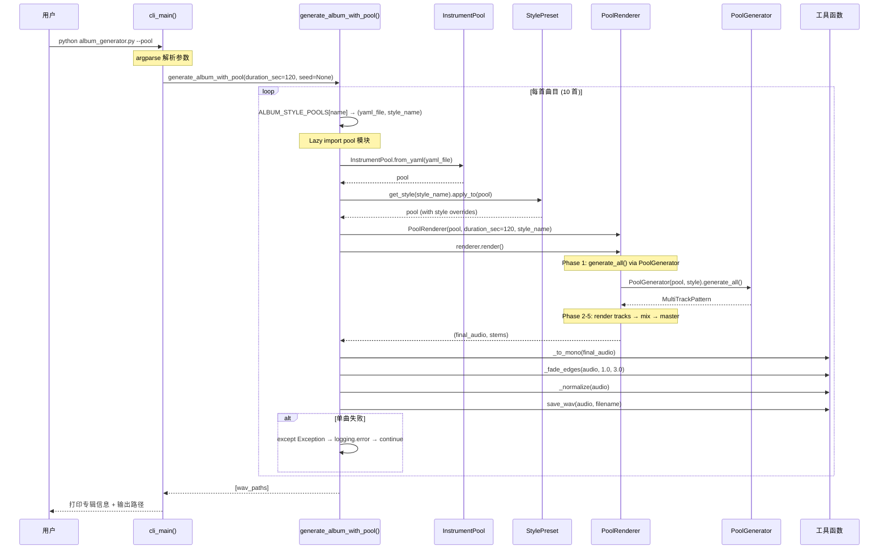
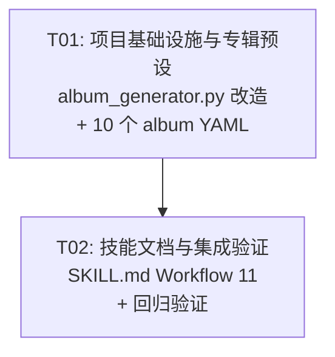

# BloodMusic 乐器池集成 — 增量架构设计文档

> 架构师: Bob · 版本: 1.0 · 日期: 2025-08
> 父文档: ARCHITECTURE-instrument-pool.md (v1.0)

---

## Part A: 系统设计

### 1. 实现方案

#### 1.1 技术分析

| 维度 | 现状 | 增量策略 |
|------|------|----------|
| 专辑生成 | `album_generator.py` 有 10 个 `track_xx_xxx()` 手写函数 + `main()` 调度 | 新增 pool-based 模式，通过 `--pool` CLI 开关触发 |
| 乐器池系统 | `instrument_pool.py` / `pool_renderer.py` / `pool_generator.py` / `pool_styles.py` 已完整实现 | **零修改** — 仅作为被调用方 |
| 序列化 | `pool_serializer.py` + `PoolSerializer.load_yaml()` 已就绪 | 10 个 album YAML 直接使用现有加载器 |
| CLI | `argparse` 在 `cli.py` 中，`album_generator.py` 原来无 CLI（直接 `main()`） | 在 `album_generator.py` 尾部新增 `cli_main()` 包装 |

#### 1.2 架构分层（改造后）

```
album_generator.py (改造后)
├── 原有 10 个 track_xx_xxx() 函数          ← legacy 模式 (零修改)
├── 原有 main() 函数                         ← 默认行为 (零修改)
├── 原有工具函数 (_to_mono, save_wav, ...)   ← 复用
│
├── [新增] ALBUM_STYLE_POOLS: Dict            ← 曲目→YAML 映射表
├── [新增] generate_album_with_pool()          ← pool 模式主函数
├── [新增] cli_main()                          ← argparse 入口
│
└── if __name__ == "__main__": cli_main()      ← 替换原有直接调用
```

#### 1.3 设计原则

- **零回归**：`main()` 和 10 个 `track_xx_xxx()` 不改一行
- **Lazy import**：pool 模块仅在 `--pool` 时通过函数内 import 加载
- **单曲失败不崩溃**：catch → logging.error 诊断 → continue 下一首
- **配置驱动**：10 首曲目各对应一个 YAML 文件，通过 `ALBUM_STYLE_POOLS` 映射

---

### 2. 文件列表

```
<仓库根>\
│
├── album_generator.py                       # [修改] 新增 pool 模式 + CLI
│
├── music\
│   ├── __init__.py                          # [确认] pool 模块导出已存在 (无需修改)
│   │
│   └── pool_presets\                        # [新增 YAML]
│       ├── album_dawn_overture.yaml         # 01 晨曦序曲 — 古典/钢琴
│       ├── album_lost_in_cosmos.yaml        # 02 星海迷途 — 新世纪
│       ├── album_deep_sea.yaml              # 03 深海絮语 — 氛围
│       ├── album_midnight_jazz.yaml         # 04 午夜爵士 — 爵士
│       ├── album_neon_pulse.yaml            # 05 霓虹脉冲 — 电子
│       ├── album_heros_journey.yaml         # 06 英雄远征 — 影视史诗
│       ├── album_nostalgia.yaml             # 07 旧日时光 — Lo-Fi
│       ├── album_birds_mountains.yaml       # 08 空山鸟语 — 冥想
│       ├── album_pastoral_tune.yaml         # 09 田园小调 — 民谣
│       └── album_finale_rebirth.yaml        # 10 终章·重生 — 史诗终章
│
└── skill\bloodmusic-beats\
    └── SKILL.md                             # [修改] 新增 Workflow 11
```

**无需修改的文件**：`music/instrument_pool.py`, `music/pool_renderer.py`, `music/pool_generator.py`, `music/pool_styles.py`, `music/pool_templates.py`, `music/pool_serializer.py`, `music/pattern.py`, `cli.py`, `core/`, `effects/`

---

### 3. 数据结构和接口

#### 3.1 类图 — 增量变更



#### 3.2 新增函数签名

```python
# ── 常量 ──

ALBUM_STYLE_POOLS: Dict[str, Tuple[str, str]] = {
    "01_晨曦序曲":     ("album_dawn_overture.yaml",    "exploration"),
    "02_星海迷途":     ("album_lost_in_cosmos.yaml",   "ambient"),
    "03_深海絮语":     ("album_deep_sea.yaml",         "ambient"),
    "04_午夜爵士":     ("album_midnight_jazz.yaml",    "town"),
    "05_霓虹脉冲":     ("album_neon_pulse.yaml",       "battle"),
    "06_英雄远征":     ("album_heros_journey.yaml",    "battle"),
    "07_旧日时光":     ("album_nostalgia.yaml",        "town"),
    "08_空山鸟语":     ("album_birds_mountains.yaml",  "ambient"),
    "09_田园小调":     ("album_pastoral_tune.yaml",    "exploration"),
    "10_终章·重生":    ("album_finale_rebirth.yaml",    "battle"),
}

POOL_OUTPUT_DIR: str  # 默认 "album_output_pool"


# ── 函数 ──

def generate_album_with_pool(
    pool_dir: str = "music/pool_presets",
    output_dir: str = POOL_OUTPUT_DIR,
    duration_sec: float = 120.0,
    seed: Optional[int] = None,
) -> list:
    """使用 InstrumentPool + PoolRenderer 批量生成专辑。

    遍历 ALBUM_STYLE_POOLS，对每首曲目：
      1. InstrumentPool.from_yaml(pool_dir / yaml_file)
      2. get_style(style_name).apply_to(pool)  # 应用风格覆盖
      3. PoolRenderer(pool, duration_sec, style_name).render()
      4. _to_mono → _fade_edges → _normalize → save_wav

    单曲失败时捕获异常，打印诊断，继续下一首。

    Args:
        pool_dir: 乐池 YAML 配置目录
        output_dir: 输出目录
        duration_sec: 每首目标时长（秒）
        seed: 随机种子（None=不设置，由 PoolConfig 处理）

    Returns:
        生成的 WAV 文件路径列表
    """


def cli_main() -> None:
    """argparse CLI 入口。

    参数:
        --pool          使用 InstrumentPool 模式（默认走 legacy 模式）
        --duration N    每首时长秒数（默认 120）
        --output DIR    输出目录（pool 模式默认 album_output_pool）
        --seed N        随机种子

    Usage:
        python album_generator.py                      # legacy 模式
        python album_generator.py --pool               # pool 模式
        python album_generator.py --pool --duration 180 --seed 42
    """
```

---

### 4. 程序调用流程

#### 4.1 Pool 模式端到端时序图



#### 4.2 CLI 命令执行流程

```
python album_generator.py
  → cli_main()
  → args.pool == False
  → main()                                    # legacy 模式，行为完全不变

python album_generator.py --pool
  → cli_main()
  → args.pool == True
  → generate_album_with_pool(duration_sec=120)  # pool 模式
  → 遍历 ALBUM_STYLE_POOLS
  → 逐个 from_yaml → render → save_wav
  → 输出到 album_output_pool/
```

---

### 5. 10 个 Album YAML 的模板结构

#### 5.1 通用结构

```yaml
name: "曲目中文名 — 风格标签"
version: "1.0"
bpm: <BPM>
key: "<调性>"
scale: "<音阶>"
style: <StylePreset名称>

instruments:
  - name: "<显示名>"
    role: melody|chord|bass|drum|pad
    engine: wavetable|subtractive|fm|noise|karplus_strong|granular
    preset: "<instruments.py 预设名>"
    volume: <0.0~1.0>
    pan: <-1.0~1.0>
    octave: <偏移>           # 可选，bass 常用 -1
    effect_chain:
      reverb_mix: <0.0~1.0>
      reverb_decay: <0.5~5.0>
      lp_filter_hz: <200~20000>

  - ...                       # chord / bass / drum 各一件

generation:
  diversity: <0.0~1.0>
  humanize: true|false
  chord_progression: "<进行名称>"  # dreamy|epic|folk|ambient|pop_verse|...
  sections: [...]              # 可选，不填则走 StylePreset 默认
  section_bars: [...]          # 可选
```

#### 5.2 各曲目参数详表

| # | 曲名 | YAML 文件 | StylePreset | BPM | Key | Scale | chord_progression | 乐器数 |
|---|------|-----------|-------------|-----|-----|-------|-------------------|--------|
| 01 | 晨曦序曲 | `album_dawn_overture.yaml` | exploration | 72 | C | major | dreamy | 3 (melody/chord/bass, 无鼓) |
| 02 | 星海迷途 | `album_lost_in_cosmos.yaml` | ambient | 85 | C | dorian | ambient | 4 (melody/pad/drum) |
| 03 | 深海絮语 | `album_deep_sea.yaml` | ambient | 60 | C | minor | ambient | 4 (melody/pad/bass/fx) |
| 04 | 午夜爵士 | `album_midnight_jazz.yaml` | town | 90 | Eb | major | folk | 4 (melody/chord/bass/drum) |
| 05 | 霓虹脉冲 | `album_neon_pulse.yaml` | battle | 128 | C | minor | epic | 4 (melody/chord/bass/drum) |
| 06 | 英雄远征 | `album_heros_journey.yaml` | battle | 100 | C | harmonic_minor | heroic | 4 (melody/chord/bass/drum) |
| 07 | 旧日时光 | `album_nostalgia.yaml` | town | 78 | A | major | pop_verse | 4 (melody/chord/bass/drum) |
| 08 | 空山鸟语 | `album_birds_mountains.yaml` | ambient | 55 | C | pentatonic | ambient | 3 (melody/pad/bass, 无鼓) |
| 09 | 田园小调 | `album_pastoral_tune.yaml` | exploration | 80 | C | pentatonic | folk | 4 (melody/chord/bass/drum) |
| 10 | 终章·重生 | `album_finale_rebirth.yaml` | battle | 110 | C | major | epic | 4 (melody/chord/bass/drum) |

#### 5.3 每首曲目的乐器组合建议（melody / chord / bass / drum）

##### 01 晨曦序曲 (album_dawn_overture.yaml)

| 角色 | 名称 | engine | preset | volume | 特效 | 说明 |
|------|------|--------|--------|--------|------|------|
| melody | piano_melody | wavetable | acoustic_grand_piano | 0.85 | reverb_mix=0.3, decay=1.5, lp=4500 | 古典钢琴旋律 |
| chord | strings_pad | subtractive | string_ensemble | 0.55 | reverb_mix=0.4, decay=2.0, pan=-0.2 | 弦乐和声垫底 |
| bass | cello_bass | subtractive | cello | 0.65 | octave=-1, reverb_mix=0.25, lp=800 | 低音大提琴 |

> 无 drum 角色 — 古典钢琴风格不应有打击乐

##### 02 星海迷途 (album_lost_in_cosmos.yaml)

| 角色 | 名称 | engine | preset | volume | 特效 | 说明 |
|------|------|--------|--------|--------|------|------|
| melody | cosmos_bell | fm | bell | 0.70 | reverb_mix=0.5, decay=2.5, lp=5000 | FM 金属铃音 |
| chord | space_drone | subtractive | warm_pad | 0.35 | reverb_mix=0.5, decay=3.0, lp=2000, pan=0.3 | 太空氛围铺底 |
| bass | deep_bass | subtractive | sub_bass | 0.60 | octave=-1, reverb_mix=0.3, lp=400 | 深空低频 |
| drum | light_perc | noise | — | 0.40 | — | 稀疏宇宙打击 |

##### 03 深海絮语 (album_deep_sea.yaml)

| 角色 | 名称 | engine | preset | volume | 特效 | 说明 |
|------|------|--------|--------|--------|------|------|
| melody | floating_mid | subtractive | sine_pad | 0.45 | reverb_mix=0.55, decay=3.5, lp=2500 | 漂浮中频旋律 |
| pad | ocean_deep | subtractive | warm_pad | 0.55 | reverb_mix=0.6, decay=4.0, lp=800 | 深海低频铺底 |
| bass | abyss_bass | subtractive | sub_bass | 0.50 | octave=-1, reverb_mix=0.4, lp=300 | 深渊低频 |
| fx | sparkle | wavetable | bell | 0.30 | reverb_mix=0.6, decay=5.0, lp=6000 | 高频闪烁粒子 |

> 无 drum 角色 — 氛围音乐以铺底为主

##### 04 午夜爵士 (album_midnight_jazz.yaml)

| 角色 | 名称 | engine | preset | volume | 特效 | 说明 |
|------|------|--------|--------|--------|------|------|
| melody | jazz_lead | wavetable | muted_trumpet | 0.75 | reverb_mix=0.15, decay=0.8, lp=4000 | 爵士旋律 |
| chord | jazz_chords | wavetable | electric_piano | 0.55 | reverb_mix=0.2, lp=3500 | 七和弦键盘 |
| bass | walking_bass | subtractive | acoustic_bass | 0.75 | octave=-1, lp=600 | 行走 Bass |
| drum | brush_kit | noise | — | 0.65 | — | 轻刷爵士鼓 |

##### 05 霓虹脉冲 (album_neon_pulse.yaml)

| 角色 | 名称 | engine | preset | volume | 特效 | 说明 |
|------|------|--------|--------|--------|------|------|
| melody | neon_lead | subtractive | square_lead | 0.75 | lp=8000 | 方波 Lead |
| chord | edm_pad | subtractive | saw_pad | 0.55 | reverb_mix=0.3, lp=6000, pan=0.3 | EDM 和弦铺底 |
| bass | acid_bass | fm | fm_bass | 0.80 | octave=-1, lp=1500 | Acid Bass |
| drum | edm_kit | noise | — | 0.80 | — | 四拍底鼓 |

##### 06 英雄远征 (album_heros_journey.yaml)

| 角色 | 名称 | engine | preset | volume | 特效 | 说明 |
|------|------|--------|--------|--------|------|------|
| melody | hero_theme | wavetable | brass_section | 0.80 | reverb_mix=0.15, lp=5000 | 铜管英雄主题 |
| chord | epic_harmony | subtractive | string_ensemble | 0.50 | reverb_mix=0.25, lp=3500, pan=-0.2 | 弦乐和声 |
| bass | fm_bass | fm | fm_bass | 0.80 | octave=-1, lp=800 | FM 战鼓低音 |
| drum | battle_kit | noise | — | 0.85 | — | 战斗史诗鼓 |

##### 07 旧日时光 (album_nostalgia.yaml)

| 角色 | 名称 | engine | preset | volume | 特效 | 说明 |
|------|------|--------|--------|--------|------|------|
| melody | lofi_lead | wavetable | electric_piano | 0.65 | reverb_mix=0.3, decay=1.5, lp=3500, vibrato_depth=1.0 | Lo-Fi 温暖旋律 |
| chord | lofi_chords | wavetable | electric_piano | 0.55 | reverb_mix=0.35, decay=1.8, lp=3000 | 七和弦铺垫 |
| bass | sub_bass | subtractive | sub_bass | 0.65 | octave=-1, lp=500 | Sub Bass |
| drum | lofi_kit | noise | — | 0.55 | — | 稀疏低保真鼓 |

##### 08 空山鸟语 (album_birds_mountains.yaml)

| 角色 | 名称 | engine | preset | volume | 特效 | 说明 |
|------|------|--------|--------|--------|------|------|
| melody | bird_song | wavetable | flute | 0.55 | reverb_mix=0.7, decay=5.0, lp=6000, vibrato_depth=3.0 | 鸟鸣高音旋律 |
| pad | mountain_drone | subtractive | sine_pad | 0.40 | reverb_mix=0.6, decay=4.0, lp=1500 | 五声音阶铺底 |
| bass | deep_resonance | subtractive | sub_bass | 0.50 | reverb_mix=0.5, decay=5.0, lp=400 | 山谷低频共鸣 |

> 无 drum 角色 — 冥想音乐不应有打击乐

##### 09 田园小调 (album_pastoral_tune.yaml)

| 角色 | 名称 | engine | preset | volume | 特效 | 说明 |
|------|------|--------|--------|--------|------|------|
| melody | folk_theme | wavetable | acoustic_guitar_nylon | 0.80 | reverb_mix=0.2, decay=1.0, lp=4500 | 尼龙吉他旋律 |
| chord | folk_harmony | wavetable | acoustic_guitar_steel | 0.50 | reverb_mix=0.25, lp=3500, pan=-0.2 | 钢弦吉他和声 |
| bass | pluck_bass | karplus_strong | plucked_string | 0.65 | octave=-1, lp=600 | 拨弦低音 |
| drum | hand_perc | noise | — | 0.55 | — | 手鼓打击 |

##### 10 终章·重生 (album_finale_rebirth.yaml)

| 角色 | 名称 | engine | preset | volume | 特效 | 说明 |
|------|------|--------|--------|--------|------|------|
| melody | finale_lead | wavetable | brass_section | 0.85 | reverb_mix=0.22, decay=1.2, lp=5000 | 宏大铜管主题 |
| chord | finale_harmony | wavetable | choir | 0.55 | reverb_mix=0.25, lp=4500 | 人声合唱层 |
| bass | fm_bass | fm | fm_bass | 0.85 | octave=-1, lp=1000 | FM 强劲低频 |
| drum | epic_kit | noise | — | 0.90 | — | 终章史诗鼓 |

---

### 6. SKILL.md 具体修改

#### 6.1 frontmatter 修改

**修改位置**: `description` 字段（第 3 行）

**原有内容**:
```yaml
description: >
  ...
  or any request to programmatically generate WAV audio files with drum rhythms and melodies.
  Supports 7 beat styles: Trap, Boom Bap, Lo-Fi, Battle, Drum-Only, EDM, and Ambient.
  Also supports full song arrangement, effect chains, automation, bass synthesis, harmony, and sampling.
```

**修改后** — 新增触发词：
```yaml
description: >
  ...
  or any request to programmatically generate WAV audio files with drum rhythms and melodies.
  Supports 7 beat styles: Trap, Boom Bap, Lo-Fi, Battle, Drum-Only, EDM, and Ambient.
  Also supports full song arrangement, effect chains, automation, bass synthesis, harmony, and sampling.
  Supports InstrumentPool (乐器池) for YAML-driven multi-instrument composition,
  album generation with --pool mode, and 10 preset album-style YAML configurations.
  Triggers include: "create instrument pool", "generate album with pool",
  "使用乐器池", "乐池生成", "pool render", "InstrumentPool".
```

#### 6.2 Overview 段修改

**修改位置**: 第 18 行 `## Overview` 段末尾

**新增一句**:
```markdown
The engine also includes the **InstrumentPool** system — define a multi-instrument ensemble
via YAML, pick a StylePreset, and render a complete arrangement with one call. 
Use `album_generator.py --pool` to generate a 10-track multi-style album from pool presets.
```

#### 6.3 Workflow 11 插入位置

在 Workflow 10 (SamplePad) 之后、`## Creating Custom Beats` 之前插入。

#### 6.4 Workflow 11 完整内容

```markdown
### Workflow 11: InstrumentPool (端到端乐器池系统)

一键从乐器池配置生成完整纯音乐 — 声明乐器、选风格、出成品。

**核心概念**：
- **InstrumentPool** — 乐器池：定义用哪些乐器、什么角色、BPM/调性/音阶
- **StylePreset** — 风格预设：5 种内置风格 (exploration, battle, town, dungeon, ambient)
- **PoolRenderer** — 渲染管线：乐池 → 分轨生成 → 混音辅助 → 母带 → 成品音频

**快速开始 — 从 YAML 到 WAV**：

```python
from bloodmusic.music.instrument_pool import InstrumentPool
from bloodmusic.music.pool_renderer import PoolRenderer

# 方式1: 从 YAML 加载预置乐池
pool = InstrumentPool.from_yaml("music/pool_presets/orchestral_small.yaml")

# 方式2: 使用内置模板
from bloodmusic.music.pool_templates import POOL_TEMPLATES
pool = POOL_TEMPLATES["electronic_group"].to_pool(style="battle")

# 方式3: 纯代码构建
from bloodmusic.music.instrument_pool import InstrumentPool, PoolInstrument, InstrumentRole, SynthEngine
pool = InstrumentPool(name="自定义BGM", bpm=120, key="C", scale="dorian")
pool.instruments.append(PoolInstrument("主旋律", role=InstrumentRole.MELODY,
    engine=SynthEngine.WAVETABLE, preset="acoustic_grand_piano", volume=0.9))
pool.instruments.append(PoolInstrument("和弦", role=InstrumentRole.CHORD,
    engine=SynthEngine.SUBTRACTIVE, preset="string_ensemble", volume=0.6))

# 一键渲染: 乐池 → 分轨 → 混音 → 成品 (float32 ndarray)
renderer = PoolRenderer(pool, duration_sec=120.0, style_name="battle")
final_audio, stems = renderer.render()

# final_audio: np.ndarray (float32, 44100Hz) — 可直接保存
# stems: Dict[str, np.ndarray] — {乐器名: 分轨音频}

# 仅导出分轨（跳过混音）
stems = renderer.render_stems_only()

# 导出为 WAV
from scipy.io import wavfile
wavfile.write("output.wav", 44100, (final_audio * 32767).astype(np.int16))
```

**5 个内置 StylePreset**：

| 风格 | 名称 | 描述 | BPM 范围 | arrangement_template |
|------|------|------|----------|---------------------|
| exploration | 探索/漫游 | 宽广、明亮的旋律 | 70-100 | ambient |
| battle | 战斗 | 激烈、快速、压迫感 | 130-180 | pop |
| town | 城镇/村庄 | 温暖、舒缓、亲切 | 80-110 | lo-fi |
| dungeon | 地下城 | 阴暗、紧张、沉重 | 60-90 | ambient |
| ambient | 氛围/环境 | 空灵、缓慢、空间感 | 40-80 | ambient |

**5 个内置 PoolTemplate**：

| 模板 | 描述 | 乐器配置 |
|------|------|----------|
| orchestral_small | 管弦小编制 | Violin(melody) + Strings(chord) + Cello(bass) + Timpani(drum) |
| electronic_group | 电子合成器组 | Square Lead(melody) + Saw Pad(chord) + FM Bass + Noise Drum |
| jazz_trio | 爵士三重奏 | Trumpet(melody) + Piano(chord) + Acoustic Bass + Brush Drum |
| rock_band | 摇滚乐队 | Dist Guitar(melody) + Clean Guitar(chord) + Pick Bass + Rock Drum |
| ambient_pad | 氛围环境 | Sine Pad(melody) + Granular Pad + Sub Bass (无鼓) |

**生成整张专辑（10 首多风格纯音乐）**：

```bash
cd <PATH>

# Pool 模式：使用 10 个 album YAML + InstrumentPool 自动生成
python album_generator.py --pool

# 自定义参数
python album_generator.py --pool --duration 180 --seed 42

# Legacy 模式（原有手写编曲，不变）
python album_generator.py
```

Pool 模式会遍历 `music/pool_presets/album_*.yaml` 中的 10 个风格配置，
调用 `InstrumentPool.from_yaml()` → `StylePreset.apply_to()` → `PoolRenderer.render()`
为每种风格生成一首完整曲目，输出到 `album_output_pool/`。

**自定义乐池 YAML 格式**：

```yaml
name: "我的自定义 BGM"
version: "1.0"
bpm: 120
key: "C"
scale: "dorian"
style: exploration          # 关联 StylePreset

instruments:
  - name: "主旋律"
    role: melody
    engine: wavetable
    preset: "acoustic_grand_piano"
    volume: 0.9
    pan: 0.0
    effect_chain:
      reverb_mix: 0.3
      reverb_decay: 1.5
      lp_filter_hz: 4500

  - name: "和弦"
    role: chord
    engine: subtractive
    preset: "string_ensemble"
    volume: 0.6
    pan: -0.2
    effect_chain:
      reverb_mix: 0.4
      reverb_decay: 2.0

  - name: "Bass"
    role: bass
    engine: fm
    preset: "fm_bass"
    volume: 0.8
    octave: -1
    effect_chain:
      lp_filter_hz: 800

  - name: "鼓"
    role: drum
    engine: noise
    volume: 0.7

generation:
  diversity: 0.3
  humanize: true
  chord_progression: "dreamy"
  # sections: ["intro", "verse", "chorus", "outro"]   # 可选，不填走 StylePreset 默认
  # section_bars: [4, 8, 8, 4]
```

**关键字段说明**：

| 字段层级 | 字段 | 类型 | 必填 | 说明 |
|----------|------|------|------|------|
| 顶层 | name | str | ✅ | 乐池名称 |
| 顶层 | bpm | int | ✅ | 速度 |
| 顶层 | key | str | ✅ | 调性 ("C", "Am", "D", ...) |
| 顶层 | scale | str | ✅ | 音阶 ("major", "minor", "dorian", "pentatonic", ...) |
| 顶层 | style | str | ❌ | 风格预设名，PoolRenderer 自动应用 |
| 顶层 | global_volume | float | ❌ | 全局音量 (默认 0.9) |
| instruments[] | name | str | ✅ | 乐器显示名 |
| instruments[] | role | str | ✅ | melody/chord/bass/drum/pad/fx |
| instruments[] | engine | str | ✅ | wavetable/subtractive/fm/fm_advanced/karplus_strong/granular/waveguide/noise |
| instruments[] | preset | str | ❌ | instruments.py 预设名 |
| instruments[] | volume | float | ❌ | 相对音量 (默认 1.0) |
| instruments[] | pan | float | ❌ | 声像 (-1.0 ~ 1.0, 默认 0.0) |
| instruments[] | octave | int | ❌ | 八度偏移 (bass 常用 -1) |
| instruments[] | effect_chain | dict | ❌ | 效果链参数 |
| instruments[].effect_chain | reverb_mix | float | ❌ | 混响混合量 |
| instruments[].effect_chain | reverb_decay | float | ❌ | 混响衰减时间 |
| instruments[].effect_chain | lp_filter_hz | float | ❌ | 低通滤波截止频率 |
| generation | diversity | float | ❌ | 多样性 (0.0~1.0, 默认 0.3) |
| generation | humanize | bool | ❌ | 人性化处理 (默认 true) |
| generation | chord_progression | str | ❌ | 和弦进行 (dreamy/epic/folk/ambient/pop_verse/heroic) |
| generation | sections | list | ❌ | 段落名称列表 |
| generation | section_bars | list | ❌ | 各段小节数 |

**InstrumentRole 枚举值**：
- `melody` — 主旋律 (使用 Markov 链生成)
- `chord` — 和弦/和声 (使用 harmony.py)
- `bass` — 低音线 (使用 bass.py)
- `drum` — 打击乐 (使用 euclidean.py)
- `pad` — 铺底/氛围 (harmony + arpeggiator)
- `fx` — 特殊效果

**SynthEngine 枚举值**：
- `wavetable` — 波表合成 (钢琴、弦乐、吉他等)
- `subtractive` — 减法合成 (铺底、正弦波)
- `fm` — 2-op FM 合成 (金属音色、铃音)
- `fm_advanced` — 多 op FM (DX7 风格)
- `karplus_strong` — 物理建模拨弦
- `granular` — 粒子合成
- `waveguide` — 波导物理建模
- `noise` — 噪声合成 (鼓专用)

**相关 Python API**：
```python
# 风格预设
from bloodmusic.music.pool_styles import STYLES, get_style, list_styles
battle = get_style("battle")

# 模板
from bloodmusic.music.pool_templates import POOL_TEMPLATES, get_template, list_templates
orch = get_template("orchestral_small")

# 序列化
from bloodmusic.music.pool_serializer import PoolSerializer
pools = PoolSerializer.list_presets()  # 列出所有 YAML 预置
```
```

#### 6.5 Resources 段修改

**修改位置**: `## Resources` 段末尾

**新增条目**:
```markdown
### music/pool_presets/album_*.yaml
10 个专辑风格乐池 YAML 配置文件，对应《血音幻境》专辑的 10 首曲目：
- `album_dawn_overture.yaml` — 01 晨曦序曲 (古典/钢琴, exploration)
- `album_lost_in_cosmos.yaml` — 02 星海迷途 (新世纪, ambient)
- `album_deep_sea.yaml` — 03 深海絮语 (氛围, ambient)
- `album_midnight_jazz.yaml` — 04 午夜爵士 (爵士, town)
- `album_neon_pulse.yaml` — 05 霓虹脉冲 (电子, battle)
- `album_heros_journey.yaml` — 06 英雄远征 (影视史诗, battle)
- `album_nostalgia.yaml` — 07 旧日时光 (Lo-Fi, town)
- `album_birds_mountains.yaml` — 08 空山鸟语 (冥想, ambient)
- `album_pastoral_tune.yaml` — 09 田园小调 (民谣, exploration)
- `album_finale_rebirth.yaml` — 10 终章·重生 (史诗终章, battle)

每个 YAML 文件包含该曲目的乐器组合、BPM、调性、音阶、效果链和生成参数。
与 `album_generator.py --pool` 配合使用。
```

---

### 7. album_generator.py 改造详细方案

#### 7.1 修改点汇总

| 位置 | 操作 | 说明 |
|------|------|------|
| 文件头部导入区 | **不修改** | 保留所有现有 import |
| 原有常量 (`OUTPUT_DIR`, `ALBUM_NAME`, `TRACKLIST`, ...) | **不修改** | 保留 |
| 工具函数 (`_to_mono`, `_to_stereo`, ...) | **不修改** | 保留 |
| `_mk_drum()` | **不修改** | 保留 |
| 10 个 `track_xx_xxx()` | **不修改** | 保留 |
| `main()` | **不修改** | 保留 |
| `if __name__ == "__main__":` → `main()` | **修改** | 改为 → `cli_main()` |
| 文件尾部 | **新增** | `ALBUM_STYLE_POOLS`, `generate_album_with_pool()`, `cli_main()` |

#### 7.2 文件尾部新增代码（架构概要）

```python
# ═══════════════════════════════════════════════════════════════════
# Pool-based 专辑生成 (v3.0 InstrumentPool 集成)
# ═══════════════════════════════════════════════════════════════════

import logging
from typing import Dict, Tuple, Optional

# ── 常量 ──

POOL_OUTPUT_DIR = os.path.join(os.path.dirname(__file__), "album_output_pool")

ALBUM_STYLE_POOLS: Dict[str, Tuple[str, str]] = {
    "01_晨曦序曲":      ("album_dawn_overture.yaml",    "exploration"),
    "02_星海迷途":      ("album_lost_in_cosmos.yaml",   "ambient"),
    "03_深海絮语":      ("album_deep_sea.yaml",         "ambient"),
    "04_午夜爵士":      ("album_midnight_jazz.yaml",    "town"),
    "05_霓虹脉冲":      ("album_neon_pulse.yaml",       "battle"),
    "06_英雄远征":      ("album_heros_journey.yaml",    "battle"),
    "07_旧日时光":      ("album_nostalgia.yaml",        "town"),
    "08_空山鸟语":      ("album_birds_mountains.yaml",  "ambient"),
    "09_田园小调":      ("album_pastoral_tune.yaml",    "exploration"),
    "10_终章·重生":     ("album_finale_rebirth.yaml",    "battle"),
}

# ── Pool 模式主函数 ──

def generate_album_with_pool(
    pool_dir: str = "music/pool_presets",
    output_dir: str = POOL_OUTPUT_DIR,
    duration_sec: float = 120.0,
    seed: Optional[int] = None,
) -> list:
    """..."""
    # Lazy import pool 模块（仅在 --pool 时加载）
    from bloodmusic.music.instrument_pool import InstrumentPool
    from bloodmusic.music.pool_renderer import PoolRenderer
    from bloodmusic.music.pool_styles import get_style

    os.makedirs(output_dir, exist_ok=True)
    generated = []

    for track_name, (yaml_file, style_name) in ALBUM_STYLE_POOLS.items():
        yaml_path = os.path.join(pool_dir, yaml_file)
        print(f"\n{'='*50}")
        print(f"  [Pool] {track_name} — style={style_name}")
        print(f"  YAML: {yaml_path}")
        print(f"{'='*50}")

        try:
            pool = InstrumentPool.from_yaml(yaml_path)
            # 应用风格覆盖
            try:
                style = get_style(style_name)
                pool = style.apply_to(pool)
            except KeyError:
                print(f"  [WARN] 未知风格 '{style_name}'，使用 YAML 原始配置")

            # 设置 seed
            if seed is not None:
                pool.config.seed = seed

            renderer = PoolRenderer(pool, duration_sec=duration_sec, style_name=style_name)
            final_audio, stems = renderer.render()

            # 后处理
            audio = _to_mono(final_audio.astype(np.float64))
            audio = _fade_edges(audio, 1.0, 3.0)
            audio = _normalize(audio)

            filename = f"{track_name}_{ALBUM_STYLE_POOLS[track_name][1]}.wav"
            wav_path = save_wav_pool(audio, filename, output_dir)
            generated.append(wav_path)

        except Exception as e:
            print(f"\n  [ERROR] {track_name}: {e}")
            import traceback
            traceback.print_exc()
            print(f"  [INFO] 跳过 {track_name}，继续下一首...")
            continue

    return generated


def save_wav_pool(audio: np.ndarray, filename: str, output_dir: str) -> str:
    """save_wav 的 pool 模式变体（使用自定义 output_dir）。"""
    audio = _normalize(audio)
    path = os.path.join(output_dir, filename)
    wavfile.write(path, SR, (audio * 32767).astype(np.int16))
    size_mb = os.path.getsize(path) / 1024 / 1024
    dur = len(audio) / SR
    print(f"  [OK] {filename}  ({dur:.0f}s, {size_mb:.1f}MB)")
    return path

# ── CLI ──

def cli_main():
    """argparse 入口：--pool 走池模式，默认 legacy 模式。"""
    import argparse
    parser = argparse.ArgumentParser(
        description="BloodMusic 纯音乐专辑生成器",
        formatter_class=argparse.RawDescriptionHelpFormatter,
        epilog="""
示例:
  python album_generator.py                  # Legacy 模式（10 首手写编曲）
  python album_generator.py --pool           # Pool 模式（10 首自动生成）
  python album_generator.py --pool --duration 180 --seed 42
        """,
    )
    parser.add_argument("--pool", action="store_true",
                        help="使用 InstrumentPool 模式（默认 legacy 模式）")
    parser.add_argument("--duration", type=float, default=120.0,
                        help="每首曲目时长（秒），默认 120")
    parser.add_argument("--output", type=str, default=None,
                        help="输出目录（pool 模式默认 album_output_pool）")
    parser.add_argument("--seed", type=int, default=None,
                        help="随机种子")
    parser.add_argument("--pool-dir", type=str, default="music/pool_presets",
                        help="乐池 YAML 目录，默认 music/pool_presets")

    args = parser.parse_args()

    if args.pool:
        # Pool 模式
        output_dir = args.output or POOL_OUTPUT_DIR
        print("=" * 60)
        print(f"  BloodMusic 纯音乐专辑生成器 (Pool Mode)")
        print(f"  使用 InstrumentPool + PoolRenderer")
        print(f"  输出目录: {output_dir}")
        print(f"  时长: {args.duration}s/首")
        print("=" * 60)

        paths = generate_album_with_pool(
            pool_dir=args.pool_dir,
            output_dir=output_dir,
            duration_sec=args.duration,
            seed=args.seed,
        )

        print(f"\n{'='*60}")
        print(f"  Pool 模式专辑制作完成！")
        print(f"  输出目录: {output_dir}")
        print(f"  成功: {len(paths)}/10 首")
        print(f"{'='*60}")
    else:
        # Legacy 模式（原有行为）
        main()


if __name__ == "__main__":
    cli_main()
```

#### 7.3 关键设计决策

1. **`save_wav_pool()` vs `save_wav()`**: 原有 `save_wav()` 使用模块级 `OUTPUT_DIR`，pool 模式需要自定义输出目录。新增 `save_wav_pool()` 接受 `output_dir` 参数，避免修改 `save_wav()`。

2. **Lazy import 位置**: `from bloodmusic.music.instrument_pool import ...` 放在 `generate_album_with_pool()` 函数内部，确保仅 `--pool` 触发时才加载 pool 模块。

3. **`main()` 零修改**: `cli_main()` 在 `args.pool == False` 时直接调用 `main()`，完整保留原有行为。

4. **单曲失败处理**: try/except 包裹每首曲目的完整生成流程，catch 后打印 traceback + 诊断，continue 下一首。

---

### 8. 待明确事项

| 编号 | 问题 | 当前决策 | 影响 |
|------|------|----------|------|
| **Q1** | `save_wav_pool()` 是否应合并到 `save_wav()` 中（添加 `output_dir` 参数）? | 新增独立函数以保持 `save_wav()` 零修改 | 代码重复度略高（~5 行），但隔离性好 |
| **Q2** | `PoolRenderer.render()` 返回的 `stems` dict 是否需要保留/导出? | 本次不导出 stems，仅保存 final_audio | P2 可加 `--stems` 参数导出分轨 |
| **Q3** | `--legacy` 和 `--pool` 是否可以同时使用? | 本次不支持同时运行；如需对比，用户分两次执行 | P2 可加 `--both` 模式 |
| **Q4** | 10 个 YAML 的 `preset` 字段是否全部存在于 `instruments.py`? | 部分 preset 名（如 `muted_trumpet`, `choir`）需要确认是否存在；不存在则使用兜底（如 `acoustic_grand_piano`） | YAML 加载时 `preset` 为 None 或无效时，`PoolGenerator` 应使用角色默认引擎参数 |
| **Q5** | `ALBUM_STYLE_POOLS` 映射表中，style 名称与 YAML `style` 字段不一致时谁优先? | YAML 文件中的 `style` 字段优先（`PoolRenderer.__init__` 中 `style_name or pool.style` 逻辑已处理） | 映射表仅用于日志/诊断输出，实际渲染以 YAML 为准 |
| **Q6** | Pool 模式下 `duration_sec` 截断后，淡出处理是否恰当? | `_fade_edges(audio, 1.0, 3.0)` 硬编码，对所有曲目一致 | 如果某首曲目实际渲染时长明显短于 `duration_sec`，末尾可能有静音段 |

---

## Part B: 任务分解

### 9. 所需依赖包

```
（无新增依赖）
```

现有依赖已满足：`numpy>=1.24`, `scipy>=1.10`, `PyYAML>=6.0`（已在 requirements.txt 中）

---

### 10. 任务列表（按依赖排序）

#### T01: 项目基础设施与专辑预设

| 属性 | 值 |
|------|------|
| **Task ID** | T01 |
| **Task Name** | 项目基础设施：album_generator.py pool 模式改造 + 10 个专辑 YAML |
| **Source Files** | `album_generator.py` (修改), `music/pool_presets/album_dawn_overture.yaml` (新增), `music/pool_presets/album_lost_in_cosmos.yaml` (新增), `music/pool_presets/album_deep_sea.yaml` (新增), `music/pool_presets/album_midnight_jazz.yaml` (新增), `music/pool_presets/album_neon_pulse.yaml` (新增), `music/pool_presets/album_heros_journey.yaml` (新增), `music/pool_presets/album_nostalgia.yaml` (新增), `music/pool_presets/album_birds_mountains.yaml` (新增), `music/pool_presets/album_pastoral_tune.yaml` (新增), `music/pool_presets/album_finale_rebirth.yaml` (新增) |
| **Dependencies** | 无（pool 模块已就绪） |
| **Priority** | P0 |
| **说明** | **(1) album_generator.py 尾部新增**: `ALBUM_STYLE_POOLS` 常量（10 首曲目→YAML+style 映射）、`generate_album_with_pool()` 函数（遍历 ALBUM_STYLE_POOLS → from_yaml → StylePreset.apply_to → PoolRenderer.render → save_wav）、`save_wav_pool()` 辅助函数、`cli_main()` argparse 入口（--pool / --duration / --output / --seed / --pool-dir）。`if __name__ == "__main__"` 改为调用 `cli_main()`。Lazy import pool 模块置于 `generate_album_with_pool()` 函数体内。**(2) 10 个 album YAML**: 按照本文档 §5.3 的乐器组合表，为每首曲目创建 YAML 文件。遵循现有 `orchestral_small.yaml` 的结构。所有 YAML 放在 `music/pool_presets/` 下，以 `album_` 前缀命名。 |
| **验收标准** | `python album_generator.py` 执行 legacy 模式（行为不变）；`python album_generator.py --pool --duration 30` 从 10 个 YAML 生成 10 首 WAV（输出到 `album_output_pool/`）；单曲 YAML 格式错误时打印诊断并继续；`python album_generator.py --pool --seed 42` 可复现。 |

#### T02: 技能文档与集成验证

| 属性 | 值 |
|------|------|
| **Task ID** | T02 |
| **Task Name** | 技能文档更新：SKILL.md Workflow 11 + 集成验证 |
| **Source Files** | `skill/bloodmusic-beats/SKILL.md` (修改), `music/pool_presets/.gitkeep` (删除或保留), `album_generator.py` (验证不引入回归) |
| **Dependencies** | T01 |
| **Priority** | P1 |
| **说明** | **(1) SKILL.md 三处修改**: frontmatter `description` 新增触发词（"create instrument pool", "generate album with pool", "使用乐器池"）；Overview 段末尾新增 InstrumentPool 一句话介绍；在 Workflow 10 后插入完整的 Workflow 11（含快速开始、5 个 StylePreset 表、5 个 PoolTemplate 表、album CLI 用法、YAML 格式、字段说明表、枚举值表、Python API 参考）；Resources 段新增 `music/pool_presets/album_*.yaml` 条目。(2) **集成验证**: 运行 `python album_generator.py` 确认 legacy 模式无回归；运行 `python album_generator.py --pool --duration 15` 确认 pool 模式 10 首全部生成；检查 `album_output_pool/` 下 WAV 文件非空。 |
| **验收标准** | SKILL.md 在 Workflow 10 和 "Creating Custom Beats" 之间包含完整的 Workflow 11；frontmatter 包含新的触发词；legacy 模式输出与改造前完全一致；pool 模式 `--duration 15` 在 2 分钟内完成 10 首生成且无崩溃。 |

---

### 11. 共享知识（跨文件约定）

```
── 命名规范 ──
- 10 个 album YAML 文件命名：album_<英文曲名>.yaml（如 album_dawn_overture.yaml）
- ALBUM_STYLE_POOLS 键名与 TRACKLIST 中文简称一致
- YAML 顶层字段顺序：name → version → bpm → key → scale → style → instruments → generation

── 修改隔离 ──
- album_generator.py 所有新增代码放在 "Pool-based 专辑生成" 注释段之后
- 原有代码行号不变，不移动任何现有函数定义
- 唯一修改的行：if __name__ == "__main__": → 改为调用 cli_main()

── 错误处理 ──
- Pool 模式：单曲 YAML 加载失败 → logging.error + traceback → continue 下一首
- Pool 模式：单曲渲染失败 → logging.error + traceback → continue 下一首
- PoolRenderer 内部已有 per-track try/except（_render_tracks_to_stems 中），
  generate_album_with_pool 的外层 try/except 捕获 PoolRenderer 构造失败等顶层异常

── YAML 字段约定 ──
- role 使用字符串：melody/chord/bass/drum/pad/fx（加载时自动转 InstrumentRole 枚举）
- engine 使用字符串：wavetable/subtractive/fm/noise/karplus_strong/granular（自动转 SynthEngine 枚举）
- preset: 引用 instruments.py 中的 InstrumentPreset 名称；若不存在，PoolGenerator 使用角色默认参数
- effect_chain: 仅序列化非默认值字段，reverb_mix/reverb_decay/lp_filter_hz 为常用字段

── StylePreset 应用约定 ──
- ALBUM_STYLE_POOLS 中的 style_name 仅用于日志和 StylePreset.apply_to()
- 如果 YAML 中 style 字段与映射表 style_name 不一致，以 YAML 为准（PoolRenderer 内部优先 pool.style）
- 如果 get_style(style_name) 抛 KeyError（风格名拼写错误），打印 warning 并跳过 apply_to()

── Lazy Import 约定 ──
- pool 模块的 import 全部放在 generate_album_with_pool() 函数体内
- 不在文件顶部或 cli_main() 中 import pool 模块
- 这确保 legacy 模式启动速度不受影响
```

---

### 12. 任务依赖图



---

> **附录：与现有架构的关系**
>
> 本增量设计完全遵循零回归约束：
> - 仅修改 `album_generator.py`（文件尾部新增 ~120 行）和 `skill/bloodmusic-beats/SKILL.md`（新增 ~150 行）
> - 新增 10 个 YAML 文件（每个 ~30 行）
> - 不修改 `music/` 下任何 pool 模块、`core/`、`effects/` 中的任何文件
> - 总计新增约 500 行（含 YAML），修改约 5 行（`if __name__` + SKILL.md 三处）
