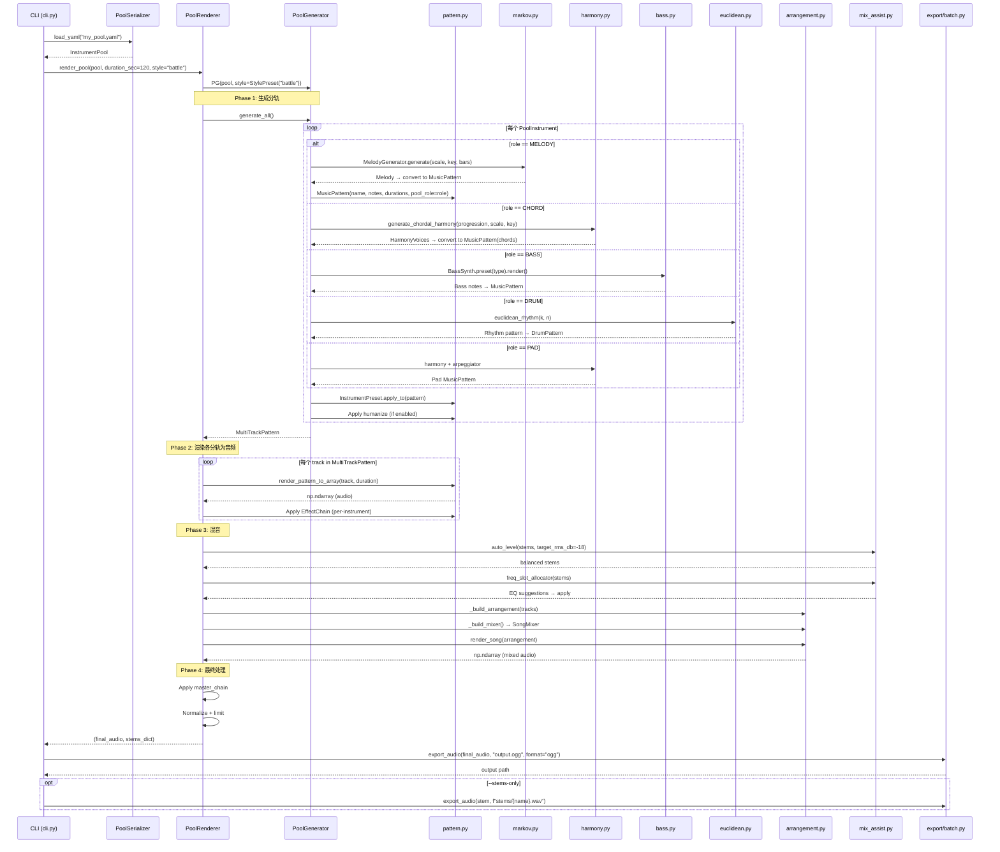
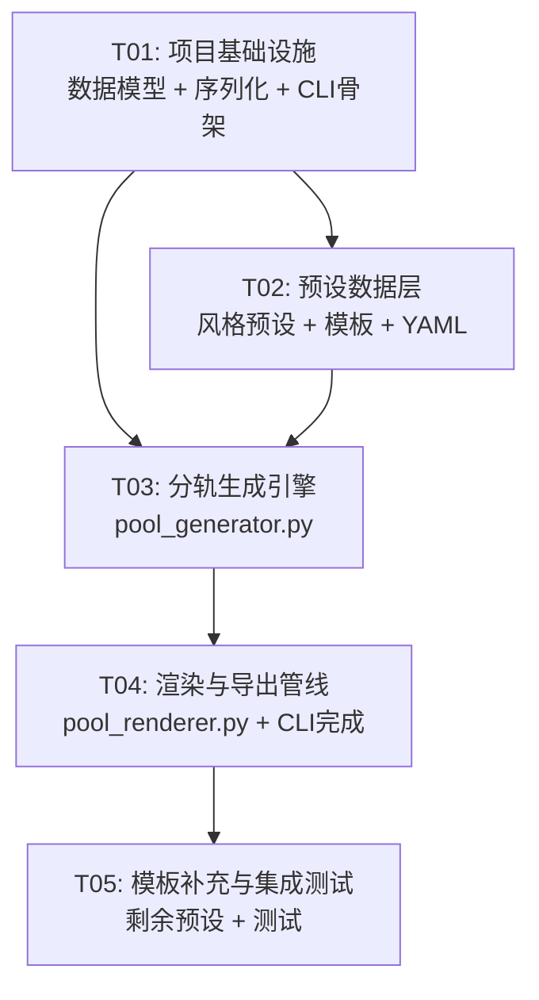

# BloodMusic 乐器池系统 — 架构设计文档

> 架构师: Bob · 版本: 1.0 · 日期: 2025-07

---

## Part A: 系统设计

### 1. 实现方案

#### 1.1 核心技术挑战

| 挑战 | 分析 | 方案 |
|------|------|------|
| 角色→引擎智能映射 | melody/chord/bass/drum/pad/fx 六种角色需要不同合成策略 | 基于 `InstrumentRole` 枚举的查找表 + 用户可覆盖 |
| 分轨生成协调 | 需协调 markov/harmony/bass/euclidean 等多种生成器 | 统一 `generate_pool_tracks()` 调度器，按角色分派 |
| 与现有 `SongArrangement` 无缝对接 | 新系统产出需可直接喂给 `render_song()` | `render_pool()` 内部将 MultiTrackPattern 转为 Section 列表 + SongArrangement |
| 混音自动化 | 复用 `auto_level()` + `freq_slot_allocator()` + `SongMixer` | 按角色自动分配 Bus，应用风格混音指导 |
| YAML 序列化 | `EffectChain` 有 30+ 字段，需安全序列化 | `pool_serializer.py` 使用 `dataclasses.asdict()` + 可选字段过滤 |

#### 1.2 架构分层

```
┌─────────────────────────────────────────────────┐
│                  CLI Layer                        │
│  python -m bloodmusic pool render/list/show/...  │
├─────────────────────────────────────────────────┤
│              Orchestration Layer                 │
│  pool_renderer.py  ←→  pool_generator.py        │
├─────────────────────────────────────────────────┤
│                 Data Layer                        │
│  instrument_pool.py / pool_serializer.py         │
│  pool_templates.py / pool_styles.py              │
├─────────────────────────────────────────────────┤
│              Existing Modules (REUSE)             │
│  pattern.py  markov.py  harmony.py  bass.py      │
│  euclidean.py  scale.py  motif.py  arpeggiator.py│
│  arrangement.py  mix_assist.py  instruments.py   │
│  humanize.py  emotion.py  chain.py  export/      │
├─────────────────────────────────────────────────┤
│              Synthesis Engine                     │
│  core/  (oscillator, fm_synth, wavetable, ...)   │
└─────────────────────────────────────────────────┘
```

#### 1.3 设计模式

- **策略模式**: `PoolInstrument.role` 决定使用哪种生成策略（melody→markov, chord→harmony, bass→bass.py, drum→euclidean, pad→harmony+arpeggiator, fx→特殊处理）
- **模板方法**: `pool_templates.py` 预定义乐器池配置，`pool_styles.py` 预定义生成参数覆盖
- **管道模式**: `render_pool()` 串联"加载→生成分轨→混音→导出"

#### 1.4 框架与库选型

| 组件 | 选型 | 理由 |
|------|------|------|
| YAML 解析 | PyYAML | PRD 指定，Python 生态成熟，支持注释 |
| JSON 解析 | 标准库 `json` | 无需额外依赖 |
| 数据验证 | `dataclasses` + 手动校验 | 保持零额外依赖 |
| CLI | `argparse` | 与现有 `cli.py` 一致 |

---

### 2. 文件列表

```
G:\tools\audio\bloodmusic\
│
├── music\                              # (现有目录，仅修改 pattern.py)
│   ├── pattern.py                      # [修改] MusicPattern 新增 pool_role: Optional[str] = None
│   ├── __init__.py                     # [修改] 导出新模块的公开 API
│   │
│   ├── instrument_pool.py             # [新增] 核心数据模型
│   ├── pool_generator.py              # [新增] 分轨生成引擎
│   ├── pool_renderer.py               # [新增] 端到端渲染管线
│   ├── pool_styles.py                 # [新增] 风格预设定义
│   ├── pool_templates.py              # [新增] 乐器池模板库
│   ├── pool_serializer.py             # [新增] YAML/JSON 序列化
│   │
│   └── pool_presets/                  # [新增] 预置 YAML 配置目录
│       ├── orchestral_small.yaml
│       ├── electronic_group.yaml
│       ├── jazz_trio.yaml
│       ├── rock_band.yaml
│       └── ambient_pad.yaml
│
├── cli.py                             # [修改] 新增 pool 子命令
├── requirements.txt                   # [修改] 添加 PyYAML
│
└── tests\                             # [可选修改]
    └── test_music.py                  # [修改] 新增乐器池测试
```

---

### 3. 数据结构和接口

#### 3.1 类图

```mermaid
classDiagram
    %% ═══ 枚举 ═══
    class InstrumentRole {
        <<enumeration>>
        MELODY
        CHORD
        BASS
        DRUM
        PAD
        FX
    }

    class SynthEngine {
        <<enumeration>>
        SUBTRACTIVE
        FM
        FM_ADVANCED
        KARPLUS_STRONG
        GRANULAR
        WAVETABLE
        WAVEGUIDE
        NOISE
    }

    %% ═══ 核心数据模型 ═══
    class PoolInstrument {
        +str name
        +InstrumentRole role
        +SynthEngine engine
        +Optional~str~ preset
        +dict params
        +Optional~EffectChain~ effect_chain
        +float pan
        +float volume
        +Optional~str~ note_sequence
        +Optional~int~ octave
        +__post_init__() None
    }

    class PoolConfig {
        +List~str~ sections
        +List~int~ section_bars
        +float diversity
        +Optional~int~ seed
        +bool humanize
        +Optional~str~ chord_progression
        +Optional~int~ target_bars
    }

    class InstrumentPool {
        +str name
        +str version
        +List~PoolInstrument~ instruments
        +Optional~str~ style
        +int bpm
        +str key
        +str scale
        +PoolConfig config
        +Optional~EffectChain~ master_chain
        +float global_volume
        +from_yaml(path) InstrumentPool$
        +from_json(path) InstrumentPool$
        +to_yaml(path) None
        +to_json(path) None
        +get_by_role(role) List~PoolInstrument~
        +validate() List~str~
    }

    class StylePreset {
        +str name
        +str description
        +dict~InstrumentRole,dict~ role_params
        +Optional~PoolConfig~ config_overrides
        +Optional~str~ arrangement_template
        +Optional~dict~ mix_params
        +apply_to(pool) InstrumentPool
    }

    class PoolTemplate {
        +str name
        +str description
        +List~PoolInstrument~ instruments
        +int bpm
        +str key
        +str scale
        +to_pool() InstrumentPool
    }

    %% ═══ 生成引擎 ═══
    class PoolGenerator {
        +InstrumentPool pool
        +Optional~StylePreset~ style
        +generate_all(target_bars) MultiTrackPattern
        +generate_melody(instrument) MusicPattern
        +generate_chord(instrument) MusicPattern
        +generate_bass(instrument) MusicPattern
        +generate_drum(instrument) DrumPattern
        +generate_pad(instrument) MusicPattern
        +generate_fx(instrument) MusicPattern
        -_resolve_style_params(role) dict
    }

    class PoolRenderer {
        +InstrumentPool pool
        +float duration_sec
        +Optional~str~ style_name
        +render() Tuple~np.ndarray, Dict~
        +render_stems_only() Dict~str, np.ndarray~
        -_build_arrangement(tracks) SongArrangement
        -_build_mixer() SongMixer
        -_apply_mix_assist(stems) Dict~str, np.ndarray~
        -_apply_master_chain(audio) np.ndarray
    }

    %% ═══ 序列化 ═══
    class PoolSerializer {
        +load_yaml(path) InstrumentPool$
        +load_json(path) InstrumentPool$
        +save_yaml(pool, path) None$
        +save_json(pool, path) None$
        +list_presets() List~str~$
        +load_preset(name) InstrumentPool$
        -_pool_to_dict(pool) dict$
        -_dict_to_pool(data) InstrumentPool$
    }

    %% ═══ 现有模块（仅关系标注） ═══
    class MusicPattern {
        +str name
        +List notes
        +List durations
        +Optional~str~ pool_role
    }

    class DrumPattern {
        +str name
        +int steps
        +dict tracks
        +dict sounds
    }

    class MultiTrackPattern {
        +str name
        +List music_tracks
        +Optional~DrumPattern~ drum_track
    }

    class SongArrangement {
        +str name
        +int bpm
        +List~Section~ sections
    }

    class SongMixer {
        +List~MixBus~ buses
        +add_bus(name, indices) Self
        +mix(tracks) np.ndarray
    }

    %% ═══ 关系 ═══
    InstrumentPool "1" --> "*" PoolInstrument : contains
    InstrumentPool "1" --> "1" PoolConfig : config
    InstrumentPool "0..1" --> "1" StylePreset : references
    PoolTemplate "1" --> "*" PoolInstrument : instruments
    PoolTemplate ..> InstrumentPool : to_pool()
    StylePreset ..> InstrumentPool : apply_to()
    PoolGenerator "1" --> "1" InstrumentPool : operates on
    PoolGenerator "0..1" --> "1" StylePreset : style
    PoolGenerator ..> MultiTrackPattern : produces
    PoolGenerator ..> MusicPattern : produces
    PoolGenerator ..> DrumPattern : produces
    PoolRenderer "1" --> "1" InstrumentPool : operates on
    PoolRenderer ..> PoolGenerator : uses
    PoolRenderer ..> SongArrangement : builds
    PoolRenderer ..> SongMixer : builds
    PoolRenderer ..> "mix_assist" : auto_level/freq_slot
    PoolRenderer ..> "export" : export_audio
    PoolSerializer ..> InstrumentPool : loads/saves
    InstrumentPool "1" --> "0..1" EffectChain : master_chain
    PoolInstrument "1" --> "0..1" EffectChain : effect_chain
    MusicPattern "1" --> "0..1" PoolInstrument : pool_role references
```

#### 3.2 关键方法签名

**`InstrumentPool`**

```python
@dataclass
class InstrumentPool:
    name: str
    version: str = "1.0"
    instruments: List[PoolInstrument] = field(default_factory=list)
    style: Optional[str] = None
    bpm: int = 120
    key: str = "C"
    scale: str = "major"
    config: PoolConfig = field(default_factory=PoolConfig)
    master_chain: Optional[EffectChain] = None
    global_volume: float = 0.9

    @classmethod
    def from_yaml(cls, path: str) -> "InstrumentPool": ...

    @classmethod
    def from_json(cls, path: str) -> "InstrumentPool": ...

    def to_yaml(self, path: str) -> None: ...

    def to_json(self, path: str) -> None: ...

    def get_by_role(self, role: InstrumentRole) -> List[PoolInstrument]: ...

    def validate(self) -> List[str]: ...
```

**`PoolGenerator`**

```python
class PoolGenerator:
    def __init__(self, pool: InstrumentPool, style: Optional[StylePreset] = None): ...

    def generate_all(self, target_bars: Optional[int] = None) -> MultiTrackPattern: ...
    def generate_melody(self, instrument: PoolInstrument) -> MusicPattern: ...
    def generate_chord(self, instrument: PoolInstrument) -> MusicPattern: ...
    def generate_bass(self, instrument: PoolInstrument) -> MusicPattern: ...
    def generate_drum(self, instrument: PoolInstrument) -> DrumPattern: ...
    def generate_pad(self, instrument: PoolInstrument) -> MusicPattern: ...
    def generate_fx(self, instrument: PoolInstrument) -> MusicPattern: ...
```

**`PoolRenderer`**

```python
class PoolRenderer:
    def __init__(self, pool: InstrumentPool,
                 duration_sec: float = 120.0,
                 style_name: Optional[str] = None,
                 output_dir: Optional[str] = None): ...

    def render(self) -> Tuple[np.ndarray, Dict[str, np.ndarray]]: ...
    def render_stems_only(self) -> Dict[str, np.ndarray]: ...
```

**`StylePreset`**

```python
@dataclass
class StylePreset:
    name: str
    description: str = ""
    role_params: Dict[InstrumentRole, dict] = field(default_factory=dict)
    config_overrides: Optional[PoolConfig] = None
    arrangement_template: Optional[str] = None  # "pop", "electronic", etc.
    mix_params: Optional[dict] = None  # target_rms_db, compression_ratio, etc.

    def apply_to(self, pool: InstrumentPool) -> InstrumentPool: ...
```

**`PoolTemplate`**

```python
@dataclass
class PoolTemplate:
    name: str
    description: str = ""
    instruments: List[PoolInstrument] = field(default_factory=list)
    bpm: int = 120
    key: str = "C"
    scale: str = "major"

    def to_pool(self, style: Optional[str] = None) -> InstrumentPool: ...
```

---

### 4. 程序调用流程

#### 4.1 端到端渲染时序图



#### 4.2 CLI 命令执行流程

```
python -m bloodmusic pool render orchestral_small --style battle --duration 120

  1. argparse 解析 → cmd_pool_render(args)
  2. args.template → PoolSerializer.load_preset("orchestral_small")
     or args.pool_file → PoolSerializer.load_yaml(path)
  3. 合并 style 覆盖参数
  4. PoolRenderer(pool, duration_sec=120).render()
  5. export_audio(audio, output_path, format)
  6. 打印诊断报告 (headroom, conflicts, suggestions)
```

---

### 5. 待明确事项

| 编号 | 问题 | 当前决策 | 影响 |
|------|------|----------|------|
| **Q1** | `note_sequence` 字段的格式？ | 采用 `List[str]`（如 `["C4","D4",null,"E4"]`），与 `MusicPattern.notes` 一致 | `pool_generator.py` 需检查是否提供了覆盖数据 |
| **Q2** | `PoolConfig.diversity` 如何映射到各生成器的 temperature/seed？ | diversity 0→固定(seed=0), 0.5→默认, 1→最大随机 | `pool_generator.py` 内部解析 |
| **Q3** | `SynthEngine.NOISE` 对应哪个核心引擎？ | 直接使用 `OscType.NOISE_WHITE/PINK/BROWN` + envelope，不经过复杂合成链 | `pool_generator.py` 中 drum role 特判 |
| **Q4** | `PoolConfig.sections` 为空时默认行为？ | 使用 `StylePreset.arrangement_template` 对应 `create_song_template()` 的结果 | `pool_renderer.py` |
| **Q5** | 风格预设的 `config_overrides` 与 pool 自身的 `config` 谁优先？ | pool.config 优先（用户显式设置），style 仅提供默认值 | `StylePreset.apply_to()` |
| **Q6** | 是否需要每个 PoolInstrument 独立设置 `humanize`？ | 暂不，使用 `PoolConfig.humanize` 全局开关 | 简化 v1 设计 |

---

## Part B: 任务分解

### 6. 所需依赖包

```
- PyYAML>=6.0         # YAML 配置文件解析（新增到 requirements.txt）
```

现有依赖无需变更：`numpy>=1.24`, `scipy>=1.10`, `sounddevice>=0.4`, `soundfile>=0.12`

---

### 7. 任务列表（按依赖排序）

#### T01: 项目基础设施 — 核心数据模型 + 序列化 + 骨架

| 属性 | 值 |
|------|------|
| **Task ID** | T01 |
| **Task Name** | 项目基础设施：数据模型 + 序列化 + CLI 骨架 + 预设目录 |
| **Source Files** | `music/instrument_pool.py` (新增), `music/pool_serializer.py` (新增), `music/pattern.py` (修改), `requirements.txt` (修改), `cli.py` (修改), `music/pool_presets/.gitkeep` (新增) |
| **Dependencies** | 无 |
| **Priority** | P0 |
| **说明** | 建立整个系统的数据基础。实现 `InstrumentRole` 枚举、`SynthEngine` 枚举、`PoolInstrument`、`PoolConfig`、`InstrumentPool` 五个核心 dataclass。实现 `PoolSerializer` 的 YAML 保存/加载（使用 PyYAML）。在 `MusicPattern` 中新增 `pool_role: Optional[str] = None` 字段。在 `cli.py` 中添加 `pool` 子命令组骨架（`list`/`show`/`render`/`create`/`preview` 占位）。创建 `pool_presets/` 目录。 |
| **验收标准** | `InstrumentPool.from_yaml("test.yaml")` 往返正确；`pool.validate()` 返回验证结果；`MusicPattern` 可设置 `pool_role` 且不影响现有功能 |

#### T02: 预设数据层 — 风格预设 + 乐器池模板 + YAML 预设文件

| 属性 | 值 |
|------|------|
| **Task ID** | T02 |
| **Task Name** | 预设数据层：风格预设 + 乐器池模板 + YAML 预设文件 |
| **Source Files** | `music/pool_styles.py` (新增), `music/pool_templates.py` (新增), `music/pool_presets/orchestral_small.yaml` (新增), `music/pool_presets/electronic_group.yaml` (新增), `music/pool_presets/jazz_trio.yaml` (新增) |
| **Dependencies** | T01 |
| **Priority** | P0 |
| **说明** | 实现 `StylePreset` 和 `PoolTemplate` 两个 dataclass。定义 5 个风格预设（exploration / battle / town / dungeon / ambient），每个包含角色→生成参数映射表（BPM 范围、音阶偏好、密度、人性化程度、arrangement_template、mix_params）。定义 3 个乐器池模板（管弦小编制 / 电子合成器组 / 爵士三重奏），用 `PoolTemplate` 包装。为 3 个模板创建对应的 YAML 文件。 |
| **验收标准** | `StylePreset("battle").apply_to(pool)` 正确覆盖参数；`PoolTemplate("orchestral_small").to_pool()` 返回合法的 `InstrumentPool`；YAML 文件可被 T01 的 `from_yaml()` 正确加载 |

#### T03: 分轨生成引擎 — `pool_generator.py`

| 属性 | 值 |
|------|------|
| **Task ID** | T03 |
| **Task Name** | 分轨生成引擎：按角色分派生成策略 |
| **Source Files** | `music/pool_generator.py` (新增), `music/pool_styles.py` (集成), `music/instrument_pool.py` (可能需要微调) |
| **Dependencies** | T01, T02 |
| **Priority** | P0 |
| **说明** | 实现 `PoolGenerator` 类。核心方法 `generate_all()` 遍历 `pool.instruments`，按角色分派到不同生成器：melody → `markov.py` 生成旋律线 → MusicPattern；chord → `harmony.py` 生成和弦进行 → MusicPattern(chords)；bass → `bass.py` 生成低音线 → MusicPattern；drum → `euclidean.py` 生成节奏 → DrumPattern；pad → `harmony.py` + `arpeggiator.py` → MusicPattern；fx → 特殊音效处理。应用 `InstrumentPreset.apply_to()` 设置音色。如果 `pool.config.humanize=True`，应用 `humanize.py`。`_resolve_style_params()` 按角色查找风格参数覆盖。 |
| **验收标准** | `PoolGenerator(pool, style).generate_all()` 返回非空 `MultiTrackPattern`；每个角色的 pattern 非空且未抛出异常；生成的 pattern 可被 `render_multi_track()` 渲染为音频 |

#### T04: 渲染与导出管线 — `pool_renderer.py` + CLI 完成

| 属性 | 值 |
|------|------|
| **Task ID** | T04 |
| **Task Name** | 渲染与导出管线：端到端渲染 + CLI pool 命令 |
| **Source Files** | `music/pool_renderer.py` (新增), `cli.py` (完成 pool 子命令), `music/__init__.py` (新增导出) |
| **Dependencies** | T03 |
| **Priority** | P0 |
| **说明** | 实现 `PoolRenderer` 类。`render()` 方法：创建 `PoolGenerator`→调用 `generate_all()`→将 `MultiTrackPattern` 转为 `SongArrangement`（用 `create_song_template()` 或 `StylePreset.arrangement_template`）→为每个 Section 分配 pattern→`render_song()`→应用 `auto_level()` 和 `freq_slot_allocator()`→母带处理→返回 `(final_audio, stems)`。`render_stems_only()` 跳过混音直接返回分轨。在 `cli.py` 完成 `pool list`/`pool show`/`pool render`/`pool create`/`pool preview` 五个子命令。在 `music/__init__.py` 中添加新模块的公开 API 导出。 |
| **验收标准** | `python -m bloodmusic pool list` 列出所有模板；`python -m bloodmusic pool render orchestral_small --style exploration --duration 30 --format wav` 输出有效的 WAV 文件；Python API `render_pool(pool, 30)` 返回 `(np.ndarray, dict)` |

#### T05: 模板补充与集成测试

| 属性 | 值 |
|------|------|
| **Task ID** | T05 |
| **Task Name** | 模板补充与集成测试 |
| **Source Files** | `music/pool_presets/rock_band.yaml` (新增), `music/pool_presets/ambient_pad.yaml` (新增), `tests/test_music.py` (修改) |
| **Dependencies** | T04 |
| **Priority** | P1 |
| **说明** | 补充剩余 2 个乐器池预设 YAML（摇滚乐队、氛围环境）。在 `tests/test_music.py` 中添加集成测试："完整渲染管线测试"（最小乐池 → render → 检查音频非空/格式正确）、"YAML 往返测试"（to_yaml→from_yaml→对象相等）、"乐器池模板测试"（5 个模板均可实例化且校验通过）、"风格预设测试"（5 个风格预设应用到乐池后参数正确）。 |
| **验收标准** | 5 个 YAML 预设均可正确加载；集成测试通过（`pytest tests/test_music.py -k pool`）；端到端：`python -m bloodmusic pool render jazz_trio --duration 15 --format wav` 无错误退出 |

---

### 8. 共享知识（跨文件约定）

```
── 命名规范 ──
- 所有新模块在 music/ 下，驼峰类名，蛇形文件名
- pool_role 字段值使用字符串："melody", "chord", "bass", "drum", "pad", "fx"
- YAML 预设文件命名：snake_case.yaml（如 orchestral_small.yaml）

── 信号流标准 ──
- 所有内部音频数组使用 float64，导出前统一转 float32
- 渲染管线：分轨生成(float64) → 效果链 → 混音 → 母带 → normalize → clip → float32
- 音量归一化目标：-1.0 dBFS（使用 constants.NORMALIZE_DBFS）

── 错误处理约定 ──
- validate() 返回 List[str] 警告列表，不抛异常（让调用者决定是否终止）
- 生成器内部使用 try/except 包裹子模块调用，单个乐器失败不中断整个乐池
- CLI 层使用 sys.exit(1) + stderr 报告致命错误
- YAML 加载失败抛 PoolSerializationError 自定义异常

── 日志/诊断约定 ──
- render_pool() 返回的诊断信息通过 Python logging 模块输出（INFO 级别）
- 混音诊断（MixDiagnosis）结果通过 logging.info(diag.summary()) 输出

── EffectChain 序列化约定 ──
- YAML 中只序列化非 None/非默认值的 EffectChain 字段
- 反序列化时未出现的字段使用 EffectChain() 默认值
- master_chain 在 YAML 顶层，per-instrument 的 effect_chain 在 instruments[].effect_chain 内

── 字符串枚举约定 ──
- YAML 中 role 字段接受字符串值（"melody"|"chord"|"bass"|"drum"|"pad"|"fx"），加载时转 InstrumentRole 枚举
- YAML 中 engine 字段接受字符串值（"subtractive"|"fm"|"fm_advanced"|...），加载时转 SynthEngine 枚举
```

---

### 9. 任务依赖图



**并行提示**: T02 和 T03 可以部分并行——T03 的核心逻辑可在 T02 完成前开始编写，但 `StylePreset.apply_to()` 和模板相关的集成测试需要 T02 完成。

---

> **附录：与现有架构的关系**
>
> 本设计完全遵循 PRD 中"增量增强"约束：
> - 仅修改 `music/pattern.py` 的 `MusicPattern`（新增 `pool_role` 字段）
> - 新增 6 个 .py 文件 + 1 个预设目录
> - CLI 新增 `pool` 子命令组
> - 不修改 `core/`, `effects/`, `export/`, `sfx/`, `gui/` 中的任何文件
> - 新增代码约 1500-2000 行（含注释和文档字符串）
