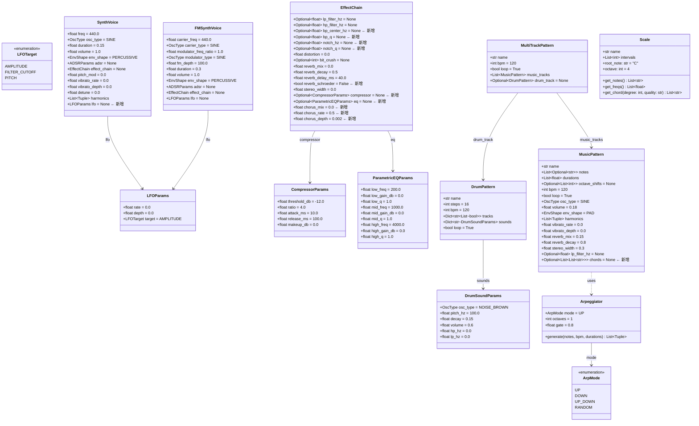
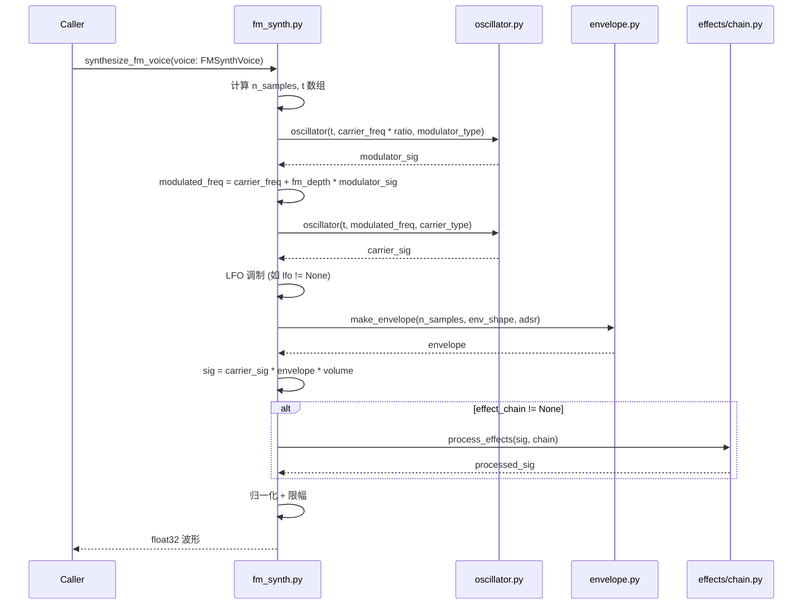
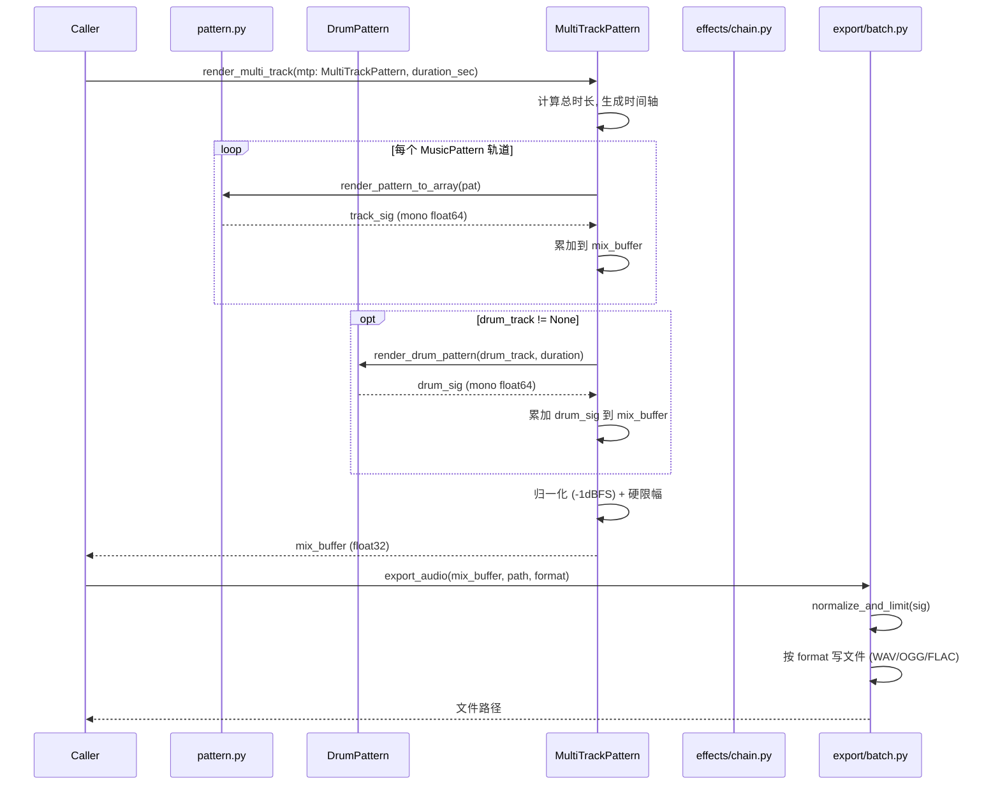
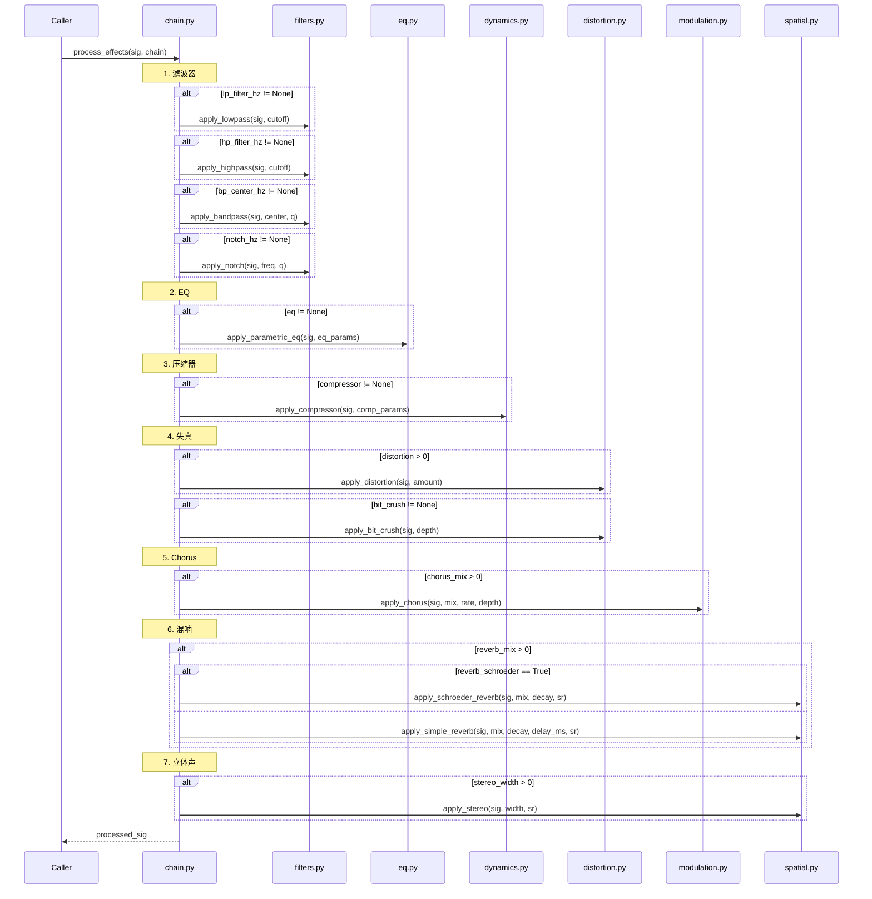
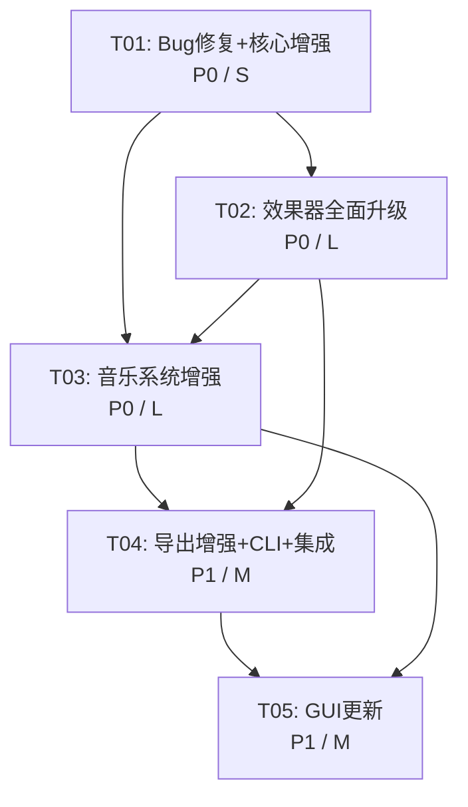

# BloodMusic 全面增强 — 系统架构设计

> 架构师: 高见远 (Gao)  
> 版本: v2.0  
> 日期: 2025-07

---

## Part A: 系统设计

### 1. 实现方案与框架选型

#### 1.1 核心技术挑战

| 挑战 | 说明 | 解决思路 |
|------|------|----------|
| **滤波器性能** | 现有一阶 IIR 使用 Python for 循环，极慢 | 使用 `scipy.signal.butter` + `scipy.signal.lfilter` 向量化替换 |
| **混响质量** | comb-filter 混响音质差，金属感重 | 实现 Schroeder 混响：4×并行 comb + 2×串联 allpass |
| **LFO 调制架构** | 现有 SynthVoice 无 LFO | 在 `synthesize_voice()` 中增加 LFO 调制路径，新增 `LFOParams` dataclass |
| **FM 合成** | 现有只有减法合成 | 新增 `FMSynthVoice`，双算子 (carrier + modulator)，不修改原 SynthVoice |
| **多轨/和弦/鼓点** | MusicPattern 只支持单音序列 | 新增 `DrumPattern` + `MultiTrackPattern`，MusicPattern 增加和弦字段 |
| **导出归一化** | 现有只做简单限幅 | 在 `batch.py` 和 `pattern.py` 中增加 -1dBFS 归一化 + 硬限幅 |
| **OGG/FLAC 导出** | 仅支持 WAV | 新增 `soundfile` 依赖，在导出层统一处理格式 |

#### 1.2 框架与库选型

| 库 | 版本 | 用途 | 选择理由 |
|----|------|------|----------|
| `numpy` | 已有 | 数组计算 | 已有依赖，无需更改 |
| `scipy` | 已有 | 信号处理 | 已有依赖，`signal.butter/lfilter` 替换 for 循环 |
| `sounddevice` | 已有 | 实时播放 | 已有依赖 |
| `tkinter` | 标准库 | GUI | 已有依赖，保持不变 |
| `soundfile` | ^0.12 | OGG/FLAC 导出 | 轻量、支持 OGG Vorbis + FLAC + WAV，比 pydub 无需 ffmpeg |

#### 1.3 架构模式

- **增量增强**：所有新功能通过新增字段（默认值=None/0）和新增类实现，不破坏现有 API
- **分层架构**：`core → effects → music/sfx → export → playback → gui`
- **策略模式**：LFO 调制目标通过 `LFOTarget` 枚举选择策略
- **组合模式**：`MultiTrackPattern` 组合多个 `MusicPattern` / `DrumPattern`

---

### 2. 文件列表

> `[新建]` = 全新文件，`[修改]` = 修改现有文件

```
bloodmusic/
├── core/
│   ├── constants.py            [修改] 新增 NORMALIZE_DBFS 常量
│   ├── note_utils.py           [修改] 修复 freq_to_midi bug
│   ├── oscillator.py           [不变]
│   ├── envelope.py             [不变]
│   ├── voice.py                [修改] 新增 LFOParams, SynthVoice 增加 LFO 字段, synthesize_voice 增加 LFO 调制
│   └── fm_synth.py             [新建] FMSynthVoice + synthesize_fm_voice
├── effects/
│   ├── __init__.py             [修改] 导出新函数
│   ├── chain.py                [修改] EffectChain 新增 bandpass/notch/EQ/compressor/chorus 字段, process_effects 增加新效果步骤
│   ├── filters.py              [修改] 用 scipy.signal 重写 lowpass/highpass, 新增 bandpass/notch, 用 lfilter 向量化
│   ├── spatial.py              [修改] 新增 Schroeder 混响, 保留 apply_simple_reverb 向后兼容
│   ├── dynamics.py             [新建] 压缩器/限幅器 (Compressor, Limiter)
│   ├── eq.py                   [新建] 三段参量 EQ (ParametricEQ)
│   └── modulation.py           [新建] Chorus 效果
├── music/
│   ├── __init__.py             [修改] 导出新类和新预设
│   ├── pattern.py              [修改] MusicPattern 新增 chords 字段, 新增 DrumPattern, MultiTrackPattern, 多轨混合渲染
│   ├── presets.py              [修改] 6→15+ 预设, 新增 RPG/平台跳跃风格
│   ├── arpeggiator.py          [新建] 琶音器 (Arpeggiator)
│   └── scale.py                [新建] 音阶/调式系统 (Scale 类)
├── sfx/
│   └── presets.py              [不变] 现有 40 个预设无需修改
├── export/
│   ├── __init__.py             [修改] 导出新导出函数
│   └── batch.py                [修改] 新增归一化/限幅, OGG/FLAC 导出, WAV 元数据
├── playback/
│   └── player.py              [不变]
├── gui/
│   └── workstation.py          [修改] 新增 DrumPattern/多轨/FM 预览, 格式选择, 新预设显示
├── __init__.py                 [修改] 导出新 API (FMSynthVoice, DrumPattern 等)
├── cli.py                      [修改] 新增 --format 参数
└── main.py                     [不变]
```

---

### 3. 数据结构与接口



---

### 4. 程序调用流程

#### 4.1 FM 合成流程



#### 4.2 多轨混合渲染流程



#### 4.3 效果链处理流程（增强后）



---

### 5. 待明确事项

| 编号 | 问题 | 当前假设 | 备注 |
|------|------|----------|------|
| Q1 | OGG 编码模式 | 默认 128kbps CBR | soundfile 支持设置 bitrate |
| Q2 | 鼓点合成方式 | 纯合成 + 噪声塑形 | 无采样依赖，保持程序化 |
| Q3 | FM 算子级联 | 双算子 (2-op) | carrier + 1 modulator，后续可扩展 |
| Q4 | GUI 框架 | 保持 Tkinter | 不迁移 pygame-ce |
| Q5 | 新增预设风格 | RPG 探索 + 平台跳跃 | 新增约 9 个预设 |
| Q6 | 和弦表示法 | 同时支持 List[str] 和 str+quality | `chords=[["C4","E4","G4"]]` 或 `chord_names=["C_maj"]` |

---

## Part B: 任务分解

### 6. 依赖包列表

```
# 新增依赖
soundfile>=0.12.1         # OGG/FLAC/WAV 多格式导出 (替代部分 scipy.io.wavfile 用法)

# 已有依赖 (无需变更)
numpy                     # 数组计算
scipy                     # 信号处理 (butter, lfilter, sosfilt)
sounddevice               # 实时播放
```

---

### 7. 任务列表

#### T01: Bug 修复 + 核心基础设施增强
**优先级**: P0 | **复杂度**: S  
**依赖**: 无  
**说明**: 修复 freq_to_midi bug；增强常量定义；为 SynthVoice 添加 LFO 支持；新增 FMSynthVoice；导出层添加归一化/限幅

| 文件 | 操作 | 内容 |
|------|------|------|
| `core/note_utils.py` | 修改 | 修复 `freq_to_midi`：`(freq / _A4_FREQ).bit_length()` → `12 * math.log2(freq / _A4_FREQ)` |
| `core/constants.py` | 修改 | 新增 `NORMALIZE_DBFS = -1.0`，`DEFAULT_OGG_BITRATE = 128000` |
| `core/voice.py` | 修改 | 新增 `LFOParams` dataclass + `LFOTarget` 枚举；`SynthVoice` 新增 `lfo: Optional[LFOParams] = None`；`synthesize_voice()` 增加 LFO 调制路径 |
| `core/fm_synth.py` | 新建 | `FMSynthVoice` dataclass + `synthesize_fm_voice()` 函数 |
| `export/batch.py` | 修改 | 新增 `_normalize_and_limit(sig, target_dbfs)` 函数，导出前调用 |
| `music/pattern.py` | 修改 | `generate_music_wav()` 写入前调用归一化/限幅 |
| `core/__init__.py` | 修改 | 导出 `LFOParams`, `LFOTarget`, `FMSynthVoice`, `synthesize_fm_voice` |

#### T02: 效果器全面升级（滤波器 + 混响 + 新效果）
**优先级**: P0 | **复杂度**: L  
**依赖**: T01 (需要 LFOParams 定义)  
**说明**: scipy.signal 重写滤波器；新增 bandpass/notch；Schroeder 混响；压缩器；参量 EQ；Chorus；EffectChain 扩展

| 文件 | 操作 | 内容 |
|------|------|------|
| `effects/filters.py` | 修改 | 用 `scipy.signal.butter` + `sosfilt` 重写 `apply_lowpass`/`apply_highpass`；新增 `apply_bandpass(sig, center_hz, q)` / `apply_notch(sig, freq_hz, q)` |
| `effects/spatial.py` | 修改 | 新增 `apply_schroeder_reverb(sig, mix, decay, sr)` — 4×comb + 2×allpass；保留 `apply_simple_reverb` 向后兼容 |
| `effects/dynamics.py` | 新建 | `CompressorParams` dataclass + `apply_compressor(sig, params)` + `apply_limiter(sig, threshold_db)` |
| `effects/eq.py` | 新建 | `ParametricEQParams` dataclass + `apply_parametric_eq(sig, params)` — 三段参量均衡 |
| `effects/modulation.py` | 新建 | `apply_chorus(sig, mix, rate, depth, sr)` — 延迟线 + LFO 调制 |
| `effects/chain.py` | 修改 | `EffectChain` 新增 `bp_center_hz`/`bp_q`/`notch_hz`/`notch_q`/`reverb_schroeder`/`compressor`/`eq`/`chorus_mix`/`chorus_rate`/`chorus_depth` 字段；`process_effects()` 按新顺序处理全部效果 |
| `effects/__init__.py` | 修改 | 导出新增函数 |

#### T03: 音乐系统增强（和弦 + 鼓点 + 多轨 + 琶音 + 音阶）
**优先级**: P0 | **复杂度**: L  
**依赖**: T01, T02 (依赖效果器升级)  
**说明**: MusicPattern 支持和弦；新增 DrumPattern 步进序列器；MultiTrackPattern 多轨混合渲染；琶音器；音阶系统

| 文件 | 操作 | 内容 |
|------|------|------|
| `music/pattern.py` | 修改 | `MusicPattern` 新增 `chords: Optional[List[List[str]]] = None`；新增 `DrumPattern` dataclass + `DrumSoundParams` + `render_drum_pattern()`；新增 `MultiTrackPattern` dataclass + `render_multi_track()`；`generate_music_wav()` 增加和弦渲染逻辑 |
| `music/arpeggiator.py` | 新建 | `ArpMode` 枚举 (UP/DOWN/UP_DOWN/RANDOM) + `Arpeggiator` dataclass + `generate_arpeggio()` |
| `music/scale.py` | 新建 | `Scale` 类，预定义大调/小调/五声/蓝调等音阶，`get_notes()` / `get_freqs()` / `get_chord()` 方法 |
| `music/presets.py` | 修改 | 6→15+ 预设，新增 RPG 探索/平台跳跃/地下城/商店/标题画面等风格 |
| `music/__init__.py` | 修改 | 导出 `DrumPattern`, `DrumSoundParams`, `MultiTrackPattern`, `render_drum_pattern`, `render_multi_track`, `Arpeggiator`, `ArpMode`, `Scale` 及新增预设 |

#### T04: 导出增强 + CLI + 顶层集成
**优先级**: P1 | **复杂度**: M  
**依赖**: T01, T02, T03 (依赖所有功能模块完成)  
**说明**: OGG/FLAC 导出；WAV 元数据；CLI 新增 --format 参数；`__init__.py` 顶层导出新 API

| 文件 | 操作 | 内容 |
|------|------|------|
| `export/batch.py` | 修改 | 新增 `export_audio(sig, path, format="wav", bitrate=128000, metadata=None)` 统一导出函数，支持 WAV/OGG/FLAC；`AudioBatchExporter` 新增 `format` 参数和 `metadata` 参数；使用 `soundfile` 写 OGG/FLAC；WAV 写入 `soundfile` 以支持元数据 |
| `export/__init__.py` | 修改 | 导出 `export_audio` |
| `cli.py` | 修改 | `batch` 子命令新增 `--format` (wav/ogg/flac) 和 `--bitrate` 参数 |
| `__init__.py` | 修改 | 顶层导出所有新增 API (FMSynthVoice, synthesize_fm_voice, LFOParams, LFOTarget, DrumPattern, MultiTrackPattern, Scale, Arpeggiator, apply_bandpass, apply_notch, apply_schroeder_reverb, apply_compressor, apply_parametric_eq, apply_chorus, CompressorParams, ParametricEQParams 等) |

#### T05: GUI 更新
**优先级**: P1 | **复杂度**: M  
**依赖**: T03, T04 (依赖新功能模块和导出能力)  
**说明**: GUI 适配新增的 DrumPattern/MultiTrackPattern/FM 合成预览；新增格式选择；展示新预设

| 文件 | 操作 | 内容 |
|------|------|------|
| `gui/workstation.py` | 修改 | 左侧列表新增 DrumPattern / MultiTrackPattern / FMSynthVoice 分类；预览逻辑适配新类型；导出区新增格式下拉框 (WAV/OGG/FLAC)；预设列表展示新增的 15+ 音乐预设 |

---

### 8. 共享知识

```
1. 采样率常量: 所有模块统一使用 core.constants.SR (44100)，不硬编码
2. 归一化标准: 导出前统一调用 _normalize_and_limit(sig, target_dbfs=-1.0)
   - 目标: 峰值 -1dBFS = 10^(-1/20) ≈ 0.8913
   - 硬限幅: np.clip(sig, -1.0, 1.0)
3. 新增字段默认值: 所有新增 Optional 字段默认 None，数值字段默认 0.0，确保向后兼容
4. 函数签名: 现有函数签名不变，新参数通过可选参数追加在末尾
5. 类型注解: 使用 Python 3.10+ 语法 (Optional[X], list[X], dict[K,V])
6. 信号流: mono float64 在效果链内部流转，最终输出 float32
7. 效果链顺序: 滤波器 → EQ → 压缩器 → 失真 → Chorus → 混响 → 立体声
8. scipy 滤波器: 统一使用 sos (second-order sections) 格式，数值更稳定
9. 命名规范: apply_xxx 效果函数，synthesize_xxx 合成函数，render_xxx 渲染函数
10. 导出格式: WAV (默认, 16bit PCM), OGG (Vorbis, 默认 128kbps CBR), FLAC (lossless)
```

---

### 9. 任务依赖图



**关键路径**: T01 → T02 → T03 → T04 → T05

**并行机会**: T02 和 T03 之间 T02 必须先完成（音乐渲染依赖效果器），但 T01 完成后 T02 可立即开始，不需要等 T03。
