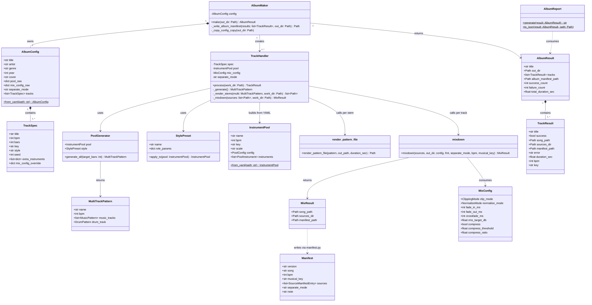
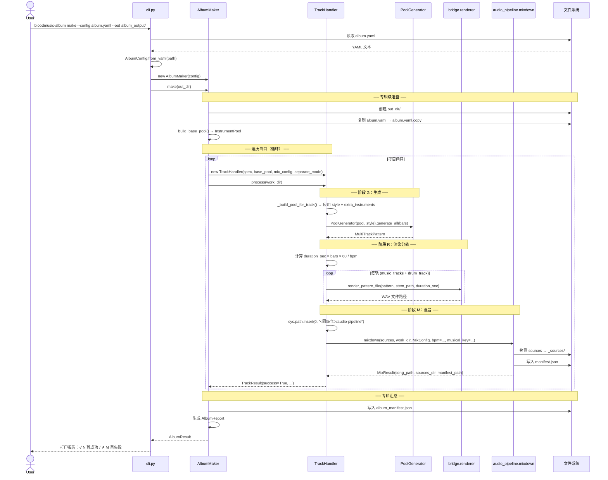
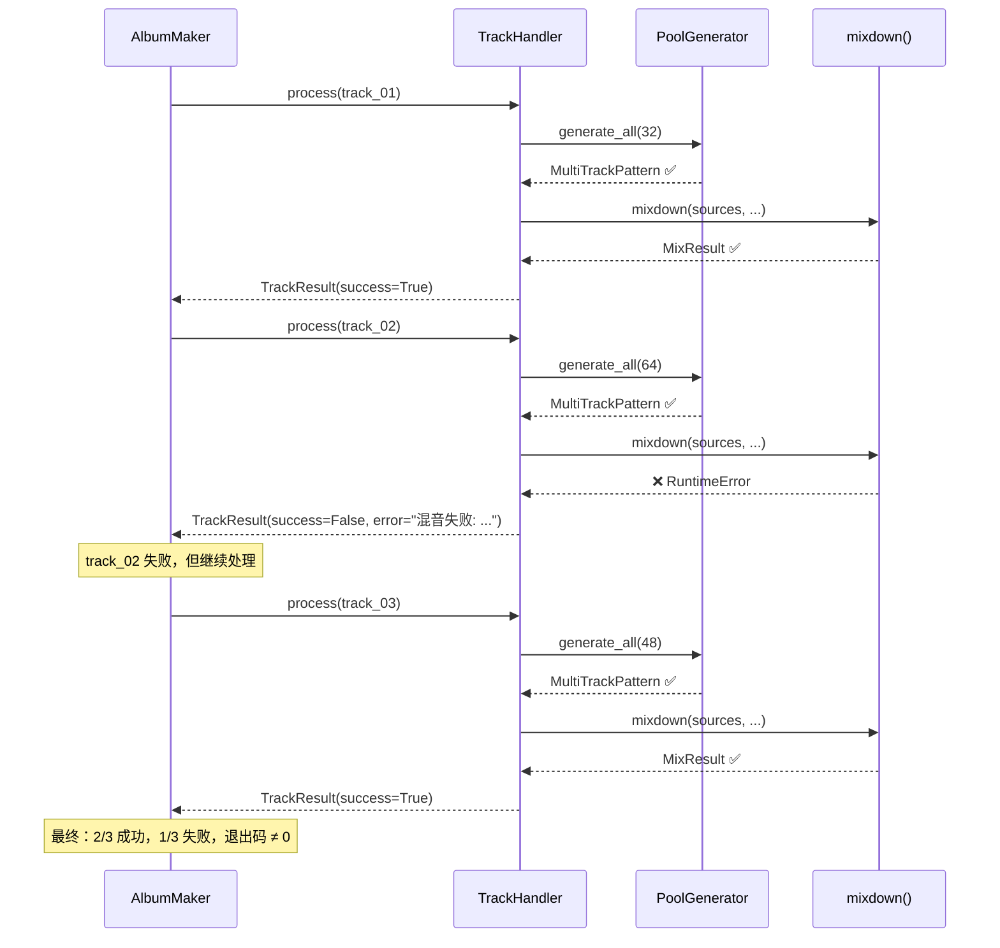
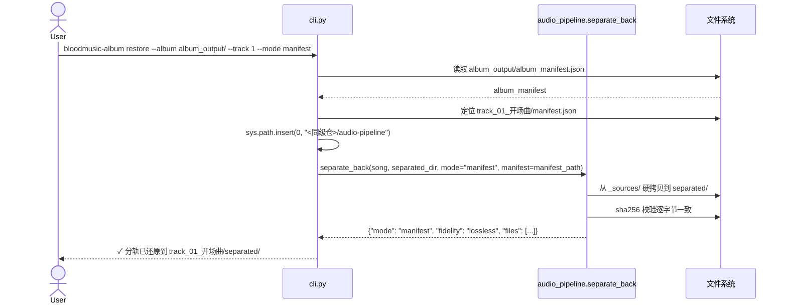
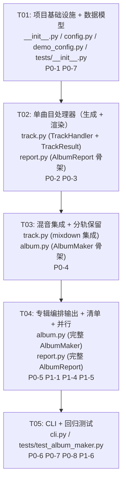

# BloodMusic Album Maker — 系统设计文档

| 项 | 值 |
|---|---|
| 文档版本 | v1.0 |
| 架构师 | 高见远（software-architect） |
| 上游输入 | PM 的 PRD + 主理人已拍板决策（R1–R4 延续 + 依赖隔离） |
| 目标仓库 | `<仓库根>`（BloodMusic v2.0.0） |
| 交付形态 | bloodmusic 子包 `bloodmusic/album_maker/` |
| 本文性质 | **只做设计与任务分解，不含实现代码** |

---

## Part A: 系统设计

### 1. 实现方案

#### 1.1 核心技术挑战

| 挑战 | 分析 | 方案 |
|------|------|------|
| **PoolGenerator → WAV 分轨渲染** | `MultiTrackPattern` 内含 `MusicPattern` 列表 + 可选 `DrumPattern`，但无批量渲染的"导出 API"。pattern.py 提供了 `render_pattern_to_array()`（旋律）和 `render_drum_pattern()`（鼓），以及 `generate_music_wav()`（单轨落盘）。bridge 的 `render_pattern_file()` 封装了单个 pattern 的渲染+落盘 | **复用 bridge 的 `render_pattern_file()`**（已封装单 pattern→WAV 落盘），逐轨调用。每首曲目的 drum + 各 music track 各自调用一次 |
| **audio_pipeline 进程内引用** | audio_pipeline 与 bloodmusic 在同一 Python env，但其包路径不在 bloodmusic 下 | `sys.path.insert(0, r"<同级仓>/audio-pipeline")` 在 `track.py` 模块顶部执行一次，后续 `from mixdown import mixdown, MixResult` 等直接可用 |
| **单曲目失败不中断整张专辑** | `PoolGenerator.generate_all()` 内部已对单乐器失败做了 try/except + logger.warning（不抛异常，跳过该乐器继续）。但混音阶段可能抛异常 | `TrackHandler.process()` 顶层 try/except，捕获所有异常 → 填充 `TrackResult(error=...)` + `success=False`，不向上抛。`AlbumMaker.make()` 遍历 tracks 时每首独立 try |
| **依赖隔离（R1：album_maker 进程内无 torch）** | `separate_back` 的模式 B 需要 `audio_separator`（torch），模式 A 仅做文件复制 | album_maker **仅调用模式 A（manifest 复制）**。restore 命令如需模式 B → subprocess 调用 audio_pipeline 的 CLI，进程隔离 |
| **R4 延续（bloodmusic 渲染侧零改造）** | 不修改 `music/pattern.py` / `export/batch.py` / `export/midi_export.py` | 只调用 bridge 的 `render_pattern_file()`（已在 R4 范围内），不触及渲染内核 |
| **专辑级 manifest vs 曲目级 manifest** | audio_pipeline 的 `Manifest` 是曲目级。专辑需要聚合 | 新建 `AlbumManifest` dataclass 聚合曲目级 manifest 引用 + 专辑元数据 + 诚实性声明 |

#### 1.2 架构分层

```
┌──────────────────────────────────────────────────────┐
│                    CLI Layer                           │
│  bloodmusic-album make / restore / doctor / ...       │
│  cli.py  (argparse 子命令)                             │
├──────────────────────────────────────────────────────┤
│                 Orchestration Layer                    │
│  album.py (AlbumMaker) ── 遍历曲目 → 汇总 AlbumResult │
│  report.py (AlbumReport) ── 生成报告                  │
├──────────────────────────────────────────────────────┤
│                  Track Layer                           │
│  track.py (TrackHandler)                               │
│  ├─ PoolGenerator.generate_all() → MultiTrackPattern   │
│  ├─ bridge renderer → 分轨 WAV                        │
│  └─ audio_pipeline mixdown → song_final.wav + manifest │
├──────────────────────────────────────────────────────┤
│                   Data Layer                           │
│  config.py (AlbumConfig / TrackSpec)                   │
│  demo_config.py (内置 demo 配置)                       │
├──────────────────────────────────────────────────────┤
│               External Dependencies                    │
│  bloodmusic (music/, bridge/)  │  audio_pipeline      │
│  PoolGenerator, InstrumentPool  │  mixdown, manifest  │
│  StylePreset, render_pattern_   │  separate_back      │
│  file, MusicPattern, ...         │  MixConfig          │
└──────────────────────────────────────────────────────┘
```

#### 1.3 框架与库选择

| 类别 | 选择 | 理由 |
|------|------|------|
| CLI 框架 | `argparse`（标准库） | 与 bloodmusic 现有 CLI 风格一致（`cli.py` 用 argparse），无需额外依赖 |
| YAML 解析 | `PyYAML` | bloodmusic 已依赖（`pool_serializer.py` 用 yaml），`InstrumentPool.from_yaml()` 已内置 |
| 并行处理 | `concurrent.futures.ProcessPoolExecutor`（P1） | 曲目间无数据依赖，进程隔离避免 GIL；与 PRD §3.4 决策一致 |
| 数据模型 | `dataclasses`（标准库） | 与 bloodmusic / audio_pipeline 现有风格一致 |
| 测试框架 | `pytest` | bloodmusic 已有 `tests/` 使用 pytest |

---

### 2. 文件列表

```
bloodmusic/album_maker/
├── __init__.py          # 包入口：导出 AlbumConfig, TrackSpec, AlbumMaker, AlbumResult,
│                        #   TrackHandler, TrackResult, AlbumReport
├── config.py            # AlbumConfig + TrackSpec dataclass；YAML 反序列化
├── demo_config.py       # --demo 内置配置（3 首曲目 × 16 小节，exploration/battle/town）
├── track.py             # TrackHandler：单曲目全流程处理器
│                        #   (PoolGenerator → bridge render → mixdown → manifest)
├── album.py             # AlbumMaker：专辑级编排器
│                        #   (遍历曲目 → 调用 TrackHandler → 汇总 AlbumResult)
├── report.py            # AlbumReport：生成报告（成功/失败统计、时长、目录结构验证）
├── cli.py               # CLI 入口：argparse 子命令（make / restore / doctor / list-styles / list-pools）
└── tests/
    ├── __init__.py      # 测试包标记
    └── test_album_maker.py  # 回归测试：--demo 完整流程 + 目录结构验证
```

**各文件职责明细：**

| 文件 | 职责 | 对外暴露 |
|------|------|---------|
| `__init__.py` | 包入口，统一导出核心类型 | `AlbumConfig`, `TrackSpec`, `AlbumMaker`, `AlbumResult`, `TrackHandler`, `TrackResult`, `AlbumReport` |
| `config.py` | YAML 专辑配置解析 + dataclass 定义 | `AlbumConfig`, `TrackSpec`, `AlbumConfig.from_yaml(path)` |
| `demo_config.py` | 硬编码的 demo 配置（无外部 YAML 依赖） | `DEMO_ALBUM_CONFIG: AlbumConfig` |
| `track.py` | 单曲目生成 → 渲染 → 混音全流程 | `TrackHandler`, `TrackResult` |
| `album.py` | 专辑级编排，遍历所有曲目并汇总 | `AlbumMaker`, `AlbumResult` |
| `report.py` | 生成 `album_manifest.json` + 控制台报告 | `AlbumReport`, `generate_report(result)` |
| `cli.py` | argparse 子命令入口 | `main()` |
| `tests/test_album_maker.py` | 回归测试 | `test_demo_album_regression()` |

---

### 3. 数据结构与接口

#### 3.1 类图



#### 3.2 YAML 专辑配置 Schema（最小样例）

```yaml
# album.yaml — 专辑制作器配置文件

# ── 专辑元数据 ──
album:
  title: "数字梦境"
  artist: "BloodMusic Engine"
  genre: "electronic"
  year: 2026
  cover: null          # 可选，Path | null

# ── 乐器池（内联定义） ──
instrument_pool:
  name: "电子氛围乐池"
  bpm: 120
  key: "Am"
  scale: "minor"
  global_volume: 0.9
  generation:
    diversity: 0.4
    humanize: true
    seed: 42
    chord_progression: "i-VI-III-VII"
  instruments:
    - name: "主旋律合成器"
      role: melody
      engine: wavetable
      preset: synth_lead
      volume: 0.9
      pan: 0.1
    - name: "和弦铺底"
      role: chord
      engine: fm_advanced
      preset: warm_pad
      volume: 0.7
      pan: -0.3
    - name: "贝斯线"
      role: bass
      engine: subtractive
      preset: deep_bass
      volume: 1.0
      pan: 0.0
    - name: "电子鼓"
      role: drum
      engine: noise
      volume: 0.85
    - name: "氛围铺底"
      role: pad
      engine: granular
      preset: bright_pad
      volume: 0.5
      pan: 0.4

# ── 混音参数（album 级默认值） ──
mix_config:
  clip_mode: soft
  normalize_mode: rms
  rms_target_db: -3.0
  fade_in_ms: 50
  fade_out_ms: 200
  compress: true
  compress_threshold: -20.0
  compress_ratio: 4.0

# ── 分离模式 ──
separate_mode: manifest               # "manifest" | "algo"

# ── 曲目列表 ──
tracks:
  - title: "开场曲 — 觉醒"
    bpm: 100
    bars: 32
    key: "Am"
    style: ambient
    seed: 42
  - title: "战斗曲 — 脉冲"
    bpm: 140
    bars: 64
    key: "Em"
    style: battle
    seed: 777
    extra_instruments:
      - name: "铜管齐奏"
        role: melody
        engine: fm_advanced
        preset: brass_section
        volume: 0.8
  - title: "终曲 — 余晖"
    bpm: 80
    bars: 48
    key: "C"
    style: lofi
    seed: 1234
    mix_config:
      rms_target_db: -2.0
```

#### 3.3 核心接口签名

```python
# ═══════════════════════════════════════════════════════════════
# config.py — 配置数据模型
# ═══════════════════════════════════════════════════════════════

@dataclass
class TrackSpec:
    """单曲目配置。"""
    title: str                          # 曲目标题
    bpm: int                            # BPM（覆盖 pool 默认）
    bars: int                           # target_bars
    key: str                            # 调性（如 "Am", "C"）
    style: str | None = None            # 风格预设名（12 选 1），None=用 pool 默认
    seed: int | None = None             # 随机种子
    extra_instruments: list[dict] | None = None  # 额外/覆盖乐器（raw dict）
    mix_config: dict | None = None      # 曲目级 mix_config 覆盖

    def to_pool_overrides(self) -> dict:
        """生成传给 InstrumentPool 构造的覆盖参数字典。"""
        ...

@dataclass
class AlbumConfig:
    """专辑配置，从 album.yaml 解析。"""
    title: str
    artist: str
    genre: str
    year: int
    cover: str | None                   # 封面路径，None=无封面
    pool_raw: dict                      # 乐器池 raw YAML dict（传 InstrumentPool 构造）
    mix_config_raw: dict                # 专辑级混音 raw dict（传 MixConfig 构造）
    separate_mode: str                  # "manifest" | "algo"
    tracks: list[TrackSpec]

    @classmethod
    def from_yaml(cls, path: str | Path) -> "AlbumConfig":
        """从 album.yaml 加载并校验。"""
        ...


# ═══════════════════════════════════════════════════════════════
# track.py — 单曲目处理器
# ═══════════════════════════════════════════════════════════════

@dataclass
class TrackResult:
    """单曲目处理结果。"""
    title: str
    success: bool
    song_path: Path | None = None       # song_final.wav
    sources_dir: Path | None = None     # _sources/
    manifest_path: Path | None = None   # manifest.json
    error: str | None = None            # 失败原因
    duration_sec: float = 0.0
    bpm: int = 120
    key: str = "C"

class TrackHandler:
    """单曲目全流程处理器。

    流程: PoolGenerator → bridge render stems → mixdown → manifest。
    任何阶段失败均返回 success=False 的 TrackResult，不抛异常。
    """

    def __init__(
        self,
        spec: TrackSpec,
        pool: "InstrumentPool",
        mix_config: "MixConfig",
        separate_mode: str = "manifest",
    ):
        ...

    def process(self, work_dir: Path) -> TrackResult:
        """执行单曲目全流程。

        Args:
            work_dir: 曲目工作目录（如 album_output/track_01_开场曲/）

        Returns:
            TrackResult（总是返回，不抛异常）
        """
        ...

    def _build_pool_for_track(self) -> "InstrumentPool":
        """根据 TrackSpec 构建曲目专属 InstrumentPool（应用 style + extra_instruments）。"""
        ...

    def _generate(self, pool: "InstrumentPool") -> "MultiTrackPattern":
        """调用 PoolGenerator.generate_all()。"""
        ...

    def _render_stems(
        self,
        multi: "MultiTrackPattern",
        work_dir: Path,
        duration_sec: float,
    ) -> list[Path]:
        """将 MultiTrackPattern 的每轨渲染为独立 WAV。

        调用 bridge.renderer.render_pattern_file() 逐轨落盘到 work_dir/stems/。
        返回 WAV 文件路径列表。
        """
        ...

    def _mixdown(
        self,
        sources: list[Path],
        work_dir: Path,
    ) -> "MixResult":
        """调用 audio_pipeline.mixdown() 混音。

        注入 sys.path 后 import；返回 MixResult。
        """
        ...


# ═══════════════════════════════════════════════════════════════
# album.py — 专辑级编排器
# ═══════════════════════════════════════════════════════════════

@dataclass
class AlbumResult:
    """专辑制作结果。"""
    title: str
    out_dir: Path
    tracks: list[TrackResult]
    album_manifest_path: Path           # album_manifest.json 路径
    success_count: int
    failure_count: int
    total_duration_sec: float

class AlbumMaker:
    """专辑制作器 —— 核心编排引擎。

    职责：遍历曲目列表，逐首调用 TrackHandler，汇总结果，生成 album_manifest。
    支持 P1 并行模式（concurrent.futures）。
    """

    def __init__(self, config: AlbumConfig):
        ...

    def make(self, out_dir: str | Path, *, parallel: bool = False) -> AlbumResult:
        """执行整张专辑制作。

        Args:
            out_dir: 输出根目录（如 album_output/）
            parallel: 是否并行生成曲目（P1，默认 False）

        Returns:
            AlbumResult（单曲目失败不中断，继续处理其余）
        """
        ...

    def _build_base_pool(self) -> "InstrumentPool":
        """从 AlbumConfig.pool_raw 构建基础 InstrumentPool。"""
        ...

    def _write_album_manifest(
        self,
        results: list[TrackResult],
        out_dir: Path,
    ) -> Path:
        """生成 album_manifest.json。"""
        ...


# ═══════════════════════════════════════════════════════════════
# report.py — 报告生成
# ═══════════════════════════════════════════════════════════════

class AlbumReport:
    """专辑报告生成器。"""

    @staticmethod
    def generate(result: AlbumResult) -> str:
        """生成可打印的控制台报告字符串。"""
        ...

    @staticmethod
    def to_json(result: AlbumResult, path: Path) -> None:
        """将 AlbumResult 序列化为 JSON 报告。"""
        ...
```

---

### 4. 程序调用流程

#### 4.1 主流程时序图



#### 4.2 曲目失败隔离流程



#### 4.3 restore 流程



---

### 5. 依赖与隔离

#### 5.1 明确依赖

| 依赖模块 | 路径 | 引用方式 | 用途 |
|---------|------|---------|------|
| `bloodmusic.music.pool_generator` | `music/pool_generator.py` | `from bloodmusic.music.pool_generator import PoolGenerator` | 分轨生成 |
| `bloodmusic.music.instrument_pool` | `music/instrument_pool.py` | `from bloodmusic.music.instrument_pool import InstrumentPool, PoolConfig, PoolInstrument` | 乐器池构造 |
| `bloodmusic.music.pool_styles` | `music/pool_styles.py` | `from bloodmusic.music.pool_styles import STYLES, StylePreset` | 风格预设 |
| `bloodmusic.music.pattern` | `music/pattern.py` | `from bloodmusic.music.pattern import MusicPattern, DrumPattern, MultiTrackPattern` | 数据类型（只读） |
| `bloodmusic.bridge.renderer` | `bridge/renderer.py` | `from bloodmusic.bridge.renderer import render_pattern_file` | 单轨 WAV 渲染 |
| `audio_pipeline.mixdown` | `<同级仓>/audio-pipeline/mixdown.py` | `sys.path` 注入后 `from mixdown import mixdown, MixResult` | 混音 + 分轨保留 |
| `audio_pipeline.manifest` | `<同级仓>/audio-pipeline/manifest.py` | `sys.path` 注入后 `from manifest import Manifest, SourceManifestEntry, write_manifest, read_manifest, sha256_file` | 清单读写 |
| `audio_pipeline.separate_back` | `<同级仓>/audio-pipeline/separate_back.py` | `sys.path` 注入后 `from separate_back import separate_back` | restore 命令 |
| `remix.core.audio_mixer` | `<同级仓>/remix/core/audio_mixer.py` | 间接（通过 audio_pipeline） | MixConfig 构造 |

#### 5.2 不需要的依赖

| 模块 | 原因 |
|------|------|
| `torch` / `demucs` | album_maker 进程内不需要；模式 B 分离通过 subprocess 走 audio_pipeline CLI |
| `audio_separator` | 同上，进程隔离 |
| `bloodmusic.export.batch` | 不直接调用；bridge.renderer 已封装（R4 延续） |
| `bloodmusic.export.midi_export` | 不涉及 MIDI 导出（R4 延续） |

#### 5.3 sys.path 注入时机与安全性

```python
# track.py 模块顶部（在 album_maker 包内，非全局 site-packages）
import sys
from pathlib import Path

_AUDIO_PIPELINE_ROOT = Path(r"<同级仓>/audio-pipeline")
if str(_AUDIO_PIPELINE_ROOT) not in sys.path:
    sys.path.insert(0, str(_AUDIO_PIPELINE_ROOT))

# 延迟 import（使用处再 import，避免模块加载时触发）
# 在 _mixdown() 方法内：
#   from mixdown import mixdown, MixResult
#   from manifest import write_manifest, read_manifest
```

**安全性保证**：
- `sys.path.insert(0, ...)` 仅在 album_maker 进程生命周期内生效
- 不影响 bloodmusic 其他模块的 import 解析（audio_pipeline 的模块名 `mixdown` / `manifest` 与 bloodmusic 无冲突）
- 如果 audio_pipeline 目录不存在，`import` 会抛出 `ModuleNotFoundError` → 被 `TrackHandler.process()` 顶层捕获

#### 5.4 输出目录结构

```
album_output/
├── album_manifest.json          # 专辑级清单（AlbumReport.to_json 产出）
├── album.yaml.copy              # 原始配置副本（可复现）
├── cover.png                    # 封面（如有指定）
├── track_01_开场曲/
│   ├── song_final.wav           # 混音成品（mixdown 产出）
│   ├── manifest.json            # 单曲清单（mixdown 产出）
│   ├── _sources/                # 原始分轨不可变拷贝（mixdown 产出）
│   │   ├── 主旋律合成器.wav
│   │   ├── 和弦铺底.wav
│   │   ├── 贝斯线.wav
│   │   ├── 电子鼓.wav
│   │   └── 氛围铺底.wav
│   └── separated/               # restore 还原产物
│       └── ...
├── track_02_战斗曲/
│   └── ...
└── track_03_终曲/
    └── ...
```

---

### 6. 任何不明确之处

| # | 问题 | 假设 |
|---|------|------|
| U1 | `PoolGenerator` 构造时用 `random.seed(pool.config.seed)` 设置全局随机种子。如果并行（ProcessPoolExecutor），子进程种子是否独立？ | 假设 ProcessPoolExecutor 子进程各自独立设置种子，并行安全。需测试验证 |
| U2 | `render_pattern_file()` 需要 `duration_sec`。鼓轨的 duration 是否等于旋律轨？ | 是：统一用 `bars × 60 / bpm` 作为所有轨的渲染时长 |
| U3 | `extra_instruments` 是追加还是替换同角色乐器？ | 假设追加（append），不替换原有同角色乐器 |
| U4 | `separate_mode: "algo"` 是否需要 album_maker 支持？ | 仅 CLI `restore` 命令支持模式 B（subprocess）。`make` 流程中 mode 仅写入 manifest 元数据 |

---

## Part B: 任务分解

### 7. 所需第三方包

```
- PyYAML>=6.0: YAML 配置文件解析（bloodmusic 已有）
- numpy>=1.24: 音频数组处理（bloodmusic 已有）
- pydub>=0.25: 音频混合引擎（remix 已有，间接依赖）
- pytest>=7.0: 测试框架（bloodmusic 已有）
```

> 均为 bloodmusic 已有依赖，album_maker 不引入新的第三方包。

### 8. 任务列表（按依赖顺序）

| Task ID | 任务名 | 源文件 | 依赖 | 优先级 | 对应 PRD |
|---------|--------|--------|------|--------|----------|
| **T01** | **项目基础设施 + 数据模型** | `__init__.py`, `config.py`, `demo_config.py`, `tests/__init__.py` | 无 | P0 | P0-1, P0-7 |
| **T02** | **单曲目处理器（生成 + 渲染）** | `track.py` (TrackHandler + TrackResult), `report.py` (AlbumReport 骨架) | T01 | P0 | P0-2, P0-3 |
| **T03** | **混音集成 + 分轨保留** | `track.py` (mixdown 集成), `album.py` (AlbumMaker 骨架 + _build_base_pool) | T02 | P0 | P0-4 |
| **T04** | **专辑编排输出 + 并行** | `album.py` (完整 AlbumMaker.make + AlbumResult), `report.py` (完整 AlbumReport) | T03 | P0/P1 | P0-5, P1-1, P1-4, P1-5 |
| **T05** | **CLI + 回归测试** | `cli.py`, `tests/test_album_maker.py` | T04 | P0/P1 | P0-6, P0-7, P0-8, P1-6 |

#### 各任务详细说明

---

**T01: 项目基础设施 + 数据模型**

| 项 | 内容 |
|----|------|
| **目标** | 搭建 album_maker 包骨架，定义核心数据模型和 demo 配置 |
| **产出文件** | `__init__.py`, `config.py`, `demo_config.py`, `tests/__init__.py` |
| **具体工作** | 1. `config.py`: 定义 `TrackSpec` 和 `AlbumConfig` dataclass；实现 `AlbumConfig.from_yaml(path)` 类方法（读取 YAML → 校验字段完整性 → 构造对象）<br>2. `demo_config.py`: 硬编码 `DEMO_ALBUM_CONFIG: AlbumConfig`，含 3 首曲目（exploration/battle/town 风格，各 16 小节，BPM 100/140/90）<br>3. `__init__.py`: 导出 `AlbumConfig`, `TrackSpec`, `AlbumMaker`, `AlbumResult`, `TrackHandler`, `TrackResult`, `AlbumReport`, `DEMO_ALBUM_CONFIG`<br>4. `tests/__init__.py`: 空文件 |
| **验收标准** | `AlbumConfig.from_yaml("album.yaml")` 正确解析 PRD §3.3 的示例 YAML；`DEMO_ALBUM_CONFIG.tracks` 长度为 3 |

---

**T02: 单曲目处理器（生成 + 渲染）**

| 项 | 内容 |
|----|------|
| **目标** | 实现 TrackHandler 的生成和渲染阶段 |
| **产出文件** | `track.py`（TrackHandler 主体 + TrackResult）, `report.py`（AlbumReport 骨架） |
| **依赖** | T01（AlbumConfig / TrackSpec 数据类型） |
| **具体工作** | 1. `track.py` 定义 `TrackResult` dataclass<br>2. `track.py` 定义 `TrackHandler.__init__()`、`_build_pool_for_track()`：从 dict 构造 `InstrumentPool`，应用 `StylePreset.apply_to()`，处理 `extra_instruments`<br>3. `track.py` 定义 `_generate()`：`PoolGenerator(pool, style).generate_all(bars)` → `MultiTrackPattern`<br>4. `track.py` 定义 `_render_stems()`：遍历 `multi.music_tracks + [multi.drum_track]`，对每轨调用 `render_pattern_file(pattern, stem_path, duration_sec)`，输出到 `work_dir/stems/`<br>5. `track.py` 定义 `process()` 顶层 try/except，先完成生成+渲染阶段，返回 `TrackResult`（混音阶段留给 T03）<br>6. `report.py` 定义 `AlbumReport` 类骨架（`generate()` 和 `to_json()` 方法签名，暂不实现完整逻辑） |
| **验收标准** | 单曲目可成功从 YAML 配置生成 `MultiTrackPattern` 并渲染 stems WAV 到指定目录；任意阶段失败返回 `success=False` 的 `TrackResult` |

---

**T03: 混音集成 + 分轨保留**

| 项 | 内容 |
|----|------|
| **目标** | 集成 audio_pipeline 的 mixdown，完成单曲目全流程 |
| **产出文件** | `track.py`（`_mixdown()` 方法 + 完整 `process()`）, `album.py`（AlbumMaker 骨架） |
| **依赖** | T02（TrackHandler 生成/渲染能力） |
| **具体工作** | 1. `track.py` 模块顶部添加 `sys.path.insert(0, r"<同级仓>/audio-pipeline")`，在 `_mixdown()` 方法内延迟 import `mixdown` / `MixResult`<br>2. `track.py` 实现 `_mixdown()`：将 stems WAV 路径列表传给 `mixdown(sources, out_dir, MixConfig, bpm=..., musical_key=...)`，返回 `MixResult`<br>3. `track.py` 完善 `process()`：串联生成 → 渲染 → 混音三个阶段<br>4. `album.py` 定义 `AlbumResult` dataclass<br>5. `album.py` 定义 `AlbumMaker.__init__()` 和 `_build_base_pool()` <br>6. `album.py` 定义 `AlbumMaker.make()` 第一版：串行遍历 tracks，创建 TrackHandler，调用 process()，汇总结果（不含 album_manifest 写入） |
| **验收标准** | 完整单曲目流程可产出 `song_final.wav` + `manifest.json` + `_sources/`；曲目混音失败不中断其他曲目 |

---

**T04: 专辑编排输出 + 清单 + 并行**

| 项 | 内容 |
|----|------|
| **目标** | 完成专辑级输出：album_manifest.json、cover 复制、并行支持 |
| **产出文件** | `album.py`（完整 AlbumMaker）, `report.py`（完整 AlbumReport） |
| **依赖** | T03（AlbumMaker 骨架 + 单曲目全流程） |
| **具体工作** | 1. `album.py` 实现 `_write_album_manifest()`：聚合所有 TrackResult → 生成 `album_manifest.json`（含 album 元数据、曲目列表、sha256、诚实性声明）<br>2. `album.py` 实现 cover 复制逻辑（如果 album_config.cover 非空）<br>3. `album.py` 完善 `make()`：加入 `parallel=True` 分支，使用 `concurrent.futures.ProcessPoolExecutor` 并行处理曲目（P1-4）<br>4. `report.py` 实现 `AlbumReport.generate()`：生成可打印的控制台报告（成功/失败数、总时长、警告）<br>5. `report.py` 实现 `AlbumReport.to_json()`：将 AlbumResult 序列化为 album_manifest.json |
| **验收标准** | `album_output/` 包含完整的 `album_manifest.json` + 所有曲目目录；控制台输出格式化的成功/失败统计；并行模式下多曲目同时处理 |

---

**T05: CLI + 回归测试**

| 项 | 内容 |
|----|------|
| **目标** | 实现 CLI 全部子命令 + 回归测试 |
| **产出文件** | `cli.py`, `tests/test_album_maker.py` |
| **依赖** | T04（完整 AlbumMaker 流程） |
| **具体工作** | 1. `cli.py` 实现 argparse 子命令体系：`make`（--config + --out + --parallel + --demo）、`restore`（--album + --track + --mode）、`doctor`（环境诊断）、`list-styles`（列出 12 种风格）、`list-pools`（列出内置乐池模板）<br>2. `cli.py` 实现 `--demo` 模式：使用 `DEMO_ALBUM_CONFIG` 替代外部 YAML<br>3. `cli.py` 实现 `restore` 命令：定位曲目 manifest → 调用 `separate_back()` → 输出结果<br>4. `tests/test_album_maker.py` 实现回归测试：`test_demo_album_regression()` 验证 `--demo` 完整流程产出目录结构完整性（至少 3 首曲目、每首含 song_final.wav + manifest.json + _sources/）<br>5. `tests/test_album_maker.py` 实现 `test_track_failure_isolation()`：验证单曲目失败不中断其他<br>6. `tests/test_album_maker.py` 实现 `test_config_roundtrip()`：验证 YAML 解析正确性 |
| **验收标准** | `bloodmusic-album make --demo --out ./test_output` 执行成功；回归测试通过（pytest）；CLI help 输出友好 |

### 9. 共享知识

```
- 所有 WAV 输出使用 int16 格式（与 bridge/audio_pipeline 一致）
- 采样率固定 44100 Hz（SR 常量来自 bloodmusic.core.constants）
- MixConfig 使用 remix.core.audio_mixer 的 dataclass（ClippingMode/NormalizeMode 枚举）
- manifest.json 遵循 audio_pipeline/manifest.py 的 Manifest 格式
- album_manifest.json 为 AlbumReport 自定义格式（聚合曲目级 manifest 引用）
- 文件名安全化：乐器名中的非字母数字字符替换为 "_"（复用 bridge 的 _safe_stem 逻辑）
- 诚实性声明：album_manifest 和 manifest 均标注「混音不可逆、算法分离是有损近似」
- 随机种子：每首曲目独立设置 random.seed(track_spec.seed)，确保可复现
- duration_sec 计算：bars × 60 / bpm（与 bridge.resolve_duration 的 pattern_duration_sec 一致）
- 错误处理：所有外部调用（PoolGenerator、render_pattern_file、mixdown）均被 try/except 包裹
```

### 10. 任务依赖图



---

## 附录：源码确认清单

| 文件 | 确认内容 | 影响设计 |
|------|---------|---------|
| `pool_generator.py:113` | `generate_all(target_bars)` → `MultiTrackPattern`，内部单乐器失败用 `logger.warning` 跳过不抛异常 | TrackHandler 的生成阶段天然具备隔离性 |
| `pattern.py:202-287` | `render_pattern_to_array(pattern, duration_sec)` 将 MusicPattern 渲染为 numpy 数组，自动循环到目标时长 | 需要精确计算 `duration_sec = bars × 60 / bpm`，避免 `np.tile` 截断 |
| `pattern.py:334-427` | `generate_music_wav(pattern, output_path, duration_sec)` 渲染单 Pattern 为 WAV（含效果链+归一化） | 可直接用此函数单轨导出，但 bridge 的 `render_pattern_file` 更安全（含写盘鉴权） |
| `bridge/renderer.py:118-156` | `render_pattern_file(pattern, out_path, duration_sec)` 统一处理 MusicPattern/DrumPattern 渲染+落盘 | **最终选择**：复用此函数，保持 R4 一致性 |
| `mixdown.py:54-161` | `mixdown(sources, out_dir, config, *, fmt, separate_mode, bpm, musical_key)` → `MixResult` | 接口确认，参数映射清晰 |
| `separate_back.py:41-147` | `separate_back(song, out_dir, mode, manifest)` 模式A 逐字节 sha256 校验 | restore 命令直接调用，无需额外封装 |
| `manifest.py:22-129` | `sha256_file()` / `Manifest` / `write_manifest()` / `read_manifest()` | album_manifest 可复用 `Manifest` 结构或新建 `AlbumManifest` |
| `remix/core/audio_mixer.py:60-83` | `MixConfig` 完整字段：clip_mode, normalize_mode, fade_in_ms, fade_out_ms, crossfade_ms, compress, compress_threshold, compress_ratio, rms_target_db 等 | YAML schema 中 mix_config 需映射这些字段 |
| `pool_styles.py:38-96` | `StylePreset.apply_to(pool)` 返回新 InstrumentPool 副本 | TrackHandler 对每首曲目独立应用风格，不污染 base_pool |
| `instrument_pool.py:273-462` | `InstrumentPool` 完整字段 + `from_yaml` 工厂方法 | 可从 YAML dict 直接构造或通过 `from_yaml` 从文件加载 |
