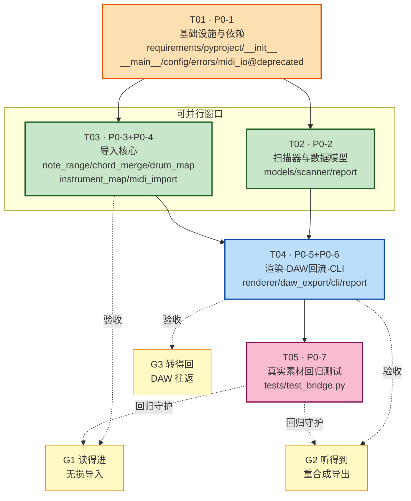

# BloodMusic × G:\midi 整合系统设计 —— 子包 `bridge`

| 项 | 值 |
|---|---|
| 文档版本 | v1.0 |
| 架构师 | 高见远（software-architect） |
| 上游输入 | PM 的 PRD + F1–F4 实测发现 + 主理人 Q1–Q7 决策 |
| 目标仓库 | `G:\tools\bloodmusic\`（BloodMusic v2.0.0） |
| 交付形态 | bloodmusic 子包 `bloodmusic/bridge/`（Q1 已拍板） |
| 本文性质 | **只做设计与任务分解，不含实现代码** |

---

## 0. 架构师补充实测（F5–F9）—— 推翻/修正了 3 条既有假设

> 我在设计前用自写的 SMF 二进制解析器（不依赖 mido）直接读了全部 6 个真实素材，
> 以下 5 条是 PRD 里没有、但**直接决定接口签名**的硬事实。请优先阅读。

### 素材实测数据（全部 6 个文件，逐轨）

| 文件 | PPQ | fmt/轨数 | 轨名 | program | channel | 音符数 | 音高域 | 同时发音分布 | 最小 onset 间隔 | 跨度 |
|---|---|---|---|---|---|---|---|---|---|---|
| `MusicStudio/…/Piano.mid` | **220** | 1 / 2 | Piano | 0 | 0 | 8 | 74–84 | `{1:8}` 纯单音 | 220 (=1拍) | 15.4 拍 |
| `MusicStudio/…/Drums.mid` | **220** | 1 / 2 | Drums | 0 | **9** | 28 | 36–42 | `{1:8, 2:4, 3:4}` | 220 (=1拍) | 15.4 拍 |
| `pro4/…/Bass_130406.mid` | **220** | 1 / 2 | Bass | **33** | 0 | 32 | 48–55 | `{1:32}` 纯单音 | 102–113 **非网格** | 15.x 拍 |
| `pro4/…/Chords_130406.mid` | **220** | 1 / 2 | Chords | 0 | 0 | 12 | 48–64 | **`{3:4}` 四个三和弦** | 880 (=4拍) | 15.8 拍 |
| `pro4/…/Drum Kit_130406.mid` | **220** | 1 / 2 | Drum Kit | 0 | **9** | 48 | 36–42 | `{1:16, 2:16}` | 110 (=1/2拍) | 15.7 拍 |
| `pro4/…/Piano_130406.mid` | **220** | 1 / 2 | Piano | 0 | 0 | 32 | 72–89 | `{1:32}` 纯单音 | 102–114 **非网格** | 15.x 拍 |

鼓件音高直方图（可直接做断言）：
- `Drums.mid` → `{36: 8, 38: 4, 42: 16}`（kick 8 / snare 4 / hihat 16，合计 **28**）
- `Drum Kit_130406.mid` → `{36: 8, 38: 8, 42: 32}`（合计 **48**）
- 两个鼓文件的**全部 onset 都是 55 ticks（=PPQ/4=十六分音符）的整数倍** → 16 步网格量化**零误差**。

### F5【严重】PPQ 是 220 不是 480 —— Q6 的「±30 ticks」不能写死

全部 6 个素材 `ticks_per_beat = 220`。主理人 Q6 的「±30 ticks（480 PPQ 下约 1/16 拍的 1/4）」
在 220 PPQ 下等于 **0.136 拍 ≈ 1/7 拍**，语义完全变了。

> **设计对策（必须采纳）**：`chord_tolerance_ticks` 默认值改为 **`None` → 运行时按 `round(ppq / 16)` 推导**。
> - 220 PPQ → 14 ticks（=1/16 拍）
> - 480 PPQ → **30 ticks（与 Q6 的原始数值完全吻合）**
>
> 即：Q6 的意图被完整保留，只是从「绝对 tick」升级为「PPQ 比例」，从而对任意分辨率的 MIDI 都正确。
> 显式传整数时仍以传入值为准（保留 Q6 的可配置性）。

### F6【利好】和弦是**严格同 tick** 的 —— 合并逻辑风险极低

`Chords_130406.mid` 的 4 个和弦 onset 分别在 tick `0 / 880 / 1760 / 2640`，每簇**恰好 3 个音**，
共 12 个音。tick 完全对齐，容差取 0 都能正确聚类。→ P0-3 可以给出**精确的无损断言**（见 §10）。

### F7【严重】Bass / Piano_130406 **未量化**，且必然出现负 gap

它们的 onset 间隔是 102、105、106、107…（人性化/摇摆），不落在任何网格上。
配合 F2 的「线性追加」缺陷，`start_tick - prev_end_tick` 会频繁为负 → 时值错乱。
→ `repair_negative_gaps()` 不是边界情况处理，而是**主路径必经步骤**。

### F8【严重】鼓跨度是 **4 小节（64 步）**，`DrumPattern.steps=16` 只能装 1 小节

两个鼓文件跨度都是 ~15.7 拍 ≈ **16 拍 = 4 小节 = 64 个十六分步**。
若照字面把 `steps` 固定为 16，将**直接丢弃 3/4 的鼓点数据**，与「不丢信息」的验收目标冲突。

> **设计对策**：把 Q7 的「16 步」重新解释为**每小节的网格分辨率**，另加 `drum_bar_policy`：
> - `"extend"`（**默认**）：`steps = 网格 × 小节数`（本例 = 64），信息**零丢失**；
>   `render_drum_pattern()` 的 `step_dur` 恒为 `beat/4`，对任意 `steps` 都正确 → **渲染侧仍零改造**。
> - `"fold"`：按小节 OR 折叠回 16 步（做 loop 素材时用）。
> - `"split"`：每小节输出一个 16 步 `DrumPattern`，命名 `<stem>_bar1..barN`。

### F9【中】Q7 的「可配 32 步」当前**渲染器不支持**

`music/pattern.py:180` 中 `render_drum_pattern()` 把 `step_dur` **硬编码为 `beat_dur / 4`**（十六分音符），
与 `pattern.steps` 无关。因此把网格改成 1/32 会让鼓点以 2 倍慢速播放。
→ 结论：**P0 期只支持 16 网格**；`--drum-grid 32` 参数保留但会返回 `error` 级 issue 并拒绝，
待 P1-7（新增，见 §11）为渲染器加一个可选 `step_div` 参数后再放开。**本期不改渲染器。**

### F10【中】`note_to_freq()` 对表外音符**静默返回 440Hz**

`core/note_utils.py::NOTES` 仅覆盖 **C0（MIDI 12）– C7（MIDI 96）**，且只收录了 `#`/`b` 到 B6；
`note_to_freq()` 查不到时 `return 440.0`——**不抛错、不告警**。
本期 6 个素材音高域 36–89 全部安全，但 DAW 回流（G3）后音高不可控。
→ 必须有 `bridge/note_range.py` 守卫层。**关键不对称**：
- 旋律轨可用 `notes[i] + octave_shifts[i]` 表达超界音高（渲染器算 `note_to_freq(note) * 2**oct`）；
- **和弦音不行**——`pattern.py:251` 的和弦分支只调 `note_to_freq(cn)`，**不施加 octave_shift**。
  故和弦音必须**折叠进 C0–C7**，并记 `warn` 级 issue。

### F11【中】现有 `export_music_to_midi()` 的和弦分支 tick 计算有 bug

`export/midi_export.py:181`：`start_ticks = int(chord_idx * sum(durations)/len(chords) * beat_dur * ticks_per_beat)`
——同时乘了 `beat_dur`(秒) 和 `ticks_per_beat`，量纲错误，和弦会被甩到极远的 tick 上。
→ P1-2 的 DAW 回流**不复用**该函数，`bridge/daw_export.py` 自带正确的写出器（鼓部分可安全复用 `MIDI_DRUM_MAP` 常量）。

### F12【低】`pyproject.toml` 的打包表是**手工枚举**的

`[tool.setuptools] packages = ["bloodmusic","core","effects","music","sfx","export","playback","gui"]`
+ 对应 `package-dir`。新增子包**必须同步加两行**，否则 `pip install -e .` 后 `bloodmusic.bridge` 不可导入。

---

## Part A：系统设计

## 1. 实现方案与框架选型

### 1.1 核心技术难点与对策

| # | 难点 | 对策 | 命中需求 |
|---|---|---|---|
| D1 | mido 未安装，`music/midi_io.py` 是**休眠代码**，其正确性未经任何验证 | 声明依赖 + 新写 `midi_to_patterns_v2`，**不继承旧实现的任何逻辑**；旧函数仅标 deprecated 保留签名 | P0-1 / Q2 |
| D2 | 素材树里混有 PyInstaller 打包噪声 | 目录名黑名单 + `os.walk` **就地剪枝**（`dirnames[:] = …`），整棵子树不进入遍历 | P0-2 |
| D3 | 和弦被压成琶音；PPQ 非标准；负 gap | 「**同时发音聚类**」抽象：`NoteEvent → NoteCluster → (notes, chords, durations)`；容差按 PPQ 比例推导（F5）；负 gap 截断修复（F7） | P0-3 |
| D4 | 鼓轨结构不兼容；跨度超 16 步 | 反转复用 `MIDI_DRUM_MAP`；十六分网格量化；`drum_bar_policy="extend"` 保长度（F8） | P0-4 |
| D5 | 音高超界静默变 440Hz | `note_range.py` 守卫：旋律用 `octave_shifts`，和弦**折叠**并告警（F10） | 全局 |
| D6 | 渲染器在 `duration_sec` 偏大时会**自动 tile**（`pattern.py:266`） | `estimate_duration_sec()` 由 pattern 时值**精确反推**，绝不用「拍脑袋时长」 | P0-5 |
| D7 | 历史资产不可污染 | `_assert_write_allowed()` 白/黑名单双重校验；默认 dry-run | Q3 |
| D8 | 批量作业里单文件失败会拖垮整体 | 每文件 try/except 隔离 → 降级为 `BridgeIssue(level="error")` 计入报告，**流程继续**，末尾汇总 | P1-4 |

### 1.2 框架选型

| 组件 | 选型 | 理由 |
|---|---|---|
| MIDI 解析/写出 | **mido >= 1.3, < 2.0** | 纯 Python、MIT、零编译、无运行时联网；`ticks_per_beat` / `merge_tracks` / `tempo2bpm` 即为本设计所需的全部能力。`python-rtmidi` 只有硬件实时端口才需要，本项目**不引入**。<br/>依据：mido 官方 API 文档（`mido.readthedocs.io/en/latest/api.html`，`DEFAULT_TICKS_PER_BEAT=480`、`tick2second/second2tick/bpm2tempo/tempo2bpm/merge_tracks` 签名） |
| 数值/音频 | numpy / scipy / soundfile | **沿用现有**，不新增 |
| CLI | `argparse` + 子命令 | 与 `bloodmusic/cli.py:343` 现有 `add_subparsers` 风格一致，零学习成本 |
| 数据建模 | `dataclasses` | 与 `music/pattern.py` 全仓风格一致 |
| 测试 | `unittest` | 与 `tests/test_export.py` 等现有 8 个测试文件风格一致（**不引入 pytest 专有 API**，但 `pyproject.toml` 已配 pytest，两者兼容） |
| 日志 | 标准库 `logging` | 离线、无依赖 |

### 1.3 架构模式：**四层单向管线（Pipeline）+ 反腐层（ACL）**

```
┌──────────────────────────── bloodmusic/bridge/ (新增) ────────────────────────────┐
│                                                                                    │
│  L4 编排层   cli.py  ·  __main__.py  ·  report.py                                  │
│                    │ 只做参数解析 / 调度 / 汇总，无业务逻辑                          │
│  ─────────────────┼────────────────────────────────────────────────────────────   │
│  L3 用例层   scanner.py   midi_import.py   renderer.py   daw_export.py             │
│                    │ 每个文件 = 一个 P0 用例，可独立测试                             │
│  ─────────────────┼────────────────────────────────────────────────────────────   │
│  L2 领域层   chord_merge.py  ·  drum_map.py  ·  note_range.py  ·  instrument_map.py │
│                    │ 纯函数，无 IO，无 mido 依赖 → 单测最容易                        │
│  ─────────────────┼────────────────────────────────────────────────────────────   │
│  L1 模型层   models.py  ·  config.py                                               │
└────────────────────┼───────────────────────────────────────────────────────────────┘
                     │  只出不进（bridge 依赖 bloodmusic 本体，本体不依赖 bridge）
                     ▼
   bloodmusic 现有资产（**零改造**，仅 midi_io.py 加 deprecated 注解）
   music/pattern.py : MusicPattern / DrumPattern / MultiTrackPattern
                      render_pattern_to_array / render_drum_pattern / render_multi_track
   export/batch.py  : export_audio（含 -1 dBFS 归一化 + 限幅）
   export/midi_export.py : MIDI_DRUM_MAP（被反转复用）
   core/            : OscType / EnvShape / note_to_freq / SR
```

**关键架构约束（写进 Shared Knowledge，工程师必须遵守）**：

1. **单向依赖**：`bridge/*` 可以 import `bloodmusic.music/core/export/effects`；**反向绝对禁止**。
2. **L2 领域层零 IO 零 mido**：`chord_merge / drum_map / note_range / instrument_map` 只接收
   `List[NoteEvent]` 这类纯数据，不碰文件、不 import mido → 单元测试无需任何素材文件、无需装 mido。
3. **mido 惰性导入**：只在 `midi_import.py` / `daw_export.py` 的**函数体内部** `import mido`。
   这样 `import bloodmusic` 与 `import bloodmusic.bridge` 在未装 mido 时仍成功（只在真正读写 MIDI 时报友好错误）。
4. **`bloodmusic/__init__.py` 不新增 `from .bridge import …`**：该文件当前会 eager import 全部子包，
   若加进去会让 mido 变成整个包的硬依赖，破坏现有用户。bridge 通过 `python -m bloodmusic.bridge`
   或 `from bloodmusic.bridge import …` 显式使用。

---

## 2. 文件列表（最终文件树）

> 对主理人给出的划分：**确认 7 项全部保留**，并基于 F5–F12 **补充 6 个模块**。
> 补充理由逐条标注在「新增理由」列。全部路径相对 `G:\tools\bloodmusic\`。

```
G:\tools\bloodmusic\
├── requirements.txt                      [改] +1 行
├── pyproject.toml                        [改] +3 处（dependencies / packages / package-dir）
│
├── bridge/                               [新增子包]
│   ├── __init__.py                       门面：re-export 公共 API + __all__ + BRIDGE_VERSION
│   ├── __main__.py                       python -m bloodmusic.bridge → cli.main()
│   ├── config.py                         BridgeConfig + 全部默认常量 + 只读根白名单
│   ├── models.py                         MidiAsset/NoteEvent/NoteCluster/TrackAnalysis/
│   │                                     ImportResult/RenderResult/BridgeIssue/BridgeReport
│   ├── errors.py                         BridgeError/MidoMissingError/BridgeWriteDenied/…
│   ├── scanner.py                        【P0-2】scan_midi_assets()
│   ├── note_range.py                     【F10 守卫】MIDI 音高 ↔ 可渲染音名 安全转换
│   ├── chord_merge.py                    【P0-3】同时发音聚类 + 负 gap 修复
│   ├── drum_map.py                       【P0-4】MIDI_DRUM_MAP 反转 + 网格量化 + 默认鼓音色
│   ├── instrument_map.py                 【P1-3】GM program → TonePreset
│   ├── midi_import.py                    【P0-3/4, P1-1/6】midi_to_patterns_v2() 主流程
│   ├── renderer.py                       【P0-5】复用 render_* + export_audio
│   ├── daw_export.py                     【P1-2】patterns_to_midi / export_to_daw
│   ├── report.py                         【P1-4】BridgeReport 构建 + JSON/MD 落盘 + logger
│   └── cli.py                            【P0-6】scan/import/render/export-to-daw/doctor
│
├── music/midi_io.py                      [改] 仅加 @deprecated + docstring 指向 bridge（不动逻辑）
│
├── tests/
│   └── test_bridge.py                    【P0-7】6 素材回归 + 领域层纯函数单测
│
├── bridge_output/                        [运行时生成] 默认输出根（Q3）
│   └── <midi_stem>/
│       ├── mix/<stem>.wav
│       ├── stems/<stem>__<track>.wav
│       ├── import.json                   ImportResult 快照
│       └── ...
├── bridge_output/report.json             批量结构化报告
├── bridge_output/report.md               批量人读报告
│
└── docs/
    ├── system_design.md                  本文
    ├── sequence-diagram.mermaid
    └── class-diagram.mermaid
```

### 2.1 对主理人原始划分的确认与修正

| 主理人指定 | 结论 | 说明 |
|---|---|---|
| `bridge/__init__.py` | ✅ 保留 | 收窄为门面，不含逻辑 |
| `bridge/scanner.py` | ✅ 保留 | 原样 |
| `bridge/midi_import.py` | ✅ 保留，但**拆薄** | 和弦/鼓/音高/音色 4 块下沉到 L2，本文件只留编排；否则单文件 600+ 行且无法脱离素材做单测 |
| `bridge/renderer.py` | ✅ 保留 | 原样 |
| `bridge/cli.py` | ✅ 保留 | export-to-daw 的**实现**移到 `daw_export.py`，cli 只做参数装配 |
| `bridge/__main__.py` | ✅ 保留 | 原样 |
| `midi_io.py` deprecated + 依赖增量 | ✅ 保留 | 见 §2.2 / §2.3 |
| `tests/test_bridge.py` | ✅ 保留 | 原样 |

| 新增模块 | 新增理由（关联发现） |
|---|---|
| `config.py` | Q3/Q4/Q6/Q7 全是可配项；散落在各文件会导致默认值漂移。集中一处便于 QA 核对 |
| `models.py` | `ImportResult` 是跨 4 个模块的契约，必须独立以免循环 import |
| `errors.py` | 「扫描/导入失败不中断」要求可分辨的异常类型，否则只能裸 `except Exception` |
| `note_range.py` | **F10**：440Hz 静默降级是隐蔽的音质事故，必须有守卫层 |
| `chord_merge.py` | **F6/F7**：聚类+负 gap 是纯算法，独立后可用构造数据做单测，不依赖 mido |
| `drum_map.py` | **F8/F9**：反转映射 + 网格策略是纯算法，同上 |
| `instrument_map.py` | **P1-3**；且 Bass_130406 的 `program=33` 已提供真实验证数据 |
| `daw_export.py` | **F11**：现有 `export_music_to_midi` 和弦分支有 bug，必须自带写出器；且写盘鉴权逻辑集中一处 |
| `report.py` | P1-4；且 P0 阶段就需要统一 logger 格式 |

### 2.2 `music/midi_io.py` 改造说明（**只加注解，不改逻辑**）

| 位置 | 改动 |
|---|---|
| 模块 docstring 顶部 | 追加 `.. deprecated:: 2.1` 段落：说明 `midi_to_patterns` 会把和弦压成琶音（F2）、鼓轨按旋律导入（F3），请改用 `bloodmusic.bridge.midi_to_patterns_v2` |
| `midi_to_patterns()` | 函数体**首行**加 `warnings.warn(..., DeprecationWarning, stacklevel=2)`；docstring 加 `.. deprecated::` |
| `music_pattern_to_midi()` / `drum_pattern_to_midi()` / `song_to_midi()` | **不动**（导出侧无已知缺陷，仍在用） |
| 逻辑代码 | **一行不改**（Q2：不破坏潜在调用方） |

> 注：Python 无内置 `@deprecated` 装饰器（`warnings.deprecated` 需 3.13+，本项目 `requires-python>=3.10`）。
> → 统一用 `warnings.warn(msg, DeprecationWarning, stacklevel=2)`，**禁止**为此引入 `Deprecated` 三方包。

### 2.3 `requirements.txt` / `pyproject.toml` 增量（P0-1）

**`requirements.txt`** —— 追加 1 行（保持现有 `>=` 风格）：
```diff
  numpy>=1.24
  scipy>=1.10
  sounddevice>=0.4
  soundfile>=0.12
  PyYAML>=6.0
+ mido>=1.3,<2.0
```

**`pyproject.toml`** —— 3 处改动（**F12：packages/package-dir 是手工枚举，漏改则子包不可导入**）：
```diff
  [project]
  dependencies = [
      "numpy>=1.24",
      "scipy>=1.10",
      "sounddevice>=0.4.6",
      "soundfile>=0.12.1",
+     "mido>=1.3,<2.0",
  ]

  [tool.setuptools]
- packages = ["bloodmusic", "core", "effects", "music", "sfx", "export", "playback", "gui"]
+ packages = ["bloodmusic", "core", "effects", "music", "sfx", "export", "playback", "gui", "bridge"]

  [tool.setuptools.package-dir]
  bloodmusic = "."
  ...
  gui = "gui"
+ bridge = "bridge"
```
> 顺带记录（不在本期修）：`requirements.txt` 有 `PyYAML` 而 `pyproject.toml` 没有，两者已不同步。
> 本期只按上表最小增量改，**不做顺带修复**，避免扩大变更面。

---

## 3. 数据结构与接口

> 完整类图见 `docs/class-diagram.mermaid`。以下给出**工程师直接照抄的签名契约**。
> 所有 `dataclass`；`Path` 一律用 `pathlib.Path`；对外 API 参数一律 **keyword-only（`*`）** 以便后续扩展不破坏调用方。

### 3.1 `bridge/models.py`

```python
@dataclass(frozen=True, slots=True)
class MidiAsset:
    path: Path            # 绝对路径
    name: str             # 文件名（不含扩展名），如 "Drum Kit_130406"
    rel_path: str         # 相对扫描根，POSIX 分隔符，用于稳定排序与报告
    source_group: str     # 相对根的首级目录名，如 "MusicStudio" / "pro4"
    size_bytes: int
    mtime_ns: int

@dataclass(slots=True)
class NoteEvent:
    start_tick: int
    end_tick: int
    midi_note: int        # 0–127
    velocity: int         # 1–127（note_on velocity）
    channel: int          # 0–15；9 = GM 鼓
    track_index: int
    @property
    def duration_ticks(self) -> int: ...
    @property
    def is_drum(self) -> bool: ...          # channel == 9

@dataclass(slots=True)
class NoteCluster:
    """一个「同时发音簇」：单音时 size==1，和弦时 size>=2。"""
    start_tick: int
    end_tick: int                            # 修复负 gap 后的最终时值
    members: list[NoteEvent]                 # 按 midi_note 升序
    @property
    def root(self) -> NoteEvent: ...         # members[0]，最低音
    @property
    def upper(self) -> list[NoteEvent]: ...  # members[1:]
    @property
    def size(self) -> int: ...
    @property
    def mean_velocity(self) -> float: ...

@dataclass(slots=True)
class TrackAnalysis:
    track_index: int
    name: str                                # track_name meta，缺省 f"track_{i}"
    channel: int | None
    program: int | None                      # program_change，缺省 None
    is_drum: bool
    kind: Literal["melody", "chord", "drum", "empty"]
    note_count: int
    max_polyphony: int
    pitch_min: int | None
    pitch_max: int | None
    span_ticks: int

@dataclass(slots=True)
class BridgeIssue:
    level: Literal["info", "warn", "error"]
    code: str                                # 见 §9.4 错误码表
    message: str                             # 简体中文，人读
    context: dict = field(default_factory=dict)

@dataclass(slots=True)
class ImportResult:
    source: Path
    bpm: int
    ticks_per_beat: int
    total_beats: float                       # 全轨对齐后的统一时间轴长度（P1-6）
    melody_patterns: list[MusicPattern] = field(default_factory=list)
    chord_patterns:  list[MusicPattern] = field(default_factory=list)
    drum_patterns:   list[DrumPattern]  = field(default_factory=list)
    multi_track:     MultiTrackPattern | None = None    # 「full」：全轨装配体
    analyses: list[TrackAnalysis] = field(default_factory=list)
    issues:   list[BridgeIssue]   = field(default_factory=list)
    @property
    def ok(self) -> bool: ...                # 无 level=="error" 的 issue
    @property
    def all_music_patterns(self) -> list[MusicPattern]: ...   # melody + chord
    @property
    def duration_sec(self) -> float: ...     # total_beats * 60 / bpm
    def to_dict(self) -> dict: ...           # 供 import.json / report.json

@dataclass(slots=True)
class RenderResult:
    source: Path
    audio_files: list[Path]
    duration_sec: float
    fmt: str
    issues: list[BridgeIssue] = field(default_factory=list)

@dataclass(slots=True)
class BridgeReport:
    root: Path
    scanned: list[MidiAsset]
    imported: list[ImportResult]
    rendered: list[RenderResult]
    issues: list[BridgeIssue]
    elapsed_sec: float
    def summary(self) -> dict: ...           # {scanned, ok, failed, warn, audio_files}
    def to_json(self) -> str: ...
    def to_markdown(self) -> str: ...
```

### 3.2 `bridge/config.py`

```python
# ── 输出（Q3）──
DEFAULT_OUTPUT_ROOT: Path = Path(__file__).resolve().parent.parent / "bridge_output"
# ── 只读硬规则（Q3）：默认绝不写入这些根之下 ──
DEFAULT_READONLY_ROOTS: tuple[Path, ...] = (Path("G:/midi"),)
# ── 和弦（Q6 + F5）──
CHORD_TOLERANCE_DIVISOR: int = 16            # tol = round(ppq / 16) → 220→14, 480→30
CHORD_MIN_NOTES: int = 2
# ── 鼓（Q7 + F8/F9）──
DEFAULT_DRUM_GRID: int = 16                  # 每小节步数；本期仅支持 16（F9）
SUPPORTED_DRUM_GRIDS: frozenset[int] = frozenset({16})
DEFAULT_DRUM_BAR_POLICY: str = "extend"      # extend | fold | split
BEATS_PER_BAR: int = 4                       # 无 time_signature 时的假设
# ── 时值 ──
MIN_NOTE_BEATS: float = 1 / 64               # 防 0 采样
DURATION_ROUND: int = 4                      # round(x, 4) 拍，避免浮点噪声

@dataclass
class BridgeConfig:
    output_root: Path = DEFAULT_OUTPUT_ROOT
    chord_tolerance_ticks: int | None = None     # None → 按 PPQ 推导
    drum_grid: int = DEFAULT_DRUM_GRID
    drum_bar_policy: str = DEFAULT_DRUM_BAR_POLICY
    audio_format: str = "wav"                    # wav | ogg | flac
    render_mode: str = "both"                    # mix | stems | both
    velocity_to_volume: bool = True              # P1-1
    instrument_preset: bool = True               # P1-3
    exclude_dirs: frozenset[str] = DEFAULT_EXCLUDE_DIRS
    readonly_roots: tuple[Path, ...] = DEFAULT_READONLY_ROOTS
    allow_daw_write: bool = False                # 仅 export-to-daw --apply 置 True
    strict: bool = False                         # True → 首个 error 即中止
    @classmethod
    def from_args(cls, ns: argparse.Namespace) -> "BridgeConfig": ...
```

### 3.3 `bridge/scanner.py`（P0-2）

```python
DEFAULT_EXCLUDE_DIRS: frozenset[str] = frozenset({
    # PRD 明确要求的 4 个
    "dist", "_internal", "build", "site-packages",
    # 同类打包/环境噪声（同样必须排除，否则未来素材树会出问题）
    "__pycache__", ".git", ".svn", "node_modules",
    "venv", ".venv", "env", ".tox", ".mypy_cache", ".pytest_cache",
})
DEFAULT_MIDI_SUFFIXES: tuple[str, ...] = (".mid", ".midi")

def is_excluded(rel_parts: Sequence[str], exclude_dirs: Collection[str]) -> bool:
    """路径任一级目录名（小写）命中黑名单，或以 '.egg-info' 结尾 → True。"""

def scan_midi_assets(
    root: str | Path,
    *,
    exclude_dirs: Collection[str] = DEFAULT_EXCLUDE_DIRS,
    suffixes: Sequence[str] = DEFAULT_MIDI_SUFFIXES,
    min_size_bytes: int = 1,
    follow_symlinks: bool = False,
) -> list[MidiAsset]:
    """递归扫描 root 下的 MIDI 资产。

    实现要点（工程师必须遵守）：
      1. 用 os.walk(topdown=True) 并 **就地** 修改 dirnames：
             dirnames[:] = [d for d in dirnames if d.lower() not in ex and not d.lower().endswith(".egg-info")]
         —— 剪枝整棵子树，比「先收集后过滤」快且不会漏。
      2. 扩展名比较用 .lower()，兼容 .MID。
      3. 返回值按 rel_path 升序排序 → 结果确定性，测试可稳定断言。
      4. root 不存在 → 抛 BridgeScanError；root 是文件且是 .mid → 返回单元素列表（便于 --file 复用）。
      5. 只读操作，不创建任何目录。

    验收（P0-2）：scan_midi_assets(r"G:\\midi") 的 len() == 6，
                 且不包含 pro4/.../dist/.../MIDI_sample.mid。
    """
```

### 3.4 `bridge/note_range.py`（F10 守卫）

```python
MIN_SUPPORTED_MIDI: int = 12     # C0，NOTES 表下界
MAX_SUPPORTED_MIDI: int = 96     # C7，NOTES 表上界（C#7 起表中已无）
SHARP_NAMES: tuple[str, ...] = ("C","C#","D","D#","E","F","F#","G","G#","A","A#","B")

def midi_to_note_name(midi_note: int) -> str:
    """60 → 'C4'。纯算术，不校验是否在 NOTES 表内。"""

def is_renderable(note_name: str) -> bool:
    """note_name 是否存在于 core.note_utils.NOTES（决定是否会静默降级到 440Hz）。"""

def safe_note_and_shift(midi_note: int) -> tuple[str, int]:
    """→ (可渲染音名, octave_shift)。用于 **旋律轨**。
    超界时按八度平移进 [C0, C7]，把差额放进 octave_shift；
    渲染器算 note_to_freq(name) * 2**shift，音高**完全无损**。"""

def fold_into_range(midi_note: int) -> tuple[str, int]:
    """→ (可渲染音名, 被折叠的八度数)。用于 **和弦音**。
    因 pattern.py:251 的和弦分支不施加 octave_shift，超界音只能折叠，
    folded != 0 时调用方必须记 BridgeIssue('warn','CHORD_PITCH_FOLDED')。"""
```

### 3.5 `bridge/chord_merge.py`（P0-3）

```python
def default_chord_tolerance(ticks_per_beat: int) -> int:
    """F5：tol = max(1, round(ppq / CHORD_TOLERANCE_DIVISOR))。
    220 → 14（=1/16 拍）；480 → 30（与 Q6 原始默认值一致）。"""

def cluster_simultaneous(
    events: Sequence[NoteEvent],
    tolerance_ticks: int,
) -> list[NoteCluster]:
    """把「几乎同时」的音符归为一簇。

    算法（单趟，O(n log n) 仅排序）：
      1. events 按 (start_tick, midi_note) 升序；
      2. 顺序扫描，若 ev.start_tick - cluster.start_tick <= tolerance_ticks → 并入当前簇；
         否则收口当前簇、开新簇；
      3. **簇锚点固定为簇内第一个音的 start_tick**（不用滑动均值，避免容差链式漂移：
         否则 n 个间隔 tol 的音会被串成一大簇）；
      4. 簇 end_tick = max(m.end_tick for m in members)（取最长音，保住延音踏板效果）;
      5. members 按 midi_note 升序 → root 恒为最低音。
    """

def repair_negative_gaps(clusters: list[NoteCluster]) -> list[BridgeIssue]:
    """F7：**原地**修复 legato 重叠。
    对相邻簇 cur/next：若 cur.end_tick > next.start_tick →
        cur.end_tick = next.start_tick，记 issue('info','OVERLAP_TRUNCATED')。
    若截断后 cur 时值 < MIN_NOTE_BEATS 对应 ticks → 记 issue('warn','NOTE_TOO_SHORT') 并 clamp。
    返回 issues 列表（调用方汇总，不抛异常）。"""

def clusters_to_pattern_fields(
    clusters: Sequence[NoteCluster],
    ticks_per_beat: int,
    *,
    chord_min_notes: int = 2,
) -> ChordFields:      # NamedTuple(notes, durations, chords, octave_shifts, velocities, issues)
    """把簇序列翻译成 MusicPattern 的四个平行数组。

    **核心契约（决定 P0-3 是否无损）**：
      - notes[i]        = safe_note_and_shift(cluster.root)[0]      ← 最低音，全音量渲染
      - octave_shifts[i]= safe_note_and_shift(cluster.root)[1]
      - chords[i]       = [fold_into_range(u)[0] for u in cluster.upper]   ← 上方音，0.5 音量
                          单音簇 → chords[i] == []（渲染器对空列表安全跳过）
      - durations[i]    = round(cluster 时值 / ppq, 4) 拍，下限 MIN_NOTE_BEATS
      - velocities[i]   = cluster.mean_velocity（P1-1 用）
      - 簇间 gap > 0 → 插入 notes=None 的休止，并**拆成 ≤ 1.0 拍的块**
        （沿用旧实现的合理部分，避免单个超长休止破坏节奏感知）
      - **len(notes) == len(durations) == len(chords) == len(octave_shifts)**
        —— MusicPattern.__post_init__(pattern.py:65) 会强校验前两者，chords 必须同步等长，
           因为渲染器用 `chords[idx % len(chords)]` 按下标取（pattern.py:247）。

    无损性：sum(1 for n in notes if n) + sum(len(c) for c in chords) == 原始音符总数。
    """
```

> **为什么 root 放 `notes` 而不是 `notes=None` + 全部塞 `chords`？**
> ① `notes` 分支享有 `octave_shifts`/vibrato/humanize（和弦分支没有）→ 根音音高无损（F10）；
> ② 根音全音量、上方音 0.5 音量，恰好是钢琴/吉他和弦的自然配重；
> ③ 便于 P1-2 反向写 MIDI 时无歧义重建。

### 3.6 `bridge/drum_map.py`（P0-4）

```python
CANONICAL_DRUM_NOTES: dict[int, str] = {
    36: "kick", 38: "snare", 39: "clap", 42: "hihat", 44: "hihat_pedal",
    46: "hihat_open", 41: "low_tom", 45: "mid_tom", 48: "high_tom",
    49: "crash", 51: "ride", 37: "rimshot", 56: "cowbell",
    54: "tambourine", 70: "shaker",
}   # ← 由 export/midi_export.py::MIDI_DRUM_MAP 反转而来的**规范名**优先表

def build_reverse_drum_map(extra: dict[str, int] | None = None) -> dict[int, str]:
    """反转 MIDI_DRUM_MAP（一对多别名 → 一个规范名）。
    MIDI_DRUM_MAP 里 36 同时对应 kick/bass_drum/bd，反转必须消歧：
    先用 CANONICAL_DRUM_NOTES 覆盖，再补 MIDI_DRUM_MAP 中未覆盖的音符号。"""

def midi_note_to_drum_track(midi_note: int, reverse_map: dict[int, str] | None = None) -> str:
    """未知音符号 → f"perc_{midi_note}"（**不丢弃**，保证鼓无损；
    调用方记 issue('info','UNMAPPED_DRUM_NOTE')）。"""

def quantize_to_steps(
    events: Sequence[NoteEvent],
    ticks_per_beat: int,
    *,
    grid: int = 16,                       # 每小节步数；本期仅 16（F9）
    beats_per_bar: int = 4,
    policy: Literal["extend", "fold", "split"] = "extend",
) -> DrumGrid:   # NamedTuple(tracks: dict[str, list[bool]], steps: int, bars: int, issues)
    """MIDI 鼓事件 → DrumPattern.tracks 步进矩阵。

    要点：
      - step_ticks = ticks_per_beat * beats_per_bar / grid   （220*4/16 = 55）
      - step_index = round(start_tick / step_ticks)          （四舍五入，非截断）
      - 量化误差 |start_tick - step_index*step_ticks| > step_ticks*0.25
            → issue('warn','DRUM_QUANTIZE_DRIFT')  （实测 6 素材误差恒为 0）
      - policy="extend"（默认）: bars = ceil((max_step+1)/grid); steps = bars*grid
            → Drums.mid / Drum Kit_130406.mid 均得 steps = 64（F8，信息零丢失）
      - policy="fold": steps = grid，各小节按位 OR
      - policy="split": 返回 bars 组，每组 steps = grid（由调用方生成多个 DrumPattern）
      - grid not in SUPPORTED_DRUM_GRIDS → issue('error','DRUM_GRID_UNSUPPORTED') 并回退 16（F9）
      - 同一步同一鼓件重复触发 → 保持 True（step 是布尔，天然去重），
        但若被去重的事件数 > 0 → issue('info','DRUM_STEP_COLLAPSED')
    """

def default_drum_sounds(track_names: Iterable[str]) -> dict[str, DrumSoundParams]:
    """为每个鼓轨给出 DrumSoundParams。数值直接沿用 music/presets.py:255-257 的基线：
       kick  = DrumSoundParams(SINE,       55,  0.22, vol 0.8)
       snare = DrumSoundParams(NOISE_WHITE,180, 0.15, hp 250, vol 0.65)
       hihat = DrumSoundParams(NOISE_WHITE,8000,0.06, hp 1500, vol 0.35)
       其余鼓件给合理外推值；未知 perc_* → NOISE_WHITE 通用值。
    必须为 tracks 中**每一个** key 都提供 sounds，否则 DrumPattern.__post_init__
    (pattern.py:118) 会 warnings.warn。"""
```

### 3.7 `bridge/instrument_map.py`（P1-3）

```python
@dataclass(frozen=True, slots=True)
class TonePreset:
    osc_type: OscType = OscType.TRIANGLE
    volume: float = 0.16
    env_shape: EnvShape = EnvShape.PAD
    harmonics: tuple[tuple[float, float], ...] = ()
    reverb_mix: float = 0.15
    reverb_decay: float = 0.8
    stereo_width: float = 0.3
    lp_filter_hz: float | None = None
    vibrato_rate: float = 0.0
    vibrato_depth: float = 0.0
    def apply_to(self, p: MusicPattern) -> MusicPattern: ...   # dataclasses.replace

GM_FAMILY_PRESETS: dict[int, TonePreset]     # key = program // 8，共 16 族
NAME_HINT_PRESETS: dict[str, TonePreset]     # 轨名关键字兜底: bass/chord/pad/lead/piano/drum

def preset_for_program(program: int | None) -> TonePreset | None: ...
def preset_for_name(track_name: str) -> TonePreset | None: ...
def resolve_preset(analysis: TrackAnalysis) -> TonePreset:
    """优先级：program → 轨名关键字 → 默认。
    真实验证数据：Bass_130406 program=33 → family 4（Bass）→ 低通 + SAW/TRIANGLE + PLUCK；
                 Piano/Chords program=0 → family 0（Piano）→ TRIANGLE + PLUCK + 轻混响。"""
```

### 3.8 `bridge/midi_import.py`（P0-3/4 主流程）

```python
def midi_to_patterns_v2(
    path: str | Path,
    *,
    bpm: int | None = None,                       # None → 从 set_tempo 读，缺省 120
    chord_tolerance_ticks: int | None = None,     # None → default_chord_tolerance(ppq)  ← F5
    drum_steps: int = 16,                         # = 每小节网格；别名保留主理人用词
    drum_bar_policy: str = "extend",              # extend | fold | split                ← F8
    chord_min_notes: int = 2,
    velocity_to_volume: bool = True,              # P1-1
    instrument_preset: bool = True,               # P1-3
    name_prefix: str | None = None,               # 默认取文件名 stem
    strict: bool = False,
) -> ImportResult:
    """【本期核心 API】无损导入一个 MIDI 文件为 bloodmusic 内部类型。

    流程：
      1. import mido（惰性）；失败 → raise MidoMissingError（含 pip 提示）
      2. mid = mido.MidiFile(path)；ppq = mid.ticks_per_beat
      3. _detect_bpm：**遍历全部轨**找第一个 set_tempo（实测 tempo 在 track0、音符在 track1，
         只扫 track0 或只扫首轨都会漏）→ int(round(mido.tempo2bpm(tempo)))；
         出现 >1 个不同 tempo → issue('warn','MULTIPLE_TEMPO')，取首个
      4. _read_events：**逐轨**累加 msg.time（delta ticks）为绝对 tick；
         note_on(v>0) 入栈，note_off / note_on(v==0) 出栈配对；
         轨末仍在栈中的音 → 用轨末 tick 收口 + issue('warn','UNCLOSED_NOTE')；
         同音高重复 note_on → 用 **栈（list）** 而非 dict，防止覆盖丢音
      5. _classify_track → TrackAnalysis.kind：
            note_count == 0                      → "empty"（跳过，不产 pattern）
            channel == 9 或 轨名含 drum/perc/kit → "drum"
            max_polyphony >= chord_min_notes     → "chord"
            否则                                  → "melody"
      6. drum  → drum_map.quantize_to_steps + default_drum_sounds → DrumPattern
         其余  → chord_merge.cluster_simultaneous → repair_negative_gaps
                 → clusters_to_pattern_fields → MusicPattern
      7. P1-1：velocity_to_volume=True 时，pattern.volume = base_vol *
               clamp(mean_velocity/100, 0.5, 1.3)（**轨级**缩放；
               MusicPattern 无逐音力度字段，逐音力度记入 ImportResult.to_dict 以备 P1-2 回写）
      8. P1-6：total_beats = ceil(全轨 max_end_tick / ppq / 4) * 4（对齐到小节），
               所有 pattern.bpm 统一、loop=False
      9. _assemble_multi_track：MultiTrackPattern(music_tracks=melody+chord,
               drum_track=drum_patterns[0] if drum_patterns else None)
               —— **注意 MultiTrackPattern 只有 1 个 drum_track 槽**（pattern.py:133）；
                  多鼓轨时取第一个进 multi_track，其余仍在 drum_patterns 里可单独渲染，
                  并记 issue('warn','MULTI_DRUM_TRACK_TRUNCATED')
     10. 全程 issue 累积，**不抛异常**（strict=True 时遇 error 才抛）
    """

def import_assets(
    assets: Sequence[MidiAsset], cfg: BridgeConfig
) -> tuple[list[ImportResult], list[BridgeIssue]]:
    """批量导入。**单文件异常隔离**：捕获后转 BridgeIssue('error', 'IMPORT_FAILED')，
    继续处理下一个，末尾统一返回。"""
```

### 3.9 `bridge/renderer.py`（P0-5）

```python
def estimate_duration_sec(result: ImportResult) -> float:
    """total_beats * 60 / bpm。
    **必须精确**：render_pattern_to_array (pattern.py:266-268) 在 target_len > 信号长度时
    会 np.tile 自动重复，给个「大概时长」会导致乐句无故循环。"""

def render_patterns(
    patterns: Sequence[MusicPattern | DrumPattern],
    out_dir: str | Path,
    *,
    fmt: str = "wav",
    duration_sec: float | None = None,
    preset: TonePreset | None = None,
    filename_prefix: str = "",
) -> list[Path]:
    """逐 pattern 渲染并落盘（stems）。
    MusicPattern → render_pattern_to_array；DrumPattern → render_drum_pattern；
    统一交 export/batch.py::export_audio（内含 -1 dBFS 归一化 + 限幅，**不要自己再归一化**）。
    out_dir 不存在则创建（export_audio 已 mkdir(parents=True)）。"""

def render_import_result(
    result: ImportResult,
    out_dir: str | Path | None = None,          # None → cfg.output_root / result.source.stem
    *,
    fmt: str = "wav",
    mode: Literal["mix", "stems", "both"] = "both",
    duration_sec: float | None = None,
) -> RenderResult:
    """mix  → render_multi_track(result.multi_track, dur) → out/mix/<stem>.<fmt>
       stems→ 每轨单独 → out/stems/<stem>__<track>.<fmt>
       同时写 out/import.json（ImportResult.to_dict）"""

def render_batch(
    results: Sequence[ImportResult], out_root: str | Path, *, fmt: str = "wav",
    mode: str = "both",
) -> list[RenderResult]:
    """单文件失败隔离，同 import_assets。"""
```

### 3.10 `bridge/daw_export.py`（P1-2）

```python
DEFAULT_DAW_MIDI_DIRS: tuple[str, ...] = (
    r"G:\midi\MusicStudio\Data\MIDI",
    r"G:\midi\pro4\MusicStudioPro\Data\MIDI",
)   # 接点依据：G:\midi\MusicStudio\Engine\gui\daw_window.py:238
    # Data/Instruments(JSON) → batch_json_to_midi → **Data/MIDI** → batch_synthesize → Data/Audio

def patterns_to_midi(
    result: ImportResult, out_path: str | Path, *,
    ticks_per_beat: int = 480, program_map: dict[str, int] | None = None,
) -> Path:
    """自带写出器（**不复用 export_music_to_midi 的和弦分支——F11 有量纲 bug**）。
       - type=1 多轨；track0 只放 set_tempo；
       - 旋律/和弦轨：notes[i] 与 chords[i] 全部在**同一 tick** note_on，同 tick note_off；
       - 鼓轨：正向复用 export/midi_export.py::MIDI_DRUM_MAP，channel=9，step_ticks=ppq//4。"""

def export_to_daw(
    result: ImportResult, daw_midi_dir: str | Path, *,
    prefix: str = "bm_", apply: bool = False, overwrite: bool = False,
    cfg: BridgeConfig | None = None,
) -> list[Path]:
    """写 MIDI 到 DAW 的 Data/MIDI，DAW 自动接管，**不改 DAW 一行代码**。
       - apply=False（默认）→ dry-run，只返回「将写入」的路径清单；
       - _assert_write_allowed()：目标必须 (a) 显式传入 且 (b) cfg.allow_daw_write=True；
         否则位于 readonly_roots 之下一律 raise BridgeWriteDenied（Q3 硬规则）；
       - 文件名统一加 prefix 'bm_'，与 DAW 原有素材物理隔离，避免覆盖历史资产。"""
```

### 3.11 `bridge/cli.py`（P0-6）+ `__main__.py`

```python
def build_parser() -> argparse.ArgumentParser: ...
def main(argv: Sequence[str] | None = None) -> int: ...   # __main__.py: raise SystemExit(main())
```

| 子命令 | 关键参数 | 行为 | 退出码 |
|---|---|---|---|
| `doctor` | — | 检查 mido 可用性/版本、`bridge_output` 可写、只读根命中情况 | 0 / 1 |
| `scan` | `--root`、`--exclude`（可重复）、`--json` | 打印资产表；`--json` 输出机读 | 0 / 1 |
| `import` | `--root` \| `--file`、`--chord-tolerance`、`--drum-grid`、`--drum-bar-policy`、`--out`、`--json` | 导入并写 `import.json`，打印每文件轨道摘要 | 0 / 2 |
| `render` | 同上 + `--format {wav,ogg,flac}`、`--mode {mix,stems,both}`、`--duration` | scan→import→render 全链路 | 0 / 2 |
| `export-to-daw` | `--file`、`--daw-dir`、`--prefix`、`--apply`、`--overwrite` | 默认 dry-run，`--apply` 才落盘 | 0 / 1 / 2 |

**退出码约定**：`0`=全成功；`1`=环境/参数错误（未装 mido、root 不存在、写盘被拒）；`2`=流程跑完但存在 `error` 级 issue（部分失败）。

---

## 4. 程序调用流程（时序图）

完整时序见 `docs/sequence-diagram.mermaid`（覆盖 doctor / scan / import / render / report / export-to-daw 六段）。核心链路速览：

```
CLI ─▶ BridgeConfig.from_args
    ─▶ scan_midi_assets(G:\midi)                       → 6 × MidiAsset
    ─▶ for asset: midi_to_patterns_v2(asset.path)
            ├─ mido.MidiFile → ppq=220, bpm=120
            ├─ _read_events → List[NoteEvent]
            ├─ _classify_track → melody | chord | drum
            ├─ [chord] cluster_simultaneous(tol=round(220/16)=14)
            │           → repair_negative_gaps → clusters_to_pattern_fields
            │           → MusicPattern(notes=根音, chords=上方音, octave_shifts)
            ├─ [drum ] quantize_to_steps(grid=16, policy=extend)
            │           → DrumPattern(steps=64, tracks, sounds)
            └─ _assemble_multi_track → MultiTrackPattern
    ─▶ render_import_result
            ├─ estimate_duration_sec = total_beats × 60/bpm   (16 拍 @120 → 8.0s)
            ├─ render_multi_track / render_pattern_to_array / render_drum_pattern   ← 现有，零改造
            └─ export_audio(-1 dBFS 归一化+限幅)               ← 现有，零改造
    ─▶ build_report → report.json / report.md
    ─▶ [可选] export_to_daw --apply → Data/MIDI/bm_*.mid → DAW 流水线自动接管
```

---

## 5. 待明确事项（Anything UNCLEAR）

### 5.1 需要主理人拍板（我已给推荐值，默认按推荐执行）

| # | 事项 | 我的推荐 | 影响 |
|---|---|---|---|
| U1 | **Q6 容差改为 PPQ 比例**（F5）：`round(ppq/16)`，220→14、480→30 | **强烈建议采纳**。写死 30 在 220 PPQ 下语义漂移 4.4 倍 | 和弦聚类正确性 |
| U2 | **Q7 的 16 步重定义为「每小节网格」+ `drum_bar_policy="extend"`**（F8） | **强烈建议采纳**。否则鼓点丢 3/4 数据，与验收目标直接冲突 | 鼓无损 |
| U3 | **Q7 的「可配 32 步」本期不放开**（F9，渲染器 `step_dur` 硬编码 beat/4） | 本期拒绝 + 明确报错；另立 **P1-7** 给渲染器加 `step_div` 参数 | 是否守住「渲染侧零改造」 |
| U4 | 和弦渲染配重：根音全音量 + 上方音 0.5 音量（渲染器写死 `*0.5`，pattern.py:256） | 接受现状，本期不调；如需均衡需改渲染器 | 音色主观感受 |
| U5 | `multi_track` 只能挂 1 个鼓轨（pattern.py:133） | 取第一个 + 告警；其余鼓轨仍可单独渲染成 stem | 多鼓轨文件（本期 6 素材均只有 1 个鼓轨，**无实际影响**） |

### 5.2 需要工程师在编码阶段用真实素材标定

| # | 事项 | 标定方法 | 兜底 |
|---|---|---|---|
| C1 | 和弦容差最终值 | 对 `Chords_130406.mid` 扫 tol ∈ {0,7,14,28,55}，验证恒为「4 簇 × 3 音」；对 `Bass/Piano_130406`（非量化，F7）验证**不会误合并**（应恒为 32 个单音簇） | `round(ppq/16)` |
| C2 | 鼓量化误差阈值 | 实测 6 素材 onset 全为 55 的整数倍，误差应恒为 0；若非 0 说明实现有 bug | `step_ticks*0.25` |
| C3 | `TonePreset` 16 族初版数值 | 先只精调 4 族（piano=0 / bass=4 / 已知素材覆盖），其余给保守默认；用 A/B 试听定 | `music/presets.py` 现有数值外推 |
| C4 | P1-1 力度→音量曲线 | 实测 velocity 域 60–95（`Drums.mid`）、76–91（`Chords`）；线性映射易过平，建议 `clamp(v/100, 0.5, 1.3)` 后试听 | 线性 |
| C5 | 长休止拆分块大小（当前沿用 ≤1.0 拍） | 对 6 素材观察 gap 分布 | 1.0 拍 |
| C6 | `beats_per_bar` | 6 素材均无 `time_signature` meta，假设 4/4；若未来素材有则读 meta | 4 |

### 5.3 已明确排除（不在本期范围）

- **F4 SoundFont**：`music/sampler.py` 仅支持 .wav，无 sf2 解析器 → 本期不做，P2 独立立项（Q5）。
- 不修 `export_music_to_midi` 的和弦 bug（F11）—— 只**绕开**，避免改动本体导出侧扩大回归面。
- 不修 `requirements.txt` / `pyproject.toml` 的 PyYAML 不同步问题（F12 附记）。
- 不动 `bloodmusic/__init__.py`（避免 mido 变成全包硬依赖）。

---

## Part B：任务分解

## 6. 依赖包列表

| 包 | 版本约束 | 状态 | 用途 | 许可 |
|---|---|---|---|---|
| `mido` | `>=1.3,<2.0` | **新增** | MIDI 文件读写（纯 Python，零编译） | MIT |
| `numpy` | `>=1.24` | 沿用 | 音频数组 | BSD |
| `scipy` | `>=1.10` | 沿用 | 滤波/wavfile | BSD |
| `soundfile` | `>=0.12` | 沿用 | WAV/OGG/FLAC 落盘 | BSD |
| `sounddevice` | `>=0.4` | 沿用 | 试听（bridge 不直接用） | MIT |
| `PyYAML` | `>=6.0` | 沿用 | 现有配置 | MIT |

**明确不引入**：`python-rtmidi`（仅硬件实时端口需要）、`pretty_midi`（拖 numpy/scipy 且抽象层与本设计重叠）、`Deprecated`（用标准库 `warnings` 即可）、任何 sf2 解析库（Q5 本期不做）。

**离线约束（Q4）**：仅 `pip install mido` 需要一次联网；安装后**全部功能完全离线**，运行期无任何网络调用。

---

## 7. 任务列表（有序，含依赖）

> 5 个任务，按依赖顺序。每任务 ≥3 个文件。T2/T3/T4 内部可并行，均只依赖 T1。

### T01 · 项目基础设施与依赖补齐 · **P0** · 依赖：无

| 项 | 内容 |
|---|---|
| 命中需求 | **P0-1**，Q1、Q2、Q3、Q4 |
| 源文件 | `requirements.txt`（改）<br/>`pyproject.toml`（改，**3 处**：dependencies / packages / package-dir —— 见 §2.3，F12）<br/>`bridge/__init__.py`（新）<br/>`bridge/__main__.py`（新）<br/>`bridge/config.py`（新）<br/>`bridge/errors.py`（新）<br/>`music/midi_io.py`（改，**只加 deprecated 注解，逻辑一行不改** —— 见 §2.2） |
| 验收 | ① `pip install -e .` 后 `python -c "import mido; print(mido.version_info)"` 成功；<br/>② `python -c "from bloodmusic.bridge import config"` 成功；<br/>③ `python -m bloodmusic.bridge doctor` 返回 0（此时 cli 可先是占位骨架）；<br/>④ 调用 `midi_to_patterns` 触发 `DeprecationWarning`；<br/>⑤ **`import bloodmusic` 在卸载 mido 后仍成功**（验证惰性导入约束） |
| 风险 | 漏改 `pyproject.toml` 的 packages/package-dir → 子包安装后不可导入（F12） |

### T02 · 资产扫描器与数据模型 · **P0** · 依赖：T01

| 项 | 内容 |
|---|---|
| 命中需求 | **P0-2** |
| 源文件 | `bridge/models.py`（新，§3.1 全部 dataclass）<br/>`bridge/scanner.py`（新，§3.3）<br/>`bridge/report.py`（新，§3.2 logger + BridgeReport 构建/落盘）<br/>`bridge/__init__.py`（改，导出 `scan_midi_assets` / `MidiAsset`） |
| 验收 | ① `scan_midi_assets(r"G:\midi")` → **len == 6**；<br/>② 结果**不含** `pro4/…/dist/…/MIDI_sample.mid`；<br/>③ 结果按 `rel_path` 升序，重复调用完全一致；<br/>④ `source_group` 分别为 `MusicStudio`(2) / `pro4`(4)；<br/>⑤ 全程零写盘 |
| 风险 | `os.walk` 剪枝写成 `dirnames = [...]`（未用切片赋值）→ 剪枝失效，会扫出 7 个 |

### T03 · 导入核心：和弦 / 鼓 / 音高守卫 / 音色 · **P0** · 依赖：T01（可与 T02 并行）

| 项 | 内容 |
|---|---|
| 命中需求 | **P0-3、P0-4**，P1-1、P1-3、P1-6 |
| 源文件 | `bridge/note_range.py`（新，§3.4 —— **F10**）<br/>`bridge/chord_merge.py`（新，§3.5 —— **P0-3 / F6 / F7**）<br/>`bridge/drum_map.py`（新，§3.6 —— **P0-4 / F8 / F9**）<br/>`bridge/instrument_map.py`（新，§3.7 —— P1-3）<br/>`bridge/midi_import.py`（新，§3.8 —— `midi_to_patterns_v2` 主编排） |
| 实现顺序 | note_range → chord_merge → drum_map → instrument_map → midi_import（前 4 个是纯函数，**无 mido、无 IO，可先用构造数据自测**） |
| 验收 | ① `Chords_130406.mid` → 1 个 chord pattern，`len(notes)==4`，`len(chords)==4`，每个 `len(chords[i])==2`，**`4 + 8 == 12` 音符零丢失**，`durations==[4.0]*4`；<br/>② `Drums.mid` → `DrumPattern(steps=64)`，`tracks` 键集 `{kick,snare,hihat}`，**True 总数 == 28**（8/4/16）；<br/>③ `Drum Kit_130406.mid` → `steps=64`，**True 总数 == 48**（8/8/32）；<br/>④ `Bass/Piano_130406.mid` → 32 个单音簇，**无误合并**，无负 gap（F7）；<br/>⑤ 所有产出 pattern 的音名均 `is_renderable() == True`（不会静默 440Hz）；<br/>⑥ `Bass_130406` 的 `program==33` 被识别为 bass 族预设 |
| 风险 | 聚类锚点用滑动均值 → 容差链式漂移把 32 个单音串成一簇；<br/>`_read_events` 用 dict 存 active notes → 同音高重复 note_on 丢音 |

### T04 · 渲染导出、DAW 回流与 CLI · **P0** · 依赖：T02、T03

| 项 | 内容 |
|---|---|
| 命中需求 | **P0-5、P0-6**，P1-2、P1-4 |
| 源文件 | `bridge/renderer.py`（新，§3.9 —— P0-5）<br/>`bridge/daw_export.py`（新，§3.10 —— P1-2）<br/>`bridge/cli.py`（新，§3.11 —— P0-6）<br/>`bridge/report.py`（改，补 `to_markdown` / `write_report`）<br/>`bridge/__init__.py`（改，导出全部公共 API） |
| 验收 | ① `python -m bloodmusic.bridge render --root G:\midi` → `bridge_output/` 下 6 个子目录，各含 mix + stems 音频，**可播放且非静音**（峰值 > 0.1）；<br/>② 输出时长 == `total_beats × 60/bpm`（16 拍 @120 → **8.0s ± 0.05**），**无意外循环重复**（D6）；<br/>③ `--format ogg` / `flac` 均成功；<br/>④ **`G:\midi` 目录树 mtime/大小在全流程后完全不变**（Q3 硬规则）；<br/>⑤ `export-to-daw` 不带 `--apply` 时零写盘；带 `--apply` 时只写 `bm_` 前缀文件；<br/>⑥ 故意塞一个损坏 .mid → 流程不中断，`report.json` 记 `IMPORT_FAILED`，退出码 2；<br/>⑦ `render_*` 与 `export_audio` **未被修改**（git diff 为空） |
| 风险 | `duration_sec` 估算偏大 → `pattern.py:266` 自动 tile 造成乐句重复（D6）；<br/>忘记 `_assert_write_allowed` 导致污染 `G:\midi` |

### T05 · 真实素材回归测试与报告校验 · **P0** · 依赖：T04

| 项 | 内容 |
|---|---|
| 命中需求 | **P0-7** |
| 源文件 | `tests/test_bridge.py`（新，`unittest` 风格，与 `tests/test_export.py` 一致）<br/>`tests/__init__.py`（确认无需改）<br/>`docs/system_design.md`（改，回填标定后的实测值：C1 容差、C3 预设、C4 力度曲线）<br/>`.gitignore`（改，追加 `bridge_output/`） |
| 测试分层 | **L2 纯函数单测**（无需素材、无需 mido）：`note_range` / `chord_merge` / `drum_map` 用构造数据；<br/>**L3 素材回归**（需素材，`@unittest.skipUnless(Path("G:/midi").exists())`）：6 个真实文件的 §10 全部断言；<br/>**L4 端到端**：CLI `render` 冒烟 + 只读性校验 |
| 验收 | ① 全部断言通过；<br/>② 在无 `G:\midi` 的机器上，L2 层测试仍全绿（不硬绑素材路径）；<br/>③ `python -m pytest tests/test_bridge.py -q` 与 `python -m unittest tests.test_bridge` 均可跑；<br/>④ 测试**不写入** `G:\midi`，临时输出走 `tempfile.TemporaryDirectory()` |

### 7.1 任务—需求覆盖矩阵

| 需求 | T01 | T02 | T03 | T04 | T05 |
|---|:-:|:-:|:-:|:-:|:-:|
| P0-1 补 mido 依赖 | ● | | | | |
| P0-2 资产扫描器（恰好 6） | | ● | | | ◐ |
| P0-3 和弦导入修复 | | | ● | | ◐ |
| P0-4 鼓轨识别与还原 | | | ● | | ◐ |
| P0-5 重合成与音频导出 | | | | ● | ◐ |
| P0-6 CLI scan/import/render | | | | ● | ◐ |
| P0-7 6 素材回归测试 | | | | | ● |
| P1-1 力度保留 | | | ● | | |
| P1-2 DAW 往返 export-to-daw | | | | ● | |
| P1-3 音色预设映射 | | | ● | | |
| P1-4 批量转换 + 结构化报告 | | ◐ | | ● | |
| P1-6 多轨时间轴对齐 | | | ● | ◐ | |

（● 主要实现　◐ 部分/验证）
未排入本期：P1-5（pool_generator 接入）、P1-7（渲染器 `step_div`，由 F9 新增）、全部 P2。

---

## 8. 任务依赖图



---

## 9. 共享知识（跨文件约定 —— 工程师必读）

### 9.1 命名与代码风格

| 项 | 约定 |
|---|---|
| 模块/函数/变量 | `snake_case`；类 `PascalCase`；常量 `UPPER_SNAKE` |
| 私有 | 单前导下划线 `_read_events`；模块内私有不进 `__all__` |
| 类型注解 | **全量注解**，用 PEP 604 `X | None`（`requires-python>=3.10` 已支持） |
| 数据类 | `@dataclass`；不可变的用 `frozen=True, slots=True` |
| 对外 API | 除第 1 个位置参数外**一律 keyword-only**（`*`），便于后续加参不破坏调用方 |
| 路径 | 内部统一 `pathlib.Path`；对外签名接受 `str | Path`；报告里输出 POSIX 风格 `rel_path` |
| docstring | 中文，Google 风格（与 `music/pattern.py` 一致），含 Args/Returns/Raises |
| 文件头 | 每个新文件顶部写「本文件命中的 P0/P1 编号 + 关联发现编号（F*）」 |

### 9.2 错误处理三原则

1. **批量不中断**：`scan` / `import` / `render` 的循环体内每个文件独立 `try/except Exception`，
   捕获后转 `BridgeIssue(level="error", code=..., context={"path": ...})` 追加到结果，**继续下一个**。
2. **末尾汇总**：所有 issue 汇入 `BridgeReport`，CLI 结束时打印分级汇总
   （`error N / warn M / info K`），并写 `report.json` + `report.md`。
3. **可分辨异常**（`bridge/errors.py`）：
   ```
   BridgeError                     所有 bridge 异常基类
    ├─ MidoMissingError            未装 mido；message 必含 "pip install mido>=1.3"
    ├─ BridgeScanError             扫描根不存在 / 不可读
    ├─ BridgeImportError           单文件解析失败（被批量层降级为 issue）
    ├─ BridgeRenderError           渲染/落盘失败
    └─ BridgeWriteDenied           触碰只读根（Q3 硬规则）——**永不降级，必须抛**
   ```
   `strict=True` 时首个 `error` 级 issue 直接抛出（供 CI 使用）。

### 9.3 硬规则（违反即视为缺陷）

| # | 规则 |
|---|---|
| R1 | **绝不写入 `G:\midi`**。任何落盘前过 `_assert_write_allowed(path, cfg)`；唯一例外是 `export-to-daw` 且 `--apply` 且 `cfg.allow_daw_write=True`，且文件名带 `bm_` 前缀。 |
| R2 | **默认输出根 = `bloodmusic/bridge_output/`**（与 `album_output*` 风格一致），并加入 `.gitignore`。 |
| R3 | **运行期完全离线**。禁止任何 `requests` / `urllib` / 遥测。 |
| R4 | **渲染侧零改造**。`music/pattern.py` 的 `render_*`、`export/batch.py` 的 `export_audio`、`export/midi_export.py` 的 `MIDI_DRUM_MAP` **只读复用**，不得修改。`git diff` 对这 3 个文件必须为空。 |
| R5 | **mido 惰性导入**：只在函数体内 `import mido`，绝不在模块顶层。 |
| R6 | **不修改 `bloodmusic/__init__.py`**（避免 mido 成为全包硬依赖）。 |
| R7 | **单向依赖**：本体不得 import `bridge`。 |
| R8 | **不重复归一化**：`export_audio` 已做 -1 dBFS 归一化 + 限幅，bridge 侧不得再做。 |

### 9.4 统一错误码（`BridgeIssue.code`）

| code | level | 触发条件 | 关联 |
|---|---|---|---|
| `MIDO_MISSING` | error | 未安装 mido | F1 |
| `SCAN_ROOT_MISSING` | error | 扫描根不存在 | P0-2 |
| `IMPORT_FAILED` | error | 单文件解析异常（批量降级） | — |
| `MULTIPLE_TEMPO` | warn | 检出 >1 个不同 set_tempo | — |
| `UNCLOSED_NOTE` | warn | 轨末仍有未配对 note_on | — |
| `OVERLAP_TRUNCATED` | info | legato 重叠，前一簇时值被截断 | F7 |
| `NOTE_TOO_SHORT` | warn | 时值 < 1/64 拍，已 clamp | — |
| `CHORD_PITCH_FOLDED` | warn | 和弦音超 C0–C7，已折叠八度 | F10 |
| `PITCH_OUT_OF_RANGE` | warn | 旋律音超界，已转 octave_shift | F10 |
| `DRUM_GRID_UNSUPPORTED` | error | `--drum-grid` 非 16，已回退 | F9 |
| `DRUM_QUANTIZE_DRIFT` | warn | 量化误差 > 25% 步长 | F8 |
| `DRUM_STEP_COLLAPSED` | info | 同步同鼓件重复触发被合并 | — |
| `UNMAPPED_DRUM_NOTE` | info | 未知鼓音符号 → `perc_<n>` | — |
| `MULTI_DRUM_TRACK_TRUNCATED` | warn | 多鼓轨，multi_track 只挂第一个 | pattern.py:133 |
| `RENDER_FAILED` | error | 渲染/落盘失败 | — |
| `WRITE_DENIED` | error | 触碰只读根 | Q3 |

### 9.5 日志格式

```python
LOG_FORMAT = "[bridge] %(asctime)s %(levelname)-5s %(name)s: %(message)s"
DATE_FORMAT = "%H:%M:%S"
# logger 名: "bloodmusic.bridge.<module>"，如 bloodmusic.bridge.midi_import
# 默认 INFO；CLI 提供 -v (DEBUG) / -q (WARNING)
# 只加 StreamHandler(stderr)；**不改 root logger 配置**（避免污染宿主应用）
```
进度行统一格式：`[bridge] 12:03:41 INFO  ...midi_import: [3/6] Chords_130406.mid → 1 chord / 0 drum (4 簇, tol=14)`

### 9.6 关键复用点速查（工程师照抄）

| 需要什么 | 从哪来 | 注意 |
|---|---|---|
| 旋律渲染 | `music.pattern.render_pattern_to_array(p, sec)` | `sec` 偏大会自动 tile（D6） |
| 鼓渲染 | `music.pattern.render_drum_pattern(p, sec)` | `step_dur` 恒为 beat/4（F9） |
| 多轨混合 | `music.pattern.render_multi_track(mtp, sec)` | 内含归一化，只有 1 个 drum_track 槽 |
| 音频落盘 | `export.batch.export_audio(sig, path, format)` | 已含 -1 dBFS 归一化 + 限幅 + mkdir |
| 鼓映射 | `export.midi_export.MIDI_DRUM_MAP` | 一对多别名，反转需消歧（§3.6） |
| 鼓音色基线 | `music.presets` 第 255–257 行 | 直接抄数值 |
| 音名→频率 | `core.note_utils.note_to_freq` | **表外静默返回 440Hz**（F10） |
| 波形/包络枚举 | `core.oscillator.OscType` / `core.envelope.EnvShape` | SAW/SQUARE/SINE/TRIANGLE/NOISE_×3；PERCUSSIVE/PAD/PLUCK/SWELL/REVERSE |
| 采样率/归一化基线 | `core.constants.SR=44100` / `NORMALIZE_DBFS=-1.0` | — |

---

## 10. 回归测试基线（P0-7 精确断言，实测数据支撑）

> 以下数值全部来自架构师对 6 个真实素材的二进制解析，**可直接写进 `tests/test_bridge.py`**。

### 10.1 扫描（T02）
```
scan_midi_assets("G:/midi")                        → len == 6
{a.name for a in assets} == {"Piano","Drums","Bass_130406",
                             "Chords_130406","Drum Kit_130406","Piano_130406"}
"MIDI_sample" not in {a.name for a in assets}      # dist/_internal 已剪枝
```

### 10.2 通用（全部 6 个文件）
```
result.ticks_per_beat == 220        # ← 不是 480！(F5)
result.bpm            == 120
result.ok             is True
```

### 10.3 和弦无损（P0-3 核心验收）—— `Chords_130406.mid`
```
len(result.chord_patterns) == 1
p = result.chord_patterns[0]
len(p.notes) == len(p.durations) == len(p.chords) == len(p.octave_shifts) == 4
all(n is not None for n in p.notes)                    # 根音全在 notes
all(len(c) == 2 for c in p.chords)                     # 上方音各 2
sum(1 for n in p.notes if n) + sum(len(c) for c in p.chords) == 12   # 零丢失
p.durations == [4.0, 4.0, 4.0, 4.0]                    # 880 ticks / 220 ppq = 4 拍
all(is_renderable(n) for n in p.notes)
all(is_renderable(x) for c in p.chords for x in c)
# 容差鲁棒性：tol ∈ {0,7,14,28} 结果恒定
```

### 10.4 鼓无损（P0-4 核心验收）
```
# Drums.mid
dp = result.drum_patterns[0]
dp.steps == 64                                          # extend 策略，4 小节 (F8)
set(dp.tracks) == {"kick","snare","hihat"}
sum(dp.tracks["kick"])  == 8
sum(dp.tracks["snare"]) == 4
sum(dp.tracks["hihat"]) == 16
sum(sum(v) for v in dp.tracks.values()) == 28           # 音符总数零丢失
set(dp.sounds) == set(dp.tracks)                        # 无 DrumPattern 警告
no issue with code == "DRUM_QUANTIZE_DRIFT"             # onset 全为 55 的整数倍

# Drum Kit_130406.mid
dp.steps == 64
sum(dp.tracks["kick"]) == 8; sum(dp.tracks["snare"]) == 8; sum(dp.tracks["hihat"]) == 32
sum(sum(v) for v in dp.tracks.values()) == 48
```

### 10.5 单音轨不被误合并（F7 回归）
```
# Bass_130406.mid (onset 间隔 102–113，非网格)
p = result.melody_patterns[0]
sum(1 for n in p.notes if n is not None) == 32          # 32 个单音，无误合并
all(c == [] for c in (p.chords or []))                  # 无伪和弦
all(d > 0 for d in p.durations)                         # 无负/零时值 (F7)
result.analyses[...].program == 33                      # GM bass 族 (P1-3)

# Piano_130406.mid
sum(1 for n in p.notes if n is not None) == 32
# Piano.mid
sum(1 for n in p.notes if n is not None) == 8
```

### 10.6 渲染与只读性（T04）
```
rr = render_import_result(result, tmpdir, fmt="wav", mode="both")
len(rr.audio_files) >= 2
abs(rr.duration_sec - 8.0) < 0.05          # 16 拍 @120 BPM
np.max(np.abs(read(mix))) > 0.1            # 非静音
# Q3 只读硬规则
snapshot_before == snapshot_after          # G:\midi 全树 (mtime, size) 不变
```

### 10.7 容错（T04/T05）
```
损坏/截断的 .mid → 不抛异常，issues 含 code=="IMPORT_FAILED"，其余 5 个文件正常完成，CLI 退出码 2
未装 mido       → MidoMissingError，message 含 "pip install mido"
--drum-grid 32  → issue code=="DRUM_GRID_UNSUPPORTED"，回退 16 (F9)
```

---

## 11. 后续（不在本期，供路线图参考）

| 编号 | 内容 | 触发条件 |
|---|---|---|
| P1-5 | 接入 `music/pool_generator.py` 做二次生成 | bridge 导入侧稳定后 |
| **P1-7（新增）** | 给 `render_drum_pattern` 增加可选 `step_div` 参数，放开 Q7 的 32 步网格 | 需要 1/32 鼓点时（F9） |
| P2-1 | SoundFont（sf2）采样库支持 | 独立立项（Q5、F4） |
| P2-2 | 修复 `export_music_to_midi` 和弦分支量纲 bug | 本体维护窗口（F11） |
| P2-3 | 复用 pro2 参数化 JSON / Tkinter GUI / 文件监听 / CC 弯音 | — |
