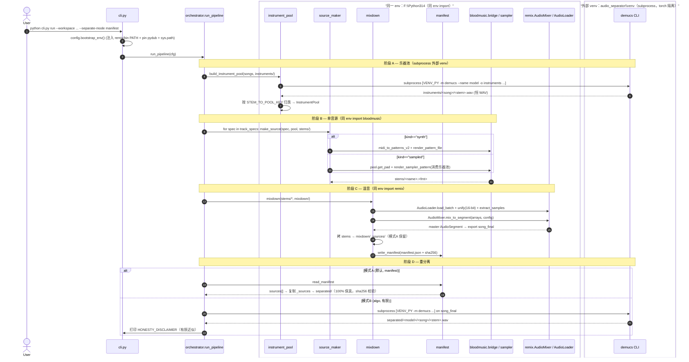
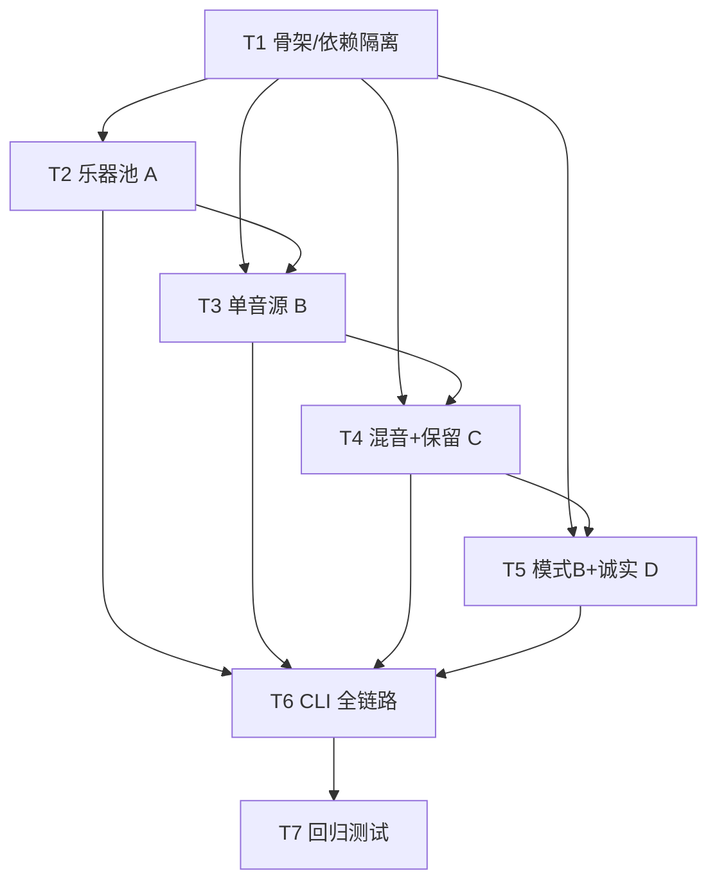

# 设计文档：纯音乐制作流水线编排工具 `audio_pipeline`

> 架构师：高见远（software-architect）
> 配套 PRD：`C:\Users\13122\WorkBuddy\2026-08-11-05-24-02\PRD_audio_pipeline.md`
> 形态：**独立编排工具** `G:\tools\audio_pipeline\`，零代码耦合 + 依赖隔离（主理人 7 条决策已拍板）

---

## 0. 设计总览与关键约束落点

| 主理人决策 | 本设计落点 |
| --- | --- |
| ① 独立编排工具，不嵌入任一项目 | 扁平模块集于 `G:\tools\audio_pipeline\`，只调用不修改外部三项目 |
| ② 跨 venv 混合策略 | remix/bloodmusic 同 `F:\Python314` → **同 env import**；audio_separator → **subprocess 自有 venv** |
| ③ 模式 A 分轨保留契约 | `mixdown/_sources/` 硬拷贝 + `manifest.json`（输出名→乐器类别→原路径→sha256） |
| ④ 采样器音色归类映射 | `instrument_pool.py::STEM_TO_POOL_KEY` 映射表 |
| ⑤ 阶段 B 走法 | 优先 `bloodmusic.bridge`（`render_pattern_file`）合成；必要时 `sampler` API 消费乐器池 |
| ⑥ 首次联网下载模型 | audio_separator subprocess 首次触发 demucs/bs-roformer 权重下载，之后离线 |
| ⑦ 模式 B 可见性 | `--separate-mode algo` 显式开关，默认模式 A；CLI/日志/manifest 统一标注有损 |

**三条硬约束贯穿全文**：依赖隔离（编排层自身不装 torch/pydub 重包，仅复用 `F:\Python314` 已装环境）、零耦合（不 import 外部私有内部模块做硬绑定，subprocess + 文件交换为主）、诚实性（混音不可逆、再分离是近似，禁止宣称无损）。

---

## 1. 实现方案

### 1.1 技术难点与框架选择

| 难点 | 选择 | 理由 |
| --- | --- | --- |
| 跨 venv 调用 audio_separator（torch 重包） | **subprocess** `[venv\Scripts\python.exe, -m, demucs]` | 绝不把 torch 引入编排层；复用其 `src/config.py` 的 `VENV_PY` 路径约定 |
| 编排层复用 remix/bloodmusic | **同 env import**（`F:\Python314` 已装 bloodmusic editable；remix 需 `sys.path.insert`） | 二者纯逻辑模块，轻量；决策②允许 |
| pydub 找不到 ffmpeg | 仿 `remix/main.py`：注入 `remix/bin` 到 `PATH` **并 pin** `pydub.AudioSegment.converter/ffprobe` | 仅 PATH 不够稳，pin 路径最可靠 |
| 采样器只吃 .wav | 阶段 A 强制 WAV（demucs 本就输出 WAV）；池样本即 WAV | 满足 P0-1 |
| remix 混音要 16-bit int | 阶段 C 用 `AudioLoader.unify(sample_width=2)` 统一为 16-bit 再 `extract_samples` | 满足 AudioMixer 输入契约 |

架构模式：**编排器（Orchestrator）+ 四阶段模块（A/B/C/D）+ 配置/清单/CLI 门面**。无 GUI（作者自用，CLI 即可）。

### 1.2 最终文件树与每文件职责

```
G:\tools\audio_pipeline\
├── config.py            # [T1] 路径/常量/环境解析：REMIX_ROOT、AUDIO_SEPARATOR_VENV_PY、默认模型、
│                       #       bootstrap_env()（PATH 注入 + pydub pin + sys.path 注入）、诚实性文案常量
├── instrument_pool.py   # [T2] (阶段A) STEM_TO_POOL_KEY 映射、InstrumentPool/PoolSample、build_instrument_pool()
├── source_maker.py      # [T3] (阶段B) TrackSpec、make_source()：synth 路径(bridge) + sampled 路径(sampler+pool)
├── mixdown.py           # [T4] (阶段C) mixdown()：AudioMixer 混音 + _sources 拷贝 + 调 manifest 写清单
├── manifest.py          # [T4] Manifest/SourceManifestEntry 数据结构、sha256_file()、read/write_manifest()
├── separate_back.py     # [T5] (阶段D) separate_back()：模式A 复用 manifest / 模式B subprocess audio_separator
├── orchestrator.py      # [T6] PipelineConfig、run_pipeline()：串联 A→B→C→D + 基于 manifest 断点续跑
├── cli.py               # [T6] argparse 入口：run / stage-a..d / doctor，--separate-mode 开关
├── requirements.txt     # 编排层自身依赖声明（仅文档说明：运行于 F:\Python314，需 bloodmusic+remix 已装）
├── tests\
│   ├── __init__.py
│   ├── conftest.py      # 合成正弦小样本 fixtures、依赖隔离探针
│   └── test_pipeline.py # [T7] 四阶段端到端手测清单 + 断言
└── docs\
    └── design.md        # 本文件
```

> 扁平布局（非包），`cli.py` 启动时把自身目录插入 `sys.path`，模块间互 import 用 `from config import ...`。

---

## 2. 关键接口签名（代码块，非实现）

### 2.1 配置与环境（config.py）

```python
# config.py —— 仅依赖 os/sys/pathlib（纯逻辑，零重包）
REMIX_ROOT          = r"G:\tools\remix"
BLOODMUSIC_ROOT     = r"G:\tools\bloodmusic"
AUDIO_SEPARATOR_ROOT= r"G:\tools\audio_separator"
AUDIO_SEPARATOR_VENV_PY = r"G:\tools\audio_separator\venv\Scripts\python.exe"  # 复用其约定，不 import
REMIX_BIN           = os.path.join(REMIX_ROOT, "bin")          # ffmpeg.exe / ffprobe.exe

DEFAULT_SEP_MODEL   = "htdemucs"     # P1-1 可选 "htdemucs_6s"（吉他/钢琴更丰富，质量较弱）
DEFAULT_SEP_SHIFTS  = 2
DEFAULT_OUTPUT_FMT  = "wav"          # 阶段A 强制 wav；阶段B/C 可 wav/ogg/flac

# 诚实性声明（CLI/日志/manifest 三处统一引用）
HONESTY_DISCLAIMER = (
    "⚠ 混音不可逆；模式A=复用源分轨(真无损100%)，"
    "模式B=算法重分离(有损近似, SDR≈9–12dB，非无损还原)"
)

def bootstrap_env() -> None:
    """在 import pydub/remix/bloodmusic 之前调用一次：
    1) 把 REMIX_BIN 注入 os.environ["PATH"]；
    2) pin pydub.AudioSegment.converter/ffprobe 到 REMIX_BIN 的 ffmpeg/ffprobe；
    3) sys.path.insert(0, REMIX_ROOT) 使 `from remix.core.audio_mixer import AudioMixer` 可用；
    4) import bloodmusic（editable 已装）、bloodmusic.bridge、bloodmusic.music.sampler。
    ※ audio_separator 永不 import（torch 留在自有 venv）。"""
```

### 2.2 阶段 A：乐器池（instrument_pool.py）

```python
# instrument_pool.py
from bloodmusic.music.sampler import Sample, SamplePad, load_sample  # 调用，不改

# 决策④：stem 名 → 采样器 SamplePad key（乐器族映射）
STEM_TO_POOL_KEY: dict[str, str] = {
    "drums":  "drums",
    "bass":   "bass",
    "piano":  "piano",
    "guitar": "guitar",
    "other":  "other",     # 非人声伴奏残留（htdemucs 四轨的 other）
    "vocals": "_ignore_",  # 纯音乐流程忽略/单独标注
}

@dataclass
class PoolSample:
    key: str            # 乐器族，如 "drums"
    path: Path          # instruments/<song>/<stem>.wav
    sample: Sample      # 延迟加载的 bloodmusic Sample（仅 .wav）

@dataclass
class InstrumentPool:
    root: Path
    samples_by_key: dict[str, list[PoolSample]]   # 同名多采样轮替
    @classmethod
    def load(cls, root: Path) -> "InstrumentPool": ...
    def get_pad(self, keys: list[str] | None = None) -> SamplePad: ...  # 按族挂载 SamplePad

def build_instrument_pool(
    songs: list[Path],
    out_dir: Path,
    *,
    model: str = DEFAULT_SEP_MODEL,
    shifts: int = DEFAULT_SEP_SHIFTS,
) -> InstrumentPool:
    """阶段A：对每个 song 调 audio_separator subprocess 拆 stems(WAV) 到
    out_dir/<song>/<stem>.wav；按 STEM_TO_POOL_KEY 归类；返回 InstrumentPool。
    产物恒为 .wav（demucs 默认输出 WAV），满足 P0-1。"""
```

> subprocess 命令严格复刻 `demucs_runner.build_command`：
> `[AUDIO_SEPARATOR_VENV_PY, "-u", "-m", "demucs", "--name", model, "-o", out_dir, "--shifts", str(shifts), "--filename", "{track}/{stem}.{ext}", <song>]`
> 阶段 A **不加** `--two-stems vocals`（要全 stem：drums/bass/piano/guitar/other）。

### 2.3 阶段 B：单音源导出（source_maker.py）

```python
# source_maker.py
from bloodmusic.bridge import midi_to_patterns_v2, render_pattern_file  # 复用 bridge（零改造 R4）
from bloodmusic.music.sampler import SamplePad, render_sampler_pattern

@dataclass
class TrackSpec:
    name: str
    kind: str = "synth"          # "synth"(bridge 合成) | "sampled"(采样器消费乐器池)
    pattern_source: Path | None = None   # MIDI 资产（bridge.midi_to_patterns_v2 输入）
    pattern_name: str | None = None      # 从 ImportResult 选单个 pattern
    pool_key: str | None = None          # sampled: 乐器族（drums/bass/piano/guitar/other）
    sample_map: dict[str, str] | None = None  # sampled: 音符名→pad key
    fmt: str = "wav"            # wav|ogg|flac（P0-2）
    duration_sec: float | None = None
    bpm: int | None = None

def make_source(track_spec: TrackSpec, pool: InstrumentPool, out_dir: Path) -> Path:
    """阶段B：单音源导出，返回产物路径。
    kind=="synth"  → midi_to_patterns_v2 取 pattern → bridge.renderer.render_pattern_file（振荡器合成，复用本体）
    kind=="sampled"→ pool.get_pad([pool_key]) → render_sampler_pattern(pad, pattern, dur, sample_map) → 写盘
                       （此路径消费阶段A乐器池，落实 G1）
    统一经 soundfile/ AudioLoader.export 落盘，支持 wav/ogg/flac。"""
```

### 2.4 阶段 C：混音 + 分轨保留（mixdown.py + manifest.py）

```python
# mixdown.py
from remix.core.audio_mixer import AudioMixer, MixConfig
from remix.core.audio_loader import AudioLoader

@dataclass
class MixResult:
    song_path: Path       # mixdown/song_final.<fmt>
    sources_dir: Path      # mixdown/_sources/（模式A 还原源）
    manifest_path: Path    # manifest.json

def mixdown(sources: list[Path], out_dir: Path, config: MixConfig) -> MixResult:
    """阶段C：remix.AudioMixer 混音为母带。
    1) AudioLoader.load_batch(sources)
    2) AudioLoader.unify(segments, target=AudioParams(16-bit))  # 统一为 16-bit int（P2-4 受控量化，非无损声明）
    3) AudioLoader.extract_samples → list[list[int]]
    4) AudioMixer.mix_to_segment(arrays, sample_width=2, frame_rate=sr, channels=ch, config) → master
    5) AudioLoader.export(master, song_final)  # 混音产物（不可逆）
    6) 拷 sources → _sources/（模式A 保留，硬拷贝，不可变）
    7) 写 manifest.json（输出名→乐器类别→原路径→sha256）"""
```

```python
# manifest.py
@dataclass
class SourceManifestEntry:
    output_name: str       # _sources 下的文件名
    instrument_class: str  # drums/bass/piano/guitar/other
    original_path: str     # 阶段B 产物原路径
    sha256: str            # 文件哈希（模式A 还原校验）

@dataclass
class Manifest:
    version: str
    created_at: str
    song: str
    bpm: int | None
    musical_key: str | None
    sample_rate: int
    bit_depth: int
    sources: list[SourceManifestEntry]
    separate_mode: str     # "manifest"(A) | "algo"(B)
    note: str              # = HONESTY_DISCLAIMER

def sha256_file(path: Path) -> str: ...
def write_manifest(path: Path, m: Manifest) -> None: ...
def read_manifest(path: Path) -> Manifest: ...
```

### 2.5 阶段 D：后期重分离（separate_back.py）

```python
# separate_back.py
SeparateMode = Literal["manifest", "algo"]   # 模式A / 模式B

def separate_back(
    song: Path,
    out_dir: Path,
    mode: SeparateMode = "manifest",          # 默认模式A（决策⑦）
    manifest: Path | None = None,             # 模式A 传入 mixdown/manifest.json
    model: str = DEFAULT_SEP_MODEL,
    shifts: int = DEFAULT_SEP_SHIFTS,
) -> dict:
    """阶段D：
    模式A(manifest): 读 manifest → 把 _sources/ 原文件 100% 保真复制到 separated/；
                     断言 sha256 一致；note 标注「真无损」。
    模式B(algo):     subprocess 调 audio_separator 对 song 重分离；
                     首行打印 HONESTY_DISCLAIMER（有损近似）；
                     输出 separated/<model>/<song>/<stem>.wav。"""
```

### 2.6 编排入口（orchestrator.py）

```python
# orchestrator.py
from dataclasses import field
from audio_pipeline.config import DEFAULT_SEP_MODEL, DEFAULT_SEP_SHIFTS
from audio_pipeline.separate_back import SeparateMode

@dataclass
class PipelineConfig:
    workspace: Path                              # audio_pipeline_workspace
    songs: list[Path]                            # 阶段A 输入真实歌
    midi_root: Path = Path("G:/midi")            # 阶段B MIDI 素材
    sep_model: str = DEFAULT_SEP_MODEL
    sep_shifts: int = DEFAULT_SEP_SHIFTS
    mix_config: MixConfig = field(default_factory=MixConfig)   # 透传增益/归一化/削波/淡变/压缩/滤波
    separate_mode: SeparateMode = "manifest"     # 决策⑦ 默认模式A
    stages: list[str] = field(default_factory=lambda: ["A", "B", "C", "D"])
    track_specs: list[TrackSpec] = field(default_factory=list)  # 阶段B 规格

def run_pipeline(cfg: PipelineConfig) -> dict:
    """串联 A→B→C→D；基于 manifest 判定完成度实现断点续跑(P1-4)；
    任意阶段失败不破坏已产物（catch 后记录并续跑后续阶段）。"""
```

---

## 3. 程序调用流程（时序图，标注跨进程边界）



**跨进程边界小结**
- 同 env import（编排进程内，无 subprocess）：`bloodmusic.bridge`、`bloodmusic.music.sampler`、`remix.core.audio_mixer`、`remix.core.audio_loader`。（torch 不在此 env。）
- 外部 venv subprocess：`G:\tools\audio_separator\venv\Scripts\python.exe -m demucs ...`（阶段 A、阶段 D-模式B）。编排进程 `sys.modules` 中**无 torch**。
- PATH 注入点：`config.bootstrap_env()` 在一切 import 之前执行（仿 `remix/main.py`）。

---

## 4. 依赖与隔离方案

| 外部调用 | env | 方式 | 路径/入口 | 隔离保证 |
| --- | --- | --- | --- | --- |
| `AudioMixer` / `AudioLoader` | `F:\Python314` | 同 env import | `from remix.core.audio_mixer import AudioMixer` | remix 根需 `sys.path.insert`；不修改 remix 源码 |
| `bloodmusic.bridge` / `bloodmusic.music.sampler` | `F:\Python314` | 同 env import（editable 已装） | `import bloodmusic.bridge` | 不修改 bloodmusic 源码（R4 三文件 git diff 为空） |
| `audio_separator` | `G:\tools\audio_separator\venv` | **subprocess** | `VENV_PY -m demucs ...` | torch 永远留在自有 venv，编排层零接触 |
| ffmpeg | `G:\tools\remix\bin` | PATH 注入 + pydub pin | `bootstrap_env()` | 仅 remix/bin 的 ffmpeg，不污染系统 |

- **编排层自身依赖**：仅标准库 + `pathlib`；运行所需重包（numpy/pydub/soundfile/mido 等）全部来自 `F:\Python314` 已装环境。`requirements.txt` 仅作文档声明，不引入新重包。
- **首次联网点**：阶段 A 首次拆歌 / 阶段 D-模式B 首次重分离，demucs 自动下载权重（htdemucs ~80MB / htdemucs_6s ~80MB / bs-roformer ~700MB，见 `bs_roformer_runner` 注释）。决策⑥允许；下载后离线运行。
- **禁止项**：编排层 `import audio_separator`（任何模块）；把 torch/pydub 混装进单环境；修改 `music/pattern.py`/`export/batch.py`/`export/midi_export.py`（R4）。

---

## 5. 任务列表（有序、含依赖、按实现顺序）

| 任务 | 名称 | 对应文件 | 前置任务 | PRD | 优先级 |
| --- | --- | --- | --- | --- | --- |
| **T1** | 骨架与依赖隔离 | `config.py`、`cli.py`(骨架)、`orchestrator.py`(占位)、`requirements.txt`、`tests/` | — | P0-6, P0-7 | P0 |
| **T2** | 乐器池接入（阶段A） | `instrument_pool.py`(`STEM_TO_POOL_KEY`/`InstrumentPool`/`build_instrument_pool`)、`manifest.py`(sha256) | T1 | P0-1, P1-1, P1-2 | P0 |
| **T3** | 单音源导出（阶段B） | `source_maker.py`(`TrackSpec`/`make_source`：synth+ sampled) | T1, T2 | P0-2 | P0 |
| **T4** | 混音 + 分轨保留（阶段C） | `mixdown.py`、`manifest.py`(`Manifest`/读写) | T1, T3 | P0-3, P0-4, P1-3, P1-5 | P0 |
| **T5** | 模式B + 诚实标注（阶段D） | `separate_back.py`(manifest 复用 / algo subprocess) | T1, T4 | P0-5, P0-7 | P0 |
| **T6** | CLI 全链路编排 | `cli.py`(全)、`orchestrator.py`(`run_pipeline` 串联 + 断点续跑) | T2, T3, T4, T5 | P1-4 | P1 |
| **T7** | 回归测试 | `tests/conftest.py`、`tests/test_pipeline.py` | T6 | P0-6/P0-7 验证 | P1 |

> T3 对 T2 的依赖仅因 sampled 路径消费 `InstrumentPool` 类型；synth 路径独立，可在 T1 后即并行开发。T1 必须先完成（依赖隔离是所有阶段的地基）。



---

## 6. 数据 / 文件契约

### 6.1 工作区目录约定

```
audio_pipeline_workspace/
├── instruments/      # 阶段A：audio_separator 拆出的 .wav stems（按歌曲分子目录）
│   └── <song>/<stem>.wav          # stem∈{drums,bass,piano,guitar,other,vocals}
├── midi/             # 阶段B 输入：来自 G:\midi 的 .mid（只读，不写）
├── stems/            # 阶段B：make_source 导出的单音源（WAV/OGG/FLAC）
│   └── <name>.<fmt>
├── mixdown/          # 阶段C 成品歌 + 模式A 还原源
│   ├── song_final.<fmt>
│   └── _sources/     # 混音前各音源不可变拷贝（模式A 还原源）
│       └── <name>.<fmt>
├── separated/        # 阶段D 输出
│   ├── <name>.<fmt>            # 模式A：_sources 的 100% 保真副本
│   └── <model>/<song>/<stem>.wav   # 模式B：algo 重分离（有损）
└── manifest.json     # 全局清单（BPM/key/sr/位深/来源/分轨哈希）
```

### 6.2 stems 命名规则

- 阶段 A：`instruments/<song>/<stem>.wav`，`<stem>` 严格等于 demucs 输出名（drums/bass/piano/guitar/other，纯音乐忽略 vocals）。
- 阶段 B：`stems/<instrument_class>__<track_name>.<fmt>`，无空格、小写、双下划线分隔（如 `drums__verse.wav`、`piano__chorus.flac`）。
- 阶段 C：`mixdown/song_final.<fmt>`；`_sources/` 下保留阶段 B 原 basename。
- 阶段 D：模式A 复制 `_sources` 原文件名到 `separated/`；模式B 沿用 demucs `{track}/{stem}.{ext}` 到 `separated/<model>/<song>/`。

### 6.3 manifest.json 字段

```json
{
  "version": "1.0",
  "created_at": "2026-08-11T06:00:00",
  "song": "song_final.wav",
  "bpm": 120,
  "musical_key": "Cm",
  "sample_rate": 44100,
  "bit_depth": 16,
  "separate_mode": "manifest",
  "note": "⚠ 混音不可逆；模式A=复用源分轨(真无损100%)，模式B=算法重分离(有损近似, SDR≈9–12dB，非无损还原)",
  "sources": [
    {"output_name": "drums__verse.wav", "instrument_class": "drums",
     "original_path": "stems/drums__verse.wav", "sha256": "a1b2..."}
  ]
}
```

---

## 7. 待明确事项（交工程师编码时标定）

1. **SamplePad 挂载细节**：`render_sampler_pattern` 的 `sample_map`（音符名→pad key）如何从 `TrackSpec` 提供；鼓 pattern（`render_drum_pattern`）与旋律 pattern 的触发分离处理。
2. **AudioMixer 默认参数**：`MixConfig` 默认（SOFT 削波 / RMS 归一化 / peak 0.95）是否合适；`crossfade_ms` 在「同时叠加」vs「顺序串联」两种语义下的使用约定（见 `mix` 内 `crossfade_ms>0` 走 `_mix_sequence`）。
3. **demucs 默认模型**：`htdemucs`（四轨·快·质量平衡）vs `htdemucs_6s`（六轨·吉他/钢琴更丰富但质量较弱，P1-1）。建议默认 `htdemucs`，`htdemucs_6s` 作 opt-in；需在 CLI/配置暴露。
4. **阶段B pattern 来源**：`TrackSpec.pattern_name` 如何从 `ImportResult.all_patterns` 选取；是否允许「无 MIDI」的程序化（内置）pattern。
5. **`F:\Python314` 是否装 `audioop-lts`**：Python 3.14 已移除标准库 `audioop`，pydub 运行依赖它（`remix/main.py` 有 `import audioop_lts` 兜底）。需工程师确认/安装，否则 pydub import 失败。
6. **模式A 拷贝策略**：默认**硬拷贝**（保证不可变、零依赖原 stems）；是否额外支持「仅引用 manifest」以省空间（默认不开）。
7. **sampled 路径时率对齐**：池样本来自 demucs（44100）；bloodmusic `_SR` 若不同，需在 `render_sampler_pattern(sr=...)` 显式对齐，避免混音阶段 `unify` 二次重采样。

---

## 8. 回归测试要点（tests/test_pipeline.py）

### 8.1 四阶段端到端手测清单
- 用**真实素材**或**合成小样本**（conftest 生成几秒正弦/鼓点 wav）跑 `cli.py run` 全流程 A→B→C→D。
- 阶段 A：断言 `instruments/<song>/` 下产物全为 `.wav` 且 `load_sample` 可加载（P0-1）。
- 阶段 B：断言 `stems/` 产出 `wav/ogg/flac` 各一，且 `TrackSpec.kind="sampled"` 时确实消费了乐器池（输出非空、能量非零）。
- 阶段 C：断言 `mixdown/song_final` 生成、`mixdown/_sources/` 含全部源、`manifest.json` 存在且字段完整。
- 阶段 D-模式A：断言 `separated/` 文件 `sha256` 与 `_sources/` 完全一致（**100% 保真**断言）。
- 阶段 D-模式B：`--separate-mode algo`，断言 `separated/<model>/` 产出 stems 且 CLI 首行含「有损近似」。

### 8.2 依赖隔离验证
- 编排进程内 `assert "torch" not in sys.modules`；`from remix.core.audio_mixer import AudioMixer` 成功；audio_separator 仅以 subprocess 出现（`psutil`/进程列表校验无 `audio_separator` 解释器被 import）。
- 确认 `remix/bin` 已注入 PATH 且 pydub converter 指向该 ffmpeg。

### 8.3 模式 A 还原零损失断言
- 对 `mixdown/_sources/<x>` 与 `separated/<x>` 做逐字节/sha256 比对，必须相等；manifest `separate_mode=="manifest"`。

### 8.4 模式 B 有损声明验证
- 捕获 CLI stdout，断言含 `HONESTY_DISCLAIMER` 子串（有损近似）；manifest `separate_mode=="algo"` 且 `note` 标注有损。

### 8.5 异常路径
- **缺 ffmpeg**：临时把 `remix/bin` 移出 PATH → 断言 `bootstrap_env()`/import pydub 报错或告警，且给出明确提示。
- **缺模型**：首次运行前清空 demucs 模型缓存 → 断言触发下载或给出「需联网下载权重」提示（决策⑥）。
- **无效音频**：传入损坏/空文件 → 断言阶段A/阶段C 抛出可读 `FileNotFoundError`/`BridgeRenderError` 且不破坏已产物（异常被 `run_pipeline` 捕获续跑）。
- **采样器输入非 WAV**：放一个 `.flac` 进 `instruments/` → 断言阶段B sampled 路径报「仅支持 .wav」或自动转 WAV（P0-1 硬约束）。

---

*文档结束 · 全部 API 均经读源码确认（bloodmusic `sampler.py`/`bridge/*`、remix `audio_mixer.py`/`audio_loader.py`/`main.py`、audio_separator `demucs_runner.py`/`config.py`/`bs_roformer_runner.py`），无凭空编造。*
